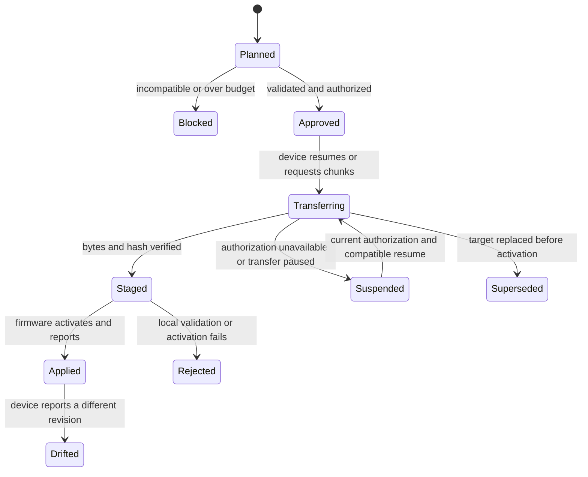
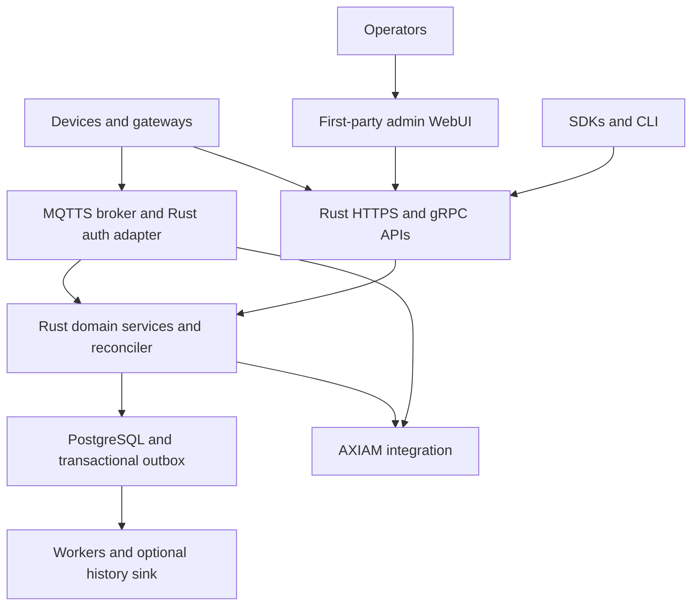

# Tyndar — IoT Digital Twin / Device Shadow Platform

## Market scouting and proposed open-source architecture

**Project name:** Tyndar  
**Prepared for:** Emanuele Panigati  
**Document revision:** 0.3 — coordinated review, 20 October 2026  
**Research date:** 19 October 2026; command-market follow-up 20 October 2026  
**Design update:** 20 October 2026 — independent Rust platform, admin WebUI, first-class commands, and minimal common device header.  
**Companions:** [Software design v0.3](iot-platform-software-design.md) · [Roadmap v0.3](iot-platform-roadmap.md)  
**Status:** Product and architecture proposal; no implementation or performance measurements performed.  
**Product description:** Tyndar is a capacity-aware device configuration and state synchronization platform, planned in Rust with AXIAM for identity and authorization.

**Naming update:** Tyndar is the adopted project name. This repository edition retains the v0.3 technical baseline and dated research; earlier naming proposals are historical context.

This review preserves the market research and implementation direction while incorporating commands, compact framing, and the later design decisions. The software design is authoritative for proposed software behavior; the roadmap is authoritative for milestone scope. Market observations remain dated evidence, not implementation guarantees. A review record appears in section 18.

## 1. Recommendation

The chosen direction is to build a **new, independent device shadow and configuration reconciliation platform from scratch**, with its own domain model, capacity compiler, synchronization engine, APIs, SDKs, and admin WebUI. Device configuration capacity remains a first-class contract.

This is an explicit project decision. Existing IoT platforms remain research references and possible future interoperability targets. The project will not start as a fork, extension, or deployment of Ditto, Astarte, ThingsBoard, or another IoT platform. Reuse AXIAM and the selected database, MQTT broker, protocol libraries, and cryptographic libraries as infrastructure; building the platform from scratch does not require reimplementing those components.

The useful promise is:

> Define configuration once, resolve it for each device, check whether it can fit and be activated safely, and track the exact revision the device reports running.

Generic desired/reported state, MQTT connectivity, device groups, Protobuf, and a Rust implementation are individually insufficient differentiators. Existing products already cover these ideas in different combinations. The opportunity is their integration around **typed configuration tables, explicit hardware budgets, reproducible device-specific artifacts, and safe reconciliation**.

Recommended initial choices:

| Decision | Recommendation |
| --- | --- |
| Primary audience | OEMs and embedded/industrial developers managing devices with schedules, routing rules, calibration tables, recipes, or other bounded local datasets |
| Product boundary | Operational device shadows, configuration delivery, latest readings, and basic history; simulation and 3D twins are outside the initial scope |
| Implementation | New Rust modular server, domain model, synchronization engine, and reusable Rust configuration compiler |
| Admin WebUI | First-party browser application, bundled with the platform and backed by the Rust management APIs; included from the developer preview |
| Identity and authorization | AXIAM, through an explicit integration adapter and provisioned resource mappings |
| Operational database | PostgreSQL for registry, schemas, revisions, deployments, latest state, and transactional outbox |
| Historical telemetry | PostgreSQL initially; optional ClickHouse after workload benchmarks justify it |
| Transports | MQTTS, HTTPS, and gRPC over TLS; device mTLS on all three where clients support it |
| Payloads and export | Versioned Protobuf and JSON first; CBOR for small devices and Parquet for analytics later |
| Sync efficiency | Hash-first no-op detection, bounded page deltas, resumable transfer, reading batches, and per-device data budgets |
| Commands | Typed sync-wait and async invocation, durable later results, explicit uncertainty, and WebRTC signaling |
| Common device header | Compact v1: 1 mandatory octet plus optional bounded route/correlation handles; 1–11 bytes, excluding body and carrier overhead |
| MQTT implementation | Evaluate a separately deployed RMQTT broker with a Rust AXIAM authorization adapter; retain a broker-independent interface |
| SDK coverage | Rust, TypeScript, Python, Java, Kotlin, C#, PHP, Go, Swift, C, and C++ |
| License proposal | Apache-2.0 for the platform, admin WebUI, compiler, SDKs, and protocol specifications; verify dependency licenses separately |

The primary deliverable is the complete new platform, including its admin WebUI. Keep the configuration compiler independently reusable as an architectural boundary. Optional future AWS, Azure, or Ditto adapters can broaden adoption without making an existing IoT platform a prerequisite for this product.

**Originality qualification:** This is an inferred market opportunity, not a claim of invention or a patentability opinion. The reviewed documentation did not establish an existing product offering this exact integrated workflow. Absence from documentation does not establish absence from a product, extension, or private deployment.

## 2. Scope, assumptions, and evidence

The scout uses vendor documentation, project repositories, standards, and implementation documentation. References `[S01]`–`[S52]` link to primary sources in section 17. Features and licenses can change; this is a dated snapshot.

The AXIAM documentation URL supplied in the brief was not accessible through the research service. Its public GitHub repository was accessible and was inspected instead. AXIAM observations are pinned to repository snapshot **`6b15aa36a42def144e3acb888ffc429c0c986b34`**. The README describes 1.0.0 as the first stable release, while some inspected documentation discusses subsequent work. Treat inspected `main` capabilities as integration evidence to verify against the exact AXIAM release deployed. [S01–S05]

Assumptions used for the proposal:

- A device has one concrete type and a hardware/firmware capability profile.
- A family groups related types and can provide shared configuration and reading definitions.
- Configuration tables are structured datasets with keys and columns, rather than only JSON settings or opaque files.
- Devices can be offline, reconnect, reboot during updates, and receive duplicate or out-of-order messages.
- “Realtime” means near-real-time ingestion and observation. Internet transport does not provide hard real-time control guarantees.
- Device firmware participates in validation, activation, and reporting. The server alone cannot guarantee atomic installation or physical correctness.
- AXIAM and the IoT platform remain independently deployed systems; they do not share database tables.
- The new platform and its admin WebUI are the implementation target; extending an existing IoT platform is not an open prerequisite or decision gate.

Comparisons distinguish documented capabilities from **assessment** and **proposed behavior**. “Not established” means this scout did not verify the capability; it does not mean unsupported. No competitor was deployed or load-tested.

## 3. Existing products and projects

### 3.1 Comparative scout

The last column identifies work still required for the proposed product experience, not an assertion that customization is impossible.

| Product | Documented model and strengths | Connectivity / representation relevant here | Deployment / licensing | Assessment relative to this brief |
| --- | --- | --- | --- | --- |
| **AWS IoT Core Device Shadow** | Named and classic JSON shadows with desired, reported, delta, and versions; state remains available offline | MQTT and HTTP shadow APIs; JSON | Managed commercial service | Strong shadow baseline. Typed configuration tables and hardware-specific capacity planning would be application logic. The documented default state-document quota is 8 KB; the current quota table marks it adjustable. This is a service quota, not a device memory guarantee. [S06, S07] |
| **Azure IoT Hub device twins** | Tags, desired/reported properties, optimistic concurrency; automatic configurations target devices using conditions and priorities | Device/backend interfaces differ; JSON twins and HTTPS service APIs | Managed commercial service | Fleet configuration and precedence already exist. Desired and reported sections each have a documented 32-KB limit; tags have 8 KB, using Azure’s size calculation. Capacity-safe table installation still requires device/application logic. [S08, S09] |
| **Azure Digital Twins** | DTDL models, relationships, and graph queries across environments | REST and event integration; connects with IoT Hub | Managed commercial service | Useful if buildings, machines, and relationships become the main product. It is a separate service from IoT Hub device twins and would add scope before solving bounded configuration synchronization. [S10] |
| **Eclipse Ditto** | Things, features, current and desired properties, policies, and twin APIs | HTTP/WebSocket and connectivity integrations; JSON model | Self-hosted; EPL-2.0 project | Close focused twin reference for design and benchmarking. Current documentation says feature definitions are annotations, without built-in validation against them. A compiler adapter could complement Ditto later; it is not the selected implementation base. [S11, S12] |
| **ThingsBoard CE / commercial editions** | Device profiles, attributes, telemetry, rules, dashboards, and device management | MQTT supports JSON and per-profile Protobuf schemas; MQTT X.509 authentication; other transports also exist | Current repository says versions before 4.4 remain Apache-2.0; starting with 4.4, BUSL-1.1 with an Additional Use Grant and later Apache conversion | Strong complete-application option, but check exact release/license rather than assuming CE is Apache-licensed. Protobuf/profiles are established. Referenced gRPC Edge documentation describes Edge-to-cloud synchronization, not a general device API. [S13–S16] |
| **Clea Astarte** | Versioned typed interfaces; separate properties and datastreams; device/server ownership | Device and application interfaces; broad SDK ecosystem | Apache-2.0 core; current repository warns its Compose dependency on ScyllaDB uses BSL | Particularly relevant prior art for typed state and telemetry. Parameterized mappings can represent collections. The reviewed interface model does not establish a planner for hardware-budgeted table bundles and activation. [S17, S18] |
| **Golioth** | Separate Settings and LightDB State; project → blueprint → device setting overrides | Device-oriented service and firmware integration | Hosted offering; do not equate open device SDKs with an open server | Clear precedent for hierarchical remote settings. Configuration inheritance itself is not novel. Review as a constrained-device UX reference. [S19] |
| **Cumulocity** | Device profiles combine firmware, software, and configuration files; configuration operations and fleet deployment | Platform/device integration; text and binary configuration snapshots | Commercial platform | Mature precedent for configuration distribution and device profiles. The opportunity is typed table compilation and explainable fit, rather than inventing remote configuration deployment. [S20, S21] |
| **FIWARE / Orion-LD** | Context entities, properties, relationships, NGSI-LD, and shared data models | NGSI-LD/JSON-LD APIs; IoT connectivity is assembled with other components | Self-hosted ecosystem; Orion-LD repository identifies AGPL-3.0 | Valuable semantic interoperability reference. Context management is a different focus from safe, bounded table replication to firmware. [S22, S23] |
| **Magistrala** | IoT platform framework with device management and data pipelines | MQTT, HTTP, WebSocket, and CoAP in current project documentation | Repository identifies Apache-2.0; verify the selected components/tag | Candidate integration substrate. Do not infer external device gRPC support from internal service RPC. Capacity compilation would be a separate subsystem. [S24] |
| **PidgeIoT** | Rust platform with provisioning, state/shadow functionality, and a split edge/data architecture | HTTP routes; separate MQTT and CoAP terminators; MQTT shadow delivery as retained state | AGPL-3.0; documented backend uses Cloudflare Workers and Durable Objects | Direct counterexample to “first Rust IoT shadow platform.” Its documented architecture differs from a portable Rust/PostgreSQL service; table-budget planning was not established. Production suitability was not assessed. [S25] |

### 3.2 Adjacent projects worth reusing or learning from

| Project / standard | Relevance | Boundary |
| --- | --- | --- |
| **Eclipse Hono** | Protocol adapters, device authentication, gateway identity, MQTT/HTTP/AMQP integration patterns | Connectivity foundation rather than the proposed configuration compiler. [S26] |
| **thin-edge.io** | Lightweight edge framework with configuration, software, and firmware management; C/Rust implementation | Potential gateway integration; avoid duplicating its whole device management agent. [S27] |
| **RMQTT / rumqtt** | Rust broker and client ecosystem respectively | Broker/client building blocks, not complete twins. Validate broker durability, ACL hooks, mTLS, and lifecycle behavior under the intended deployment. [S28, S29] |
| **rust-iot-platform** | Additional Rust IoT implementation with several transports | Evidence that Rust IoT platforms are an existing category; no maturity or feature-parity claim is made here. [S30] |
| **LwM2M / Anjay** | Structured objects, resources, composite reads/writes, and device management conventions | Constrained-device management is not unexplored territory. An adapter is more realistic than claiming a replacement standard. [S31] |
| **W3C WoT / Sparkplug** | Thing descriptions and industrial MQTT state conventions | Useful interoperability targets. Supporting Protobuf alone does not make a protocol Sparkplug-compatible. [S32, S33] |

### 3.3 What the existing market rules out as a unique selling point

- **Desired/reported synchronization:** established in AWS, Azure, and Ditto.
- **Typed device data:** established in Astarte and other schema-driven systems.
- **Fleet inheritance and targeting:** established in Azure configurations and Golioth settings.
- **Protobuf over MQTT:** established in ThingsBoard and the Sparkplug ecosystem.
- **Configuration files and fleet rollouts:** established in Cumulocity and edge management tools.
- **Rust implementation:** already present in IoT platforms, agents, brokers, and shadow libraries.
- **Chunked delivery:** AWS already documents MQTT-based file delivery; chunking alone is not the gap. [S41]

The proposed differentiation is a consistent, testable workflow connecting these concerns: **resolve → explain → check capacity → package → transfer → activate → verify reported state**.

### 3.4 Command and signaling prior art — follow-up review

Commands are established functionality and must not be marketed as a new category invented by this project.

| Product | Verified command behavior | Design implication |
| --- | --- | --- |
| Azure IoT Hub | Direct methods offer request/result interaction with a bounded response wait; cloud-to-device messages offer queued delivery and feedback. [S47, S48] | Keep immediate interactions separate from durable deferred work; delivery feedback alone is not proof of physical effect |
| AWS IoT Device Management | Reusable commands, per-device executions, reported status, and event notifications. [S49] | Durable invocation tracking and command templates are prior art, separate from Device Shadow state |
| ThingsBoard | One-/two-way RPC and persistent RPC with TTL and execution states. [S50] | Persistence and offline queues are established; distinguish uncertain effects and define replay behavior precisely |
| Eclipse Ditto | Messages support fire-and-forget or waiting for a response through HTTP and other integrations. [S51] | A live response path is useful, but the proposed durable command ledger needs its own documented guarantees |
| WebRTC / JSEP | Peer connection negotiation and signaling semantics are standardized; RFC 9429 supersedes RFC 8829. [S52] | Reuse interoperable WebRTC endpoints; provide authorized signaling and lifecycle orchestration, not a new media protocol |

The proposed differentiator remains the integration of capacity-checked configuration, bounded device resources, explicit command outcomes, and measured low-overhead communication. No comparative header-size superiority is established without packet-level measurements under equivalent semantics and security. WebRTC signaling does not by itself differentiate a general IoT platform.

## 4. Product direction and alternatives

### 4.1 Recommended proposition

**“An open-source configuration and state platform for devices that cannot store everything.”**

A platform operator should be able to ask:

1. Which configuration should this device have, and which family/type/device rule supplied each value?
2. Which rows are mandatory, optional, or inapplicable?
3. Does the result fit its table slots, encoded storage, runtime representation, transfer buffers, and activation strategy?
4. What exact artifact was approved and delivered?
5. What revision does the device report as active, and how fresh is that report?

Initial examples: a controller holding a bounded schedule table, an industrial sensor holding calibration records, and a gateway holding routing/filter rules. These examples exercise different capacities without requiring a broad industrial ontology.

### 4.2 Distinctive capabilities to build together

| Capability | User-visible result | Qualification |
| --- | --- | --- |
| Typed table compiler | One schema generates validation, firmware-facing payloads, descriptors, and language types | Strong typing already exists elsewhere; focus on configuration table semantics |
| Capacity preflight | Exact wire size plus a declared/verified device memory model; actionable refusal reasons | A server estimate is conditional on the firmware decoder/storage contract |
| Explainable resolution | Every field/row has provenance, precedence, and selection reasons | Useful independently of the transport |
| Immutable deployment bundle | Multiple dependent tables share one manifest and activation target | Atomic activation only on devices advertising and implementing that capability |
| Resumable reconciliation | Resume transfer, reject stale bases, and fall back to a full snapshot | Reliability depends on durable server and device state |
| Reported configuration receipt | Revision/hash and result tied to an authenticated device session | Evidence of what firmware reports; not hardware attestation or proof of physical behavior |

### 4.3 Build decision and alternatives retained for context

The following judgments are architectural assessments, not benchmark scores.

| Option | Benefit | Main cost | Decision |
| --- | --- | --- | --- |
| Build a complete general-purpose IoT suite | Large feature surface | Competes with mature dashboards, rules, asset models, and integrations | Avoid initially |
| Extend Ditto with a capacity compiler | Reuses focused twin behavior and policies | JVM operations and dual authorization integration with AXIAM | Considered; not selected |
| Extend Astarte or ThingsBoard | Reuses data modeling or application tooling | Existing ownership, runtime, and extension models constrain the design | Considered; not selected |
| Build a new focused Rust platform with reusable compiler and admin WebUI | Owns the domain, synchronization, capacity semantics, APIs, and operator experience | Must implement and maintain these behaviors and their conformance tests | **Selected implementation direction** |

Begin with an end-to-end slice of the new platform: an operator signs in through AXIAM, defines a family/type and table in the WebUI, plans a capacity-checked deployment, synchronizes a device, and sees its reported active revision. Use competitor behavior as a reference where useful. A competing-platform prototype or another build-versus-extend decision is not required to start.

## 5. AXIAM integration grounded in the inspected implementation

### 5.1 Reusable foundations

AXIAM’s README documents organizations/tenants, hierarchical RBAC with deny-override, OAuth2/OIDC, REST/gRPC/AMQP interfaces, PKI, certificate authentication, and eleven SDK languages. Its storage choice is SurrealDB and its REST/gRPC stack is Actix-Web/Tonic. These are documented project capabilities, not an independent security audit. [S01]

The inspected certificate path resolves a validated certificate to a **service account and tenant**. The PKI guide requires Device and Service certificates to be bound to a service account before device authentication. The platform should maintain an explicit mapping:

`(AXIAM issuer, organization, tenant, service_account_id) → platform device_id`

Certificate identity should use enrolled certificate/key identifiers and validated issuer context. Do not identify a device solely from an arbitrary certificate common name, a payload `device_id`, or an MQTT client ID. [S02, S05]

### 5.2 Important transport and authorization distinction

The inspected gRPC `AuthorizationService.CheckAccess` is caller-scoped: an empty subject means the token subject, and a nonempty subject must match it. The protobuf contract explicitly states there is no cross-subject `authz:check_as` form over gRPC. [S03]

The REST `/api/v1/authz/check` and batch endpoint accept an optional subject override, guarded by `authz:check_as`. Tenant identity is resolved from authenticated context. An authorization refusal is represented by `allowed: false`; a successful HTTP response carrying a decision is not itself an allow. [S04]

Consequences for implementation:

- For supported bearer-token flows, invoke a caller-scoped check using the caller’s properly scoped AXIAM credential.
- For broker-side or certificate-only flows, use a narrowly privileged, tenant-scoped adapter to make REST check-as decisions for an already verified device principal, or add an explicitly designed delegated service API to AXIAM.
- Verify accepted token type, audience, principal kind, and tenant behavior against the selected release. Do not forward a platform-audience token to an AXIAM endpoint without checking its audience contract.
- Never use a platform service token with caller-scoped gRPC and assume the result describes the device: that checks the platform service itself.
- Prefer batch decisions for related resources. Avoid one remote authorization call per telemetry field or table row.

### 5.3 Resource and permission model

Provision AXIAM resources deliberately, with durable mappings to platform identifiers:

| Resource / action examples | Intended actor |
| --- | --- |
| `device:read`, `reading:read`, `history:export` | Operators and applications |
| `configuration:edit`, `configuration:publish`, `deployment:approve` | Separately grantable administrative responsibilities |
| `configuration:receive`, `configuration:ack` | The assigned device or explicitly delegated gateway |
| `reading:publish`, `state:report` | The assigned device |
| `capability:approve`, `device:enroll`, `device:revoke` | Provisioning administrators |

The names above are **proposed platform permissions**, not existing AXIAM built-ins. Register them and their resource relationships during setup.

A schema family/type relationship is not automatically an authorization inheritance relationship. Keep family/type classification separate from installation/site access. Where a device can appear in several operational groups, explicitly define which grants apply; do not turn every group membership into a parent in AXIAM’s resource hierarchy.

### 5.4 mTLS lifecycle and authorization cache

All new ingress adapters must validate certificate chains, validity, intended use, identity enrollment, and revocation policy. AXIAM’s existing mTLS implementation does not automatically secure a new MQTT broker or gRPC server.

The inspected AXIAM PKI guide distinguishes application-level revocation checks from TLS handshake behavior and notes that established/bound-token access may persist until expiry. Therefore define an IoT-specific revocation objective: for example, **disconnect revoked online devices within a tested maximum interval of 60 seconds**. This is a proposed target requiring implementation, not an inherited AXIAM guarantee. [S02]

Use short, bounded authorization cache entries keyed by issuer, tenant, principal, resource, action, and relevant credential/policy context. Revalidate subscriptions and long-lived sessions, invalidate on supported AXIAM events, and fall back to expiry when event delivery is interrupted. A policy revision key is useful only if the integration can actually obtain it. Deny new privileged configuration writes when authorization cannot be established. Existing telemetry sessions may continue only inside an explicitly documented, bounded authorization lease.

Prefer on-device key generation and CSR enrollment when supported. Test algorithm compatibility with real firmware: the inspected AXIAM guide documents Ed25519 and RSA profiles; do not assume a P-256-only secure element can enroll without compatible PKI work. [S02]

## 6. Domain model: separate definitions, intent, and observations

### 6.1 Proposed entities

| Entity | Purpose and invariants |
| --- | --- |
| `Tenant` | Mirrors the AXIAM tenant boundary; tenant ID is included in every persisted key and relationship |
| `DeviceFamily` | Shared definitions/defaults for related types; optional single-parent family hierarchy with cycle rejection |
| `DeviceTypeVersion` | Immutable concrete model version; belongs to one family and pins compatible schemas/capability profiles |
| `Device` | One type version, tenant, identity binding, lifecycle state, and approved capability profile |
| `CapabilityProfile` | Limits and supported features for a hardware/firmware combination; device reports may lower available capacity but cannot grant themselves more authority |
| `ConfigurationTableSchemaVersion` | Columns, stable field IDs, primary key, constraints, bounded values, dependencies, merge rules, and device layout model |
| `ReadingSchemaVersion` | Field types, units, ranges, quality states, timestamps, sequence rules, and retention |
| `SchemaBinding` | Attaches a configuration or reading definition to a family or type; records compatible version ranges/pins |
| `ConfigurationRevision` | Immutable values/rows at a defined scope, with author and provenance |
| `ResolvedConfiguration` | Effective per-device intent after inheritance and validation, before optional capacity projection |
| `DeviceArtifact` | Exact encoded bytes and manifest for a particular resolved configuration/capability combination |
| `Deployment` | Approval, target snapshot, rollout policy, per-device generation, and progress |
| `ReportedConfiguration` | Device-reported active revision/artifact hash, activation result, and observation freshness |
| `LatestReading` / `ReadingEvent` | Current materialized observation / optional immutable historical sample |
| `CommandDefinition` / `CommandInvocation` | Versioned typed family/type capability; durable request, deadlines, progress, and result |
| `RtcSession` | Authorized participants, negotiation generation, signaling bounds, and expiry |

Use schema composition for reusable capabilities such as battery or temperature sensing. Initially reject ambiguous collisions rather than implementing arbitrary multiple inheritance. Operational groups such as “site A” or “canary” are separate targeting cohorts, not additional type families.

**Configuration and reading bindings are equally first-class.** A family can define a shared `environment` reading schema and `schedule` table; a type can add `motor_current` readings and pin a stricter schedule schema. Samples always belong to device instances, not directly to their family/type definition. Reassigning a device type does not reinterpret historical samples: samples retain their schema version.

### 6.2 Distinguish intent, projection, observations, and commands

| State | Writer | Meaning |
| --- | --- | --- |
| Desired configuration | Authorized backend/operator | What the fleet policy intends |
| Resolved/projected configuration | Deterministic compiler | What a particular device is approved to receive |
| Reported configuration | Device | What firmware says it activated |
| Latest readings | Device or explicitly authorized gateway | Most recent accepted observations, with freshness and quality |
| Commands | Authorized actor and responding device | One-time invocation, progress, terminal result, or uncertain effect; independent of persistent desired state |

Do not encode “reboot now” as a persistent desired boolean. Do not interpret an old temperature reading as current merely because it is still the last stored value. Do not set reported state from the server when a delivery message is sent.

### 6.3 Resolution and precedence

Proposed precedence, from least to most specific:

`tenant defaults → family ancestors → family → device type → deployment policy → device override`

Every layer must be authorized and schema-valid. Explicit device overrides can be prohibited for sensitive tables. Schema bindings are versioned; defaults changing do not mutate previously approved deployment artifacts.

For tables, merge by stable primary key. Declare per-table behavior: replace the whole table, replace keyed rows, or merge specified columns. Never use array position as row identity. Define separately:

- **Unset override:** resume inheritance from a less specific layer.
- **Delete row:** explicit tombstone in the resolved view.
- **Null value:** a value only when the column is nullable.

If two policies have equal precedence and conflict, refuse publication with an explanation. Do not depend on database row order or message arrival time. Provide an `explain(device, table, row, field)` view showing provenance and the reason a value won.

## 7. Capacity-aware configuration as the central feature

### 7.1 The budget is more than a row count

A capability profile should express at least:

```yaml
profile: controller-v2-fw3
tables:
  schedule:
    max_rows: 128
    max_encoded_bytes: 24576
    max_runtime_bytes: 16384
    layout_model: fixed-schedule-row-v1
storage:
  configuration_partition_bytes: 65536
  reserved_bytes: 8192
  staging_supported: true
transport:
  max_packet_bytes: 6144
  max_chunk_payload_bytes: 4096
  max_inflight_chunks: 1
runtime:
  max_decode_working_bytes: 8192
activation:
  atomic_bundle: true
  power_loss_recovery: journaled-pointer-v1
```

This is a **proposed schema example**, not a discovered device capability. Limits must be measured or established by the firmware implementer. Track profile version, firmware range, provenance, and approval. If a runtime report says storage has shrunk, re-plan or refuse; do not keep sending an artifact compiled against stale assumptions.

Enforce:

1. Per-table row count and bounded field sizes.
2. Exact encoded bytes for the chosen codec and framing.
3. Persistent decoded representation, indexes, alignment, and allocation overhead.
4. Peak decode/decompression/patch working memory.
5. Existing active data, staging, recovery journal, reserved storage, and free-space requirements.
6. Transport packet size including topic/protocol/envelope overhead, rather than payload alone.
7. Optional application constraints such as maximum update frequency and flash wear.

For a selected activation strategy, require:

`active_bytes + staging_bytes + journal_bytes + reserved_bytes <= partition_bytes`

This equation describes a device sharing one configuration partition. A fixed A/B layout instead needs each image to fit its own slot, plus separately budgeted metadata. Use the actual layout model, not one universal formula.

### 7.2 Worked example

Assume a controller has a 64-KiB configuration partition, 8 KiB reserved, an existing 20-KiB active image, and requires 4 KiB of recovery metadata.

| Candidate | Active + staging + journal + reserve | Result |
| --- | --- | --- |
| New image: 30 KiB | 20 + 30 + 4 + 8 = 62 KiB | Fits the shared partition, subject to other limits |
| New image: 36 KiB | 20 + 36 + 4 + 8 = 68 KiB | Refused; 4 KiB over budget |

If the schedule additionally needs 150 rows but has 128 slots, the first candidate still fails. If a compressed transfer is 10 KiB but decoding needs 40 KiB of RAM, small wire size does not establish a fit. Report all relevant failures.

### 7.3 Selection must preserve meaning

Default policy: **if required data does not fit, reject deployment**.

Optional projection is allowed only when the schema/application explicitly defines it. Examples include excluding routes for unsupported interfaces or choosing explicitly optional diagnostic rules. The result must record omitted rows and reasons. Never silently truncate schedules, access rules, calibration points, or dependencies.

A deterministic first implementation can:

1. Resolve all applicable layers and validate keys/types.
2. Include mandatory rows and their dependency closure.
3. Refuse if the mandatory closure exceeds any budget.
4. Consider optional dependency groups by explicit priority and stable key ordering.
5. Include a group only if every declared budget remains satisfied.
6. Encode the final artifact and verify exact byte size and device-layout estimates.
7. Emit an inclusion/exclusion and resource-use report.

This is a predictable greedy policy, not an optimal multidimensional knapsack solver. More advanced optimization should be a separately versioned policy with user-visible objectives and reproducible output. Changing selection policy changes the artifact revision.

### 7.4 Contract for safe delivery and activation

Separate a reusable content manifest from a per-device signed deployment grant. The content manifest identifies exact page bytes, lengths, schemas, compiler/layout, revisions, and dependencies. The grant binds the manifest hash to tenant/device/enrollment, monotonic deployment generation, capability profile, signer, and activation conditions. Do not put per-device identity into every shared page.

A content hash is not an authorization grant. Check authorization independently on artifact access. Initial activation requires a live authenticated session and device-local validation; offline activation authority is deferred. Keep secrets out of shared plaintext content, using references or separately encrypted per-device material.

Hash **the exact published artifact bytes**. Protobuf deterministic serialization is not a cross-language canonical representation; devices should verify downloaded bytes rather than decode/re-encode and expect the same digest. A semantic configuration hash, if needed, requires its own specified canonicalization. [S34]

### 7.5 Synchronization behavior



Maintain a monotonic deployment generation per device. A late acknowledgment for generation 40 cannot mark generation 41 as applied. Repeated requests/acknowledgments are idempotent using tenant, device, generation, and operation ID. Reusing an operation ID with different content is an error.

An intentional rollback publishes a new deployment generation referencing an older approved configuration artifact. It does not reset the anti-replay generation counter. Device factory reset/re-enrollment requires an explicit recovery policy rather than accepting any old signed bundle.

On reconnect, the device reports its active artifact hash and persisted staging progress. The server resumes only compatible immutable transfers. Deltas require an exact base hash and adequate patch memory/storage; otherwise send a full snapshot. A delta can be larger or more expensive to apply than a snapshot, so compare both.

Use exponential retry with jitter, expiry, and bounded queues. MQTT QoS is transport behavior, not proof of application commit or physical actuation. A broker PUBACK must never be presented as “configuration applied.”

Atomic multi-table activation requires device support: verify all staged tables, validate cross-table references, then commit a durable active-generation pointer or equivalent. Without staging/recovery support, advertise a weaker capability and reject deployments requiring atomicity. A server-side rollback cannot recreate missing local storage or a power-loss-safe firmware routine.

After lost acknowledgments or a reboot, query/report the active generation; never infer rollback or success from silence. A receipt proves only that the authenticated firmware reported success. Independent attestation or process verification is a future, separate feature.

### 7.6 Efficient sync: a versioned application protocol

**Performance, bandwidth, and metered data consumption are explicit requirements.** Optimize bidirectional traffic and device work under a freshness/reliability contract. A small payload requiring many round trips, repeated handshakes, or large allocations can be worse overall.

Define a common `Sync v1` state machine mapped to MQTT messages, HTTPS requests, or a gRPC stream. This is a proposed application protocol, not an existing standard or a new transport.

| Exchange | Information | Efficiency rule |
| --- | --- | --- |
| `HELLO` | Protocol/features, capability-profile reference, active generation/hash, staging and telemetry cursors | Send full capabilities only when changed; negotiate compact handles within the authenticated session |
| `SYNC_PLAN` | No change, or target generation, manifest/digest, transfer mode, byte counts, receiver credit | Matching hashes send no configuration body; coalesce superseded intent |
| `DATA` | Transfer handle, page/chunk number, bounded payload | Send missing bytes only; do not repeat schemas, UUIDs, JWTs, or manifests in every chunk |
| `PROGRESS` | Durably staged contiguous chunk, bounded gap bitmap/ranges, available credit | Piggyback and acknowledge a bounded window, rather than every row |
| `ACTIVATE` / `RESULT` | Target generation/hash and activation outcome | Preserve explicit commit semantics |
| `READING_BATCH` / `ACCEPTED` | Stream/schema handles, boot/session identity, batch sequence, packed samples, durable acceptance cursor | Share metadata; retain unaccepted data locally under a bounded policy |

Handles reduce repetition but confer no authority: bind them to the authenticated principal/tenant, renegotiate after session loss, and enforce authorization leases. Keep persistent transfer identity separate from session handles so credential rotation or a transport change need not force a full download.

The shadow is a materialized view, not a periodically resent full document. An unchanged configuration needs only a no-change exchange, or no application exchange while an authorized push session is healthy. Liveness still has a cost and a defined policy.

### 7.7 Configuration deltas and flow control

Use **immutable page replacement against an exact base manifest** initially. Encode tables as bounded Protobuf pages with stable key ranges/page assignments; a small edit should usually change few pages. Splits and resizing can amplify changes, so measure this and version the layout.

Retain unchanged page bytes, transfer changed/new pages, and remove obsolete references. In v1, send the exact complete target-manifest bytes unless that manifest is already cached; a page delta does not imply a manifest delta. Check its digest and the signed per-device grant. Defer manifest-byte patching until a bounded byte-level format is specified and benchmarked; applying logical edits and reserializing Protobuf cannot reliably recreate exact signed bytes.

For small tables, a cached generation/manifest or a short revision journal is cheaper than exchanging every page hash. Merkle trees are a later option for large/divergent datasets, not a default for a 32-row table. Precompute/cache immutable pages instead of computing full diffs on heartbeats.

Row/field patches can later reduce sparse changes within pages, but need a specified canonical logical-state format or deterministic device encoder/storage contract. Never assume decode/re-encode reproduces artifact bytes. Generic binary patching must also fit device working memory and recovery constraints.

Choose among **no-op, page delta, compressed delta, full snapshot, and compressed snapshot** using estimated total cost:

`score = wB × bidirectional_bytes + wR × round_trips + wC × device_CPU + wE × energy + retry_risk_penalty`

Weights are deployment policy, and inputs require measurements or declared models. Reject candidates violating memory, staging, safety, or freshness first. Skip compression for small/incompressible messages; negotiate codec/window limits, bound decoded output, and compress independent pages/batches to retain efficient resume. Avoid double compression at application and gRPC layers.

Transfer requirements:

- Use a bounded sliding window with receiver credits. One in-flight chunk is the safe minimum profile, not the universal performance default.
- Tune in-flight bytes against RAM, RTT, and rate. Approaching rate `R` over RTT `T` generally requires on the order of `R × T` bytes in flight, subject to buffering and processing limits.
- A cumulative application ACK means **durably staged**. Include only bounded gap ranges; a reboot must not silently erase acknowledged progress.
- Rely on TCP for ordinary packet retransmission. Application resume handles connection/process loss and confirmed missing staged data; avoid an aggressive competing retry loop.
- After a missing ACK, query progress before restarting an artifact. Balance checkpoint granularity against flash writes and replay bytes.
- Prioritize critical readings/control over bulk pages; bound device/tenant transfer concurrency. Safely reclaim superseded staging data.

For illustration, assume 32 KiB of page data, three changed 1-KiB pages, and a complete target manifest of 2 KiB (including the page digests and references). The delta sends **5,120 bytes**, versus **34,816 bytes** for the full page snapshot plus the same manifest: about **85.3% fewer artifact bytes**. Assumptions: retained base, stable pages, and an actual 2-KiB target manifest; 32 SHA-256 page digests alone require 1,024 bytes, before references and schema metadata. This excludes transport overhead, retries, and staging amplification. A small delta does not imply equally small staging: some firmware must still materialize the full new image. Page reuse saves flash only if the layout supports it.

### 7.8 Efficient readings with explicit semantics

| Technique | Behavior | Constraint |
| --- | --- | --- |
| Batch values | Flush on maximum bytes, sample count, or latency deadline | Critical events bypass normal batching |
| Share metadata | Schema/context once per stream/batch; base timestamp plus offsets/cadence; numeric field IDs | Encode actual irregular timing; do not fabricate it |
| Specialized messages | Packed numeric arrays or fixed-schema columns | Bound counts and preserve quality/missing-value information |
| Change-only state | Publish meaningful changes plus maximum-silence refresh | Only for explicitly configured state streams |
| Deadband/hysteresis | Publish changes beyond a declared threshold | Opt-in lossy mode; expose policy/resolution |
| Downsampling | Send window summaries, counts, and ranges | Summaries are not raw history |
| Store-and-forward | Bounded spool, acceptance cursor, controlled replay | Explicit overflow policy; no silent loss of critical or lossless data |

Batching/compact encoding can preserve every sample. Suppression and aggregation change the data contract and cannot be implicit. A lossless stream must eventually throttle/reject upstream, or surface explicit data loss if collection cannot slow and the spool fills.

Illustrative estimate: ten regular float32 values at 1 Hz, without quality exceptions. Sending ten individual messages/s, each assumed to use 16 application bytes plus 80 amortized transport bytes, costs **960 bytes/s = 82.944 MB/day**. A ten-second batch with 100 × 4-byte values, 40 shared application bytes, and 80 shared transport bytes costs **52 bytes/s = 4.4928 MB/day**, approximately **94.6% less in this model**. Decimal MB is used; the stream must permit the added batching latency.

These are assumptions, not measurements or universal savings. Irregular timestamps, quality, missing values, extra envelopes, segmentation, ACKs, loss, setup, and billing granularity change the result. Replace the model with packet capture and modem counters before publishing cost claims.

### 7.9 Transport profiles and data budgets

| Profile | Default | Trade-off to measure |
| --- | --- | --- |
| Frequent, mains-powered telemetry | Reuse MQTT/gRPC connection with bounded batches/windows | Keepalives versus NAT expiry/reconnection |
| Sleeping cellular device | Wake, exchange sync summary, transfer bounded batch, sleep | Radio wake/tail time, handshakes, response latency |
| Simple HTTPS firmware | Reuse connections within wake period; conditional manifest GET and batch POST | A `304` removes the body, not polling/setup/header cost. [S43] |
| Aggregating gateway | Multiplex explicitly delegated device streams and share schemas/sessions | Queue isolation, fairness, and gateway trust |

MQTT 5 Topic Alias, Receive Maximum, Maximum Packet Size, and Session Expiry can reduce repetition and bound work. Aliases are connection-scoped and must be rebuilt after reconnect. Application cumulative ACKs do not replace required MQTT acknowledgments. Use QoS 1 with application idempotency for reliable configuration; optional disposable readings may use QoS 0 only under an explicit loss policy. [S42]

For gRPC, reuse channels, use streaming for long-lived flows, and bound queues/flow control. Configure keepalive for actual traffic; an always-open stream is not automatically cheapest for sleeping sensors. [S44, S45] Use TLS resumption where supported while preserving revocation/authorization policy. Do not enable replayable 0-RTT for configuration mutation, activation, command/cancellation, or signaling mutation. [S46]

Define daily uplink/downlink allowances, wake windows, maximum sync duration, and a reserved critical/control allowance per device. Near a limit, defer optional bulk work/diagnostics first. Never silently break mandatory telemetry or defer urgent work: expose the conflict for policy resolution. Track bytes by category/device/tenant.

`total_network_bytes = payload + application_metadata + protocol/security_overhead + ACKs/keepalives + retransmissions + connection_setup`

Count both directions and actual session/wake patterns; apply the specific carrier's billing granularity if known. Server storage compression and gateway-side batching do not save bytes already sent over the device's metered link.

Efficiency gates: no-change device, sparse/dense edits, expired base history, interruption, 50/200/1,000-ms RTT, injected loss, reconnect storm, and a real modem. Publish **bytes/successful activation**, **bytes/accepted sample**, **idle bytes/device/day**, round trips, RAM/CPU, replay bytes, and freshness percentiles. Compare full JSON, full Protobuf, and adaptive deltas under identical reliability/security. Performance targets remain provisional until measured.

### 7.10 Essential header and commands

The shared **device-plane** header is one octet containing kind/presence bits, optionally followed by nonzero canonical uint32 ULEB128 route and correlation handles. It is 1–11 bytes; a command with two handles below 128 has a 3-byte header. This excludes command identity/deadlines in the first request body and MQTT/HTTPS/gRPC/TLS/network overhead. It is not a one-byte network packet claim. Numeric handles avoid repeating identity/schema context but must be authorized, bounded, and bound to a fresh session epoch. No routine generic JSON envelope, UUID, JWT, timestamp, length, or checksum belongs in this header.

The design section 7.2 specifies exact codes, result ACKs, bootstrap, lifecycle, invalid-input handling, and golden vectors. Headers do not depend on whether the body is a command, configuration page, or reading batch. MQTT session topics prevent queued old short handles from acquiring new meanings; standard gRPC still adds its own framing. Do not move redundant metadata into the body just to reduce the reported header size.

Commands offer `InvokeAndWait` for a bounded wait and `StartCommand` for an immediate durable reference with a later result. Both share typed definitions, identity, deduplication, and authorization. Light/setpoint success means the defined handler action completed, not that an environmental target has been reached. Wait timeout does not prove failure or authorize a second effect. Async commands may queue offline only under explicit bounded policy and expiry.

The platform durably acknowledges device results, reconciles missing replies, and blocks unsafe retries after uncertain actuation. Even absolute setters can overwrite newer intent if replayed late; effect ordering and stale-command rejection are required. WebRTC uses authorized offer/answer/ICE signaling and separate negotiated/connected states; media uses peers or configured TURN, outside the command data path. Command and signaling support belongs in the public core, UI, and applicable SDK profiles.

## 8. APIs, transports, and exported representations

### 8.1 Transport contract

All adapters invoke the same domain services and enforce the same tenant, schema, version, idempotency, and authorization rules.

| Surface | Main use | Authentication and limits |
| --- | --- | --- |
| **MQTTS**, MQTT 5 preferred, 3.1.1 compatibility | Persistent device uplink, desired notifications, chunk requests, reports | mTLS preferred; bounded sessions and packet limits. JWT/token alternatives only over TLS, with expiry and reauthorization |
| **HTTPS REST** | Management, schema CRUD, configuration publishing, exports; simple device polling and batch readings | AXIAM tokens for people/services; mTLS for devices. Conditional requests/ETags and idempotency keys |
| **gRPC over TLS** | Gateway/server SDKs, batch telemetry, streaming observation, configuration synchronization | AXIAM tokens and/or mTLS; deadlines, message limits, flow control, bounded stream leases. Tonic provides client-CA configuration primitives. [S35] |
| **HTTPS SSE** | Browser dashboards and resumable live observation | Token/cookie policy and tenant authorization; explicit replay cursor and retention window |

Browsers cannot generally open raw MQTT/TCP connections or configure arbitrary per-request client certificates. Use HTTPS/SSE for browser TypeScript; optionally add MQTT-over-WSS or gRPC-Web as separate capabilities. Neither is required to make Node.js support MQTT and native gRPC.

The default compact MQTT profile uses bounded bootstrap topics, then negotiated session-epoch-scoped topics such as:

```text
v1/t/{tenant}/d/{device}/s/{session_epoch}/up
v1/t/{tenant}/d/{device}/s/{session_epoch}/down
```

The design section 12.2 specifies bootstrap ACLs and an optional semantic-topic compatibility profile. Do not dual-publish by default. Topic Alias can amortize topic cost on MQTT 5; MQTT 3.1.1 must account for the full repeated topic.
The broker must bind topic tenant/device to the authenticated identity before accepting a publish or subscription. Devices cannot publish downlink state or subscribe to arbitrary wildcards. Only trusted platform services can publish under `down`. Gateways need explicit child-device delegation, not permission to impersonate any device in the tenant.

Compact session data and commands are never retained. A compatibility profile may retain an explicitly scoped desired pointer, not replayable commands or chunks. Last Will/keepalive is a connectivity signal, not evidence of process health.

For reliable ingress, define an application acknowledgment such as `READINGS_ACCEPTED` only after durable acceptance. A broker can acknowledge receipt before the platform commits data; clients requiring stronger semantics must keep their local batch until the application acknowledgment arrives.

### 8.2 Logical APIs

Proposed operations, independent of their eventual URL spelling:

| Control plane | Device / observation plane |
| --- | --- |
| Create family/type; publish schema; bind schema | Register approved capability profile / report current capabilities |
| Commit immutable table revision | Publish reading batch and report state |
| Resolve and explain effective configuration | Obtain desired manifest and request/resume chunks |
| Plan deployment and obtain capacity report | Validate/stage/apply artifact and acknowledge generation |
| Approve, pause, cancel, and inspect deployment | Watch desired changes / latest readings |
| Export schemas, configuration revisions, and readings | Report active revision and recovery result |
| Publish command definitions; invoke/wait, start, inspect, cancel | Execute registered handlers; persist/report progress and results |
| Create/inspect/close authorized RTC sessions | Exchange bounded offer/answer/ICE signaling and session events |

Management publication uses compare-and-swap on the expected revision. A configuration can be saved as a draft even if some devices cannot accept it; publishing a deployment produces per-device eligibility results, and policy determines whether partial eligibility is allowed. Default to refusing an accidental partial fleet deployment.

### 8.3 Schema and format strategy

Use one versioned semantic schema model with stable field IDs, bounded strings/arrays, units, nullable/presence rules, table keys, and constraints. Generate from it:

- Typed `.proto` messages and a `FileDescriptorSet`.
- JSON Schema and examples for management tooling.
- Language-specific model types.
- Device validation/layout metadata.

Do not make arbitrary user-supplied `.proto` compilation an unsandboxed request path. Validate names, imports, complexity, field numbers, and expansion budgets. MVP can support a deliberately restricted schema DSL and generate Protobuf, rather than promising lossless import of arbitrary Protobuf or JSON Schema.

Protobuf should be a real interoperable export: include binary data, schema ID/version, descriptors, full message name, framing, and manifest. A JSON string stuffed into a generic Protobuf envelope is not the intended typed export.

| Representation | Intended use | Scope |
| --- | --- | --- |
| Protobuf binary + descriptors | Efficient device/gateway transfer and typed SDK integration | Initial release |
| JSON + JSON Schema | Debugging, administration, human-readable exports | Initial release; define 64-bit integers, bytes, timestamps, and nonfinite numeric policy |
| CBOR + defined schema mapping | Constrained device payloads | Follow-up; bounded decoding and exact semantic mapping required |
| CSV | Interchange of a single flat configuration table | Follow-up; include metadata sidecar and escaping/type rules |
| Parquet / Arrow | Historical telemetry analytics | Follow-up; preserve timestamps, units, quality, and schema lineage |
| WoT, DTDL, NGSI-LD, Sparkplug | External ecosystem interoperability | Explicit adapters/subsets; avoid claiming automatic lossless conversion |

Transport and encoding are separate: Protobuf can travel over HTTPS or MQTT; gRPC provides an RPC protocol normally using Protobuf. CBOR is an encoding, not a transport.

### 8.4 Illustrative generated data contract

The following excerpt illustrates **self-describing exports and generic tooling**, not the Compact v1 hot-path envelope. Device streams bind schema/boot context once and use specialized bounded bodies where beneficial. It is not a finalized public API:

```proto
syntax = "proto3";
package platform.device.v1;

message ScheduleRow {
  uint32 row_id = 1;
  uint32 weekday_mask = 2;
  uint32 start_minute = 3;
  uint32 duration_seconds = 4;
  optional sint32 target_milliunits = 5;
}

message ScheduleSnapshot {
  string schema_id = 1;
  uint32 schema_major = 2;
  uint64 configuration_revision = 3;
  repeated ScheduleRow rows = 4;
}

message Reading {
  uint32 field_id = 1;
  sint64 observed_at_unix_ms = 2;
  uint32 quality_code = 3;
  oneof value {
    double floating_value = 4;
    sint64 integer_value = 5;
    bool boolean_value = 6;
    string text_value = 7;
    bytes binary_value = 8;
  }
}

message ReadingBatch {
  string schema_id = 1;
  string boot_session_id = 2;
  uint64 sequence = 3;
  repeated Reading readings = 4;
}

message ConfigurationReceipt {
  uint64 deployment_generation = 1;
  bytes artifact_sha256 = 2;
  string boot_session_id = 3;
  string activation_result = 4;
}
```

Table row bounds, ranges, and capacity constraints require generated validators or equivalent metadata: Protobuf wire types do not enforce them. The generic reading union supports dynamic tooling; high-volume fixed schemas can additionally generate specialized messages to reduce repeated identifiers and metadata.

Never reuse removed field numbers; reserve removed names/numbers, preserve explicit presence, and version breaking changes. A missing field, a zero, an unset override, and a deletion must remain distinguishable. Apply compatibility checks to binary and JSON contracts, not only to whether a `.proto` file compiles. [S36]

## 9. Rust architecture and deployment

### 9.1 Start with a modular server



Proposed Cargo workspace boundaries:

| Crate / module | Responsibility |
| --- | --- |
| `domain` | Types, ownership rules, revisions, state transitions, errors |
| `schema` | Semantic schema registry and compatibility |
| `compiler` | Resolution, selection, capacity models, immutable artifacts |
| `sync-core` | Transfer sessions, generations, retry and resume |
| `commands` | Durable invocations/results, actuation ordering, uncertainty, and signaling policy |
| `identity-axiam` | Token/certificate integration, resource provisioning, decisions |
| `api-http`, `api-grpc`, `mqtt-adapter` | Transport mapping and admission controls |
| `storage-postgres` | Transactional repositories and outbox |
| `server`, `cli` | Composition, operation, and developer workflow |

The design selects Tokio, Serde, Actix-Web, Tonic/Prost, Rustls, and SQLx/PostgreSQL. These are implementation decisions to qualify and pin in M0, not claims of framework superiority. Keep the compiler mostly pure and reusable outside the server.

Add a `webui/` frontend workspace alongside the Cargo workspace. The browser application consumes the versioned management API; all validation, authorization, configuration compilation, and deployment transitions are implemented in Rust on the server. Bundle the frontend assets in the release and serve them from the Rust HTTP service, so a separate frontend hosting service is not required. The design selects Rust/WASM Leptos CSR, subject to the M0 grid/accessibility spike; the admin WebUI is a required deliverable.

### 9.2 Broker decision

RMQTT documents Rust implementation, MQTT protocol support, plugins, persistence components, and MIT/Apache-2.0 workspace licensing. It is a reasonable candidate when Rust is a project priority. Those claims do not establish the durability or security of the final integration. [S28]

Run a bounded spike covering mTLS identity exposure to the authorization hook, wildcard ACLs, revocation disconnects, persistent sessions, restart/crash recovery, and backpressure. Do not write a new MQTT implementation for the MVP. A standards-compatible external broker adapter remains useful even if it is implemented in another language; distinguish “our platform services are Rust” from “every dependency is Rust.”

### 9.3 Durability and scaling

Use a PostgreSQL transaction to save a configuration revision, deployment state, and outbox event together. Workers claim outbox work durably and deliver at least once; consumers deduplicate by event/operation ID. Do not claim distributed exactly-once delivery.

Serialize conflicting updates per device through optimistic concurrency or durable ownership with fencing. A process-local mutex is insufficient once multiple replicas exist. Start single-region; multi-region active/active configuration writers introduce conflict and ownership problems outside the initial scope.

Separate ingestion resources from management resources: independent queue limits, worker pools, rate limits, and database pool budgets. Large exports and configuration compilation must not block live ingestion. Cache compiled artifacts by all relevant inputs, including schema/compiler/capability versions; ensure authorization is checked independently on access.

Initial deployment: Rust server with bundled admin WebUI, MQTT broker, PostgreSQL, and the existing AXIAM installation. Store small artifacts transactionally in PostgreSQL initially; add immutable object storage when artifact size/volume warrants it. Large historical telemetry and exports can use a separate sink. An extra event broker, Redis, Kubernetes, or a graph database is not mandatory for the first usable release.

For disconnected sites, a later Rust edge relay can cache authorized artifacts and spool telemetry. Define an expiring authorization lease and one configuration writer per device; offline relay support must not silently become unbounded offline authority.

### 9.4 First-party admin WebUI

The WebUI is the normal operator entry point for the new platform. It must support a usable management workflow from the first developer preview, then grow with the APIs. It is part of the open-source core and does not depend on the admin console of an existing IoT platform.

#### Navigation and functional scope

| Area | Operator capabilities | Essential information |
| --- | --- | --- |
| Overview | Inspect fleet health and outstanding work; navigate to affected devices | Online/offline signals, stale readings, drift, deployment failures, over-budget devices, and data usage |
| Families and types | Create/version families and types; bind configuration and reading schemas | Inheritance, pinned versions, compatibility, affected devices, and conflicts |
| Device inventory | Enroll/register, search, filter, assign a type/profile, and inspect lifecycle | Identity binding, approved capabilities, firmware, last seen, and current deployment |
| Device detail | Compare desired, projected, and reported configuration; inspect live readings and history | Active generation/hash, freshness/quality, capacity consumption, transfer progress, and drift explanation |
| Schema registry | Define/version typed table and reading schemas; inspect generated exports | Field types/IDs, keys, units, bounds, compatibility errors, and family/type bindings |
| Configuration tables | Edit keyed rows and scoped overrides, import/export data, compare revisions, save drafts | Validation, provenance, tombstones versus inherited values, dependencies, and revision history |
| Capacity planner | Select targets and preview a deployment without sending it | Per-device fit, mandatory/optional rows, exclusions, memory/storage limits, and explicit refusal reasons |
| Deployments | Review/approve, start, pause/cancel where supported, retry, and request a new rollback deployment | Frozen target revision/cohort, eligible/blocked targets, rollout progress, device receipts, and failures |
| Readings and usage | Inspect latest values/basic history and bandwidth consumption | Units, quality, observation/ingestion times, retention, bytes per category, and allowance pressure |
| Commands and RTC sessions | Invoke typed sync/async operations, inspect late results, request cancellation and session teardown | Pending versus succeeded, unknown effect, deadlines, authorized participants, negotiation versus connectivity |
| Audit and access | Inspect authorized platform actions and effective access; navigate to AXIAM administration when needed | Actor, tenant, action, resource, outcome, timestamp, and trace/deployment correlation |

The overview is an operational dashboard, not a general dashboard-builder product. Rich visualization authoring, arbitrary rules engines, and 3D views remain outside the initial scope.

#### Primary configuration workflow

1. Sign in with AXIAM and select an authorized tenant.
2. Choose a family/type, schema version, and configuration scope.
3. Edit a draft table, with server-side validation surfaced against the relevant rows/fields.
4. Review the effective configuration, inheritance/provenance, and revision diff.
5. Select a device cohort and run the capacity planner. Show incompatible/over-budget devices before deployment.
6. Review the exact immutable revision, frozen target set, omitted optional rows, expected transfer bytes, and rollout policy. Any relevant change invalidates the old plan and requires a new one.
7. An actor holding the required publish/approval permission starts the deployment. A separate approval step is required only when configured by tenant policy.
8. Track transfer, staging, and reported activation separately. Open a failure to see the reason and an appropriate retry or corrected-deployment action.

Never label a draft save, broker acknowledgment, or successful HTTP request as device activation. A rollback action creates a newer deployment generation targeting an approved older artifact, preserving anti-replay semantics.

#### Identity and authorization

Integrate browser sign-in with AXIAM using Authorization Code with PKCE. Prefer a same-origin backend-for-frontend session in the Rust HTTP service: keep OAuth tokens server-side and use a Secure, HttpOnly session cookie with an appropriate SameSite policy and CSRF protection for mutations. Bind tenant selection to the authenticated session and clear tenant-scoped UI caches when it changes. Implement sign-out and session expiration coherently with AXIAM's supported session/logout mechanisms.

Hiding a control in the browser is not authorization. Every management API must enforce AXIAM permissions and resource scope again, including export, bulk actions, and watch subscriptions. Separate read, edit, publish, approve, enrollment, and revocation permissions. Read-only operators must have a useful inspection experience. AXIAM remains the authority for identities, grants, and certificates; the IoT UI manages platform resources and links to AXIAM rather than building a second IAM system.

#### Responsiveness and verification

Use server-side pagination/filtering, virtualized large tables, bounded live updates, and background jobs for compilation and exports. Subscribe to relevant summaries/device detail only; the fleet list must not open a telemetry stream for every device or trigger full configuration downloads. Show sampling/coalescing and stale/offline state explicitly. Format errors for operators while retaining a correlation ID for diagnostics.

Provide keyboard navigation, accessible table/form controls, status text alongside colors, explicit unsaved-change handling, and concurrent-edit conflict recovery using revision preconditions. Preserve operator input when validation fails. Provide an authorized JSON/Protobuf export without requiring users to understand transport internals to perform ordinary configuration work.

WebUI acceptance scenarios must cover tenant isolation, read-only access, an expired session, conflicting edits, an over-budget plan, a target/revision change after planning, interrupted device sync, a failed activation, and late/stale receipts. UI end-to-end checks complement the existing backend and SDK conformance tests; they do not substitute for them.

## 10. Database recommendation and alternatives

### 10.1 Choose PostgreSQL for the operational core

The hard operational problems are transactional: publishing related table revisions, preserving tenant boundaries, preventing conflicting deployments, and recording a durable delivery intent. PostgreSQL’s relational constraints, transactions, JSON capabilities, and partitioning fit this model. This is an architectural recommendation, not a measured throughput comparison. [S37, S38]

Use normalized records for tenants, types, bindings, revisions, and deployments; use validated JSONB where schema flexibility is valuable. Avoid dynamically creating a physical SQL table for every user-defined device table. Store logical table rows under `(tenant, table, revision, primary_key)` or store immutable revision artifacts, with indexes for the access patterns actually needed.

Suggested logical collections/tables:

`families`, `type_versions`, `devices`, `identity_bindings`, `schema_versions`, `schema_bindings`, `configuration_revisions`, `configuration_rows`, `artifacts`, `deployments`, `device_deployment_state`, `reported_configuration`, `latest_readings`, `reading_events`, `command_definitions`, `command_invocations`, `command_events`, `rtc_sessions`, `outbox`, `audit_events`.

All tenant-crossing foreign keys should include tenant identity. PostgreSQL row-level security can be defense in depth, but table owners and privileged roles have special bypass behavior. Use a non-owner application role, transaction-scoped tenant context, and pool-safe handling. RLS does not replace AXIAM authorization or application-level device ownership checks. [S38]

### 10.2 Decision matrix

| Option | Best fit | Trade-off | Decision |
| --- | --- | --- | --- |
| PostgreSQL | Schemas, registry, desired/reported configuration, latest values, modest telemetry | Frequent latest-value upserts and long retention can create contention/storage pressure | **Required initial backend** |
| PostgreSQL + TimescaleDB | Time-series queries close to transactional data | Features differ between Apache-2.0 and Timescale-license editions | Optional; identify exact features and terms before making it a dependency. [S39] |
| PostgreSQL + ClickHouse | Large append-heavy telemetry history and analytics | Second datastore, asynchronous sink lag, different update/deduplication behavior | Add after evidence; keep deployment truth in PostgreSQL. [S40] |
| SurrealDB | Potential operational alignment with AXIAM and graph/document modeling | No workload evidence here favoring it for this product; current core licensing is BSL/source-available | Do not select solely because AXIAM uses it. [S01, S39a] |
| SQLite on a relay/device | Local cursor, transfer journal, and bounded offline spool on Linux gateways | Local storage, not a central multi-node backend | Optional edge implementation choice |

ClickHouse’s `ReplacingMergeTree` performs replacement during merges and is not a substitute for transactional compare-and-swap on current deployment state. [S40]

**Open-source packaging implication:** Apache-2.0 application code does not make all dependencies OSI open source. AXIAM’s documented SurrealDB dependency means an AXIAM-based deployment already includes a source-available database component at the inspected licensing snapshot. Be explicit about this boundary. Do not advertise the complete reference stack as exclusively OSI-licensed unless AXIAM’s selected storage/version also meets that claim. The proposed platform can still be Apache-2.0. [S01, S39a]

## 11. Reading ingestion and performance plan

### 11.1 Correctness before throughput claims

Include authenticated device identity, schema version, boot/session identifier, sequence, observation timestamp, server ingestion timestamp, and quality in the internal event model. Derive tenant/device from authenticated context, checking any payload identity for equality.

Deduplicate retransmitted batches using a stable event/batch key, not only timestamps. Retain deduplication information for a documented retry/replay window. Partitioned history storage complicates global unique constraints: use a dedicated deduplication ledger or a suitable tenant/device/time key design rather than assuming a cross-partition unique event ID.

Do not let a late sample overwrite latest state merely because it arrived last. Define per-stream sequencing and reboot behavior, including fencing of old sessions. Use device timestamps for observation semantics with quality/clock checks; they are not a safe global ordering authority. Preserve out-of-order samples in history when valid.

Watch streams need flow control. Latest-state watchers can coalesce updates, while event consumers require resumable cursors within a stated replay window. A slow subscriber must not force unbounded memory growth or block ingestion.

### 11.2 Workload assumptions to validate

These are synthetic sizing scenarios, not capacity promises:

| Scenario | Devices and frequency | Samples per second | Purpose |
| --- | --- | --- | --- |
| Starter fleet | 1,000 devices; 5 readings every 10 seconds | 500 | Establish small-deployment cost and footprint |
| Growth fleet | 10,000 devices; 10 readings every 10 seconds | 10,000 | Exercise batch ingestion, latest state, and retention |
| Stress fleet | 100,000 devices; 10 readings every second | 1,000,000 | Separate scaling research; may require sharding and a dedicated history pipeline |

At 10,000 samples/s there are 864 million samples/day. Assuming **100 persisted bytes/sample**, history alone is roughly **86.4 GB/day** before indexes, replication, backups, and database overhead. That illustrative arithmetic shows why retention, batching, change-only readings, and downsampling must be explicit. It does not predict actual row size or compression.

Measure connection count separately from sample rate: 10,000 readings/s could come from a small number of gateways or a very large mostly idle fleet, with different costs.

### 11.3 Benchmark method and tentative objectives

Publish hardware, operating system, storage, database settings, Rust build profile, TLS/cipher/certificate setup, payload sizes, field counts, network latency, and exact software commits. Compare equal durability, validation, authorization, and history settings.

Measure:

- End-to-end durable acceptance and latest-state visibility: p50, p95, p99.
- CPU/core, RSS, bytes on wire, allocation pressure, database writes, and WAL volume.
- MQTT sessions, reconnect bursts, TLS handshake/renewal cost, and revocation latency.
- Compiler time/memory versus rows, dependency edges, scopes, and target device count.
- Full/delta transfer bytes, device peak memory, retries, and activation recovery.
- Total bidirectional bytes, connection/keepalive overhead, radio wake frequency, and metered consumption under sections 7.6–7.9.
- Authorization cache hit/miss cost and AXIAM outage behavior.
- Queue depth, explicit refusal/drop counts, replay lag, and tenant fairness.

An initial **benchmark objective**, not a published guarantee: sustain the growth-fleet scenario with p99 durable-ingest latency below 100 ms on a documented same-region reference deployment. Calibrate after a baseline; do not infer throughput from the Rust language or from an in-memory microbenchmark. Test control-plane responsiveness during ingestion overload and configuration rollout.

## 12. SDK parity with AXIAM

AXIAM currently lists **eleven languages**, not just Rust/Java/Python/TypeScript. The same language range should be a release requirement for this platform. Repository references below come from AXIAM’s README. They establish the documented range, not independent package quality or protocol parity. [S01]

| Language | AXIAM reference | Proposed platform profiles |
| --- | --- | --- |
| Rust | [axiam-rust-sdk](https://github.com/ilpanich/axiam-rust-sdk) | Full async management/device SDK; HTTPS, MQTT, native gRPC; separate constrained core where feasible |
| TypeScript | [axiam-typescript-sdk](https://github.com/ilpanich/axiam-typescript-sdk) | Browser HTTPS/SSE; Node.js HTTPS/MQTT/gRPC |
| Python | [axiam-python-sdk](https://github.com/ilpanich/axiam-python-sdk) | Async device and management clients; synchronous convenience layer |
| Java | [axiam-java-sdk](https://github.com/ilpanich/axiam-java-sdk) | JVM device/gateway and management clients |
| Kotlin | [axiam-kotlin-sdk](https://github.com/ilpanich/axiam-kotlin-sdk) | Coroutine API; test Android separately from server JVM |
| C# | [axiam-csharp-sdk](https://github.com/ilpanich/axiam-csharp-sdk) | .NET async device and management clients |
| PHP | [axiam-php-sdk](https://github.com/ilpanich/axiam-php-sdk) | Management and HTTPS device clients; optional native gRPC extension integration |
| Go | [axiam-go-sdk](https://github.com/ilpanich/axiam-go-sdk) | Context-aware management/device clients and native gRPC |
| Swift | [axiam-swift-sdk](https://github.com/ilpanich/axiam-swift-sdk) | Async client; separate Apple networking/credential tests |
| C | [axiam-c-sdk](https://github.com/ilpanich/axiam-c-sdk) | Hosted management/device API plus bounded embedded codec/sync profile; HTTPS/MQTT transport interfaces |
| C++ | [axiam-cplusplus-sdk](https://github.com/ilpanich/axiam-cplusplus-sdk) | RAII management/device wrapper, Protobuf types, MQTT/HTTPS; hosted native gRPC |

Support parity should mean the same configuration, reading, command/signaling, identity, retry, and error semantics across supported profiles. It does **not** require an MCU C client or browser to run a full native gRPC stack. Document a transport matrix explicitly; the platform provides all three requested server interfaces, and capable SDKs expose them. Hosted C gRPC can be an optional transport rather than forcing its footprint into embedded C.

Provide two conceptual clients per language where applicable: `PlatformClient` for management and `DeviceClient` for synchronization/telemetry. Embedded profiles may omit administrative APIs, but this does not replace the hosted SDK’s management coverage.

Avoid eleven independent implementations of the synchronization rules. Generate wire types and routine clients; specify the behavior in one normative SDK contract with shared conformance vectors. Handwrite idiomatic authentication, streaming, retries, cancellation, and transport integration. For constrained devices, use bounded generated codecs and explicit storage/crypto callbacks; optional C ABI reuse can reduce duplicated sync logic but should be justified by footprint measurements.

SDK command APIs expose invoke/wait, start, status/watch, and best-effort cancellation; device profiles expose handler/storage callbacks. WebRTC signaling APIs do not require a media runtime in every SDK. Dynamic schemas are validated from bounded metadata; generated static types are an explicit development-time artifact, not newly compiled code injected into deployed firmware.

Required cross-language cases include: zero versus absent, 64-bit integers in JavaScript, binary fields, Unicode bounds, unknown fields, schema mismatch, stale revision, duplicate chunk/ack, deadline/cancellation, certificate rotation, expired authorization, and reconnect after power loss.

## 13. Security and operability requirements

These are concrete design requirements arising from the architecture:

- **Tenant isolation:** enforce identity-derived tenant context in all APIs, broker ACLs, storage keys, export jobs, and artifact access.
- **Least privilege:** devices publish their readings/reports and receive their assigned configuration; authoring intent remains a backend permission.
- **Enrollment lifecycle:** separate manufacturing/bootstrap credential from runtime identity; support transfer of ownership, revocation, rotation overlap, and decommissioning.
- **Transport identity:** mTLS verifies key possession; it does not by itself assign platform permissions. Do not trust forwarded certificate headers from untrusted paths.
- **Anti-replay:** deployment generations, base hashes, operation IDs, expiry, and session fencing. Recovery/reset rules must not permit replay of an old enrollment.
- **Artifact integrity:** immutable bytes, authenticated manifests where needed, explicit signing key rotation, and scoped artifact authorization.
- **Bounded inputs:** limits on nesting, fields, rows, string lengths, decompression, descriptor compilation, in-flight transfers, and subscription fan-out.
- **Device safety:** validated invariants and defined local fallback; hard real-time and safety-critical interlocks remain local firmware responsibilities.
- **Auditability:** record schema publication, configuration edits, approvals, targeting, refusals, revocations, and reported activation. Avoid logging secrets or every sensor sample as an administrative audit event.
- **Recovery:** database backups with restore drills, persistent deployment/outbox cursors, and reconciliation from active device hashes after server/device restart.

Expose metrics for incompatible/over-budget targets, stale readings, desired/reported drift, transfer failures, queue pressure, schema rejection, authorization latency, and revocation delay. A device detail view should show intent, approved projection, last reported configuration, freshness, capacity consumption, and reasons for divergence.

## 14. Delivery roadmap and release gates

The [roadmap v0.3](iot-platform-roadmap.md) owns delivery sequencing; this summary replaces the earlier broad phases to avoid conflicting preview promises.

| Milestone | Deliverable and gate |
| --- | --- |
| M0 | Pin AXIAM/broker/hardware/UI assumptions; specify compact bootstrap/header, commands, recovery, and benchmark contracts |
| M1 | Operator preview: registry, schemas, command definitions, configuration drafts, AXIAM-secured WebUI |
| M2 | HTTPS device preview: capacity-checked full deployment, power-loss recovery, sync/async commands, minimal durable readings/latest-state view, Rust/C references |
| M3 | MQTTS parity, result acknowledgments, fencing/recovery, credentials and revocation |
| M4 | Efficient page sync, batched readings/history, byte budgets and total-wire benchmarks |
| M5 | Native gRPC, fleet workflows, WebRTC signaling reference, complete operator workflows; final conformance also depends on M4 |
| M6 | All eleven SDK languages and feature-complete beta across R01–R17 |
| M7 | Recovery/security/load/upgrade qualification and a production candidate; 1.0 only after blocking findings are resolved |

The first external preview is HTTPS-only. MQTT follows in M3; full reading/history optimization follows in M4. Existing platforms remain research references, never a mandatory implementation base. Team interviews/pilot evidence should refine usability and device budgets throughout M0–M2.

Later demand may justify ClickHouse, CBOR, an edge relay, ecosystem adapters, and additional layouts. Firmware OTA, rules engines, general dashboards, simulation, and 3D are separate scope decisions. Command handling, signaling, the minimal header, and the operational WebUI are not deferred.

## 15. Open-source offering and adoption

Use Apache-2.0 as a proposed alignment with AXIAM’s application license and to make SDK/firmware integration straightforward. Keep the admin WebUI, central capacity planner, synchronization protocol, schema export, mTLS integration, and tenant isolation in the public core. Potential commercial work can be managed hosting, integration, operations, or support.

Publish:

1. A short normative configuration/sync protocol and compatibility policy.
2. A reusable Rust compiler crate and CLI with no dependency on a running platform.
3. OpenAPI, `.proto` definitions/descriptors, JSON Schema outputs, and conformance fixtures.
4. A reproducible “table does not fit” example showing a refusal and an explainable corrected deployment.
5. An example where transfer is interrupted and resumes, and where an old ACK cannot overwrite a newer deployment.
6. A reference stack with exact versions, license inventory, security policy, and measured resource footprint.
7. The admin WebUI source and bundled release assets, with a documented AXIAM setup and an operator walkthrough.

**Tyndar** is the chosen project name, with **“Capacity-aware IoT configuration and device shadows”** as the descriptive positioning. Design section 18 records this decision and retains the earlier naming proposals as historical research. Those preliminary collision checks concerned earlier candidates; Tyndar package/domain availability and any necessary name clearance remain unverified.

### A concrete first demonstration

Use a family `irrigation-controller` with two device types: an 8-zone small controller and a larger 32-zone controller. Bind shared `schedule` configuration and `zone_status`/`water_flow` reading schemas at family scope; bind additional diagnostics to the larger type.

Using the new platform's WebUI, create the family/types and their schema bindings, then publish one typed schedule revision. The planner finds that the small controller cannot fit it, explains the row/storage limit, and blocks that target. An explicitly approved site-specific schedule revision fits. Deliver the two appropriate artifacts, interrupt one transfer, resume it, and show reported active generations beside current readings, freshness, and sync byte counts. Include a read-only operator to demonstrate server-enforced access. This demonstrates the required relationships, limits, protocols, exports, reconciliation, and admin workflow in the new solution.

## 16. Acceptance checklist and unresolved decisions

### 16.1 Requirements traceability

| Requested capability | Proposal location / acceptance evidence |
| --- | --- |
| New solution implemented from scratch | Sections 1, 4.3, 9, and 14; independent platform/domain/sync/WebUI, with AXIAM and infrastructure reused |
| Admin WebUI | Section 9.4 and phases 0–3; bundled interface, AXIAM sign-in, tenant/permission enforcement, and complete operator workflow |
| AXIAM authentication and authorization | Section 5; enrolled identity, real policy checks, revocation and tenant tests |
| Device types and families | Section 6; immutable type versions and reusable family bindings |
| Configuration tables | Sections 6–8; typed schemas, keys, revisions, precedence, export |
| Realtime readings | Sections 6 and 11; schemas, instance samples, latest state, freshness, history |
| Link configurations/readings to types/families | `SchemaBinding` and worked example; verify both kinds at both scopes |
| Rust and performance | Sections 9–11; Rust services/compiler and reproducible workload benchmarks |
| Database recommendation | Section 10; PostgreSQL core, measured optional time-series expansion |
| MQTTS, HTTPS, gRPC | Section 8; common semantics and conformance tests |
| mTLS where possible | Sections 5 and 8; native device transport authentication and lifecycle |
| Protobuf / useful export formats | Section 8; typed binary exports with descriptors and metadata |
| Bounded device configuration capacity | Section 7; per-resource preflight and local activation validation |
| Efficient sync performance, bandwidth, and data consumption | Sections 7.6–7.9 and 11; adaptive sync, batching, total-byte accounting, and metered-link benchmarks |
| AXIAM SDK language range | Section 12; all eleven languages before the full-surface release |
| Sync/async commands and WebRTC signaling | Sections 3.4, 7.10, 8, 9.4, and design section 10; typed lifecycle, durable results, uncertainty, and real peer/browser reference |
| Essential common protocol header | Section 7.10 and design section 7.2; exact 1–11-byte header, safe session context, and total-wire measurements |
| Original open-source proposition | Sections 3, 4, and 15; differentiated hypothesis and adoption plan |

### 16.2 Decisions to resolve before freezing the design

| Question | Proposed default |
| --- | --- |
| Browser UI framework qualification | Design selects Leptos CSR/Rust-WASM; validate grid, accessibility, BFF/SSE, and release build in M0 |
| Actual fleet size, sample rate, and retention? | Benchmark starter/growth scenarios; use configurable retention |
| What does a “family” mean in the target domain? | One family lineage per type; independent deployment cohorts |
| Can devices stage and atomically switch configuration? | Require explicit capability; refuse stronger guarantees otherwise |
| Which memory layout must the compiler predict? | A firmware-versioned layout contract plus device-local validation |
| Does the device support Ed25519/RSA or require another key type? | Validate actual hardware before PKI selection |
| Is configuration authoritative centrally or editable locally? | Central intent; local deviations reported as drift; explicit override workflow |
| Must disconnected sites author configuration? | No in MVP; later single-writer ownership/leases |
| Must the complete reference stack be OSI-only? | Flag AXIAM storage licensing boundary and decide explicitly |
| Which SDKs are required for the first pilot? | Rust/C device references, then all eleven for the complete release |

**Next implementation step:** create the new platform workspace and deliver its first vertical slice: AXIAM sign-in → admin WebUI family/type and table definition → capacity-checked plan → Rust synchronization → device receipt and readings visible in the WebUI. Use a real constrained device to validate the compiler's firmware contract, while preserving the database, transport, SDK, security, and efficiency decisions in this document.

## 17. Primary-source register

The original sources were accessed or retrieved on 19 October 2026. Command sources S47–S52 were reviewed on 20 October; the ThingsBoard license boundary was rechecked then. Other market rows remain the dated original snapshot, not a claim that every source was re-audited on 20 October. Links to floating documentation may subsequently change. AXIAM implementation links below are pinned; they document the inspected snapshot rather than guaranteeing identical behavior in every stable release.

### AXIAM

- **[S01]** [AXIAM README and eleven-language SDK list](https://github.com/ilpanich/axiam/blob/6b15aa36a42def144e3acb888ffc429c0c986b34/README.md).
- **[S02]** [AXIAM PKI / Certificate Guide](https://github.com/ilpanich/axiam/blob/6b15aa36a42def144e3acb888ffc429c0c986b34/docs/pki/README.md).
- **[S03]** [AXIAM authorization gRPC contract](https://github.com/ilpanich/axiam/blob/6b15aa36a42def144e3acb888ffc429c0c986b34/proto/axiam/v1/authorization.proto).
- **[S04]** [AXIAM REST authorization-check implementation](https://github.com/ilpanich/axiam/blob/6b15aa36a42def144e3acb888ffc429c0c986b34/crates/axiam-api-rest/src/handlers/authz_check.rs).
- **[S05]** [AXIAM certificate-authentication extractor](https://github.com/ilpanich/axiam/blob/6b15aa36a42def144e3acb888ffc429c0c986b34/crates/axiam-api-rest/src/extractors/cert_auth.rs).

### Products and projects

- **[S06]** [AWS IoT Device Shadow service](https://docs.aws.amazon.com/iot/latest/developerguide/iot-device-shadows.html).
- **[S07]** [AWS IoT Core endpoints and quotas](https://docs.aws.amazon.com/general/latest/gr/iot-core.html).
- **[S08]** [Azure IoT Hub device twins](https://learn.microsoft.com/en-us/azure/iot-hub/iot-hub-devguide-device-twins).
- **[S09]** [Azure automatic device management and configurations](https://learn.microsoft.com/en-us/azure/iot-hub/iot-hub-automatic-device-management).
- **[S10]** [Azure Digital Twins overview](https://learn.microsoft.com/en-us/azure/digital-twins/overview).
- **[S11]** [Eclipse Ditto features and definition-validation boundary](https://eclipse.dev/ditto/basic-feature.html).
- **[S12]** [Eclipse Ditto repository](https://github.com/eclipse-ditto/ditto).
- **[S13]** [ThingsBoard device profiles](https://thingsboard.io/docs/user-guide/device-profiles/).
- **[S14]** [ThingsBoard CE MQTT connection, X.509, and Protobuf configuration](https://thingsboard.io/docs/reference/mqtt-api/getting-connected/).
- **[S15]** [ThingsBoard repository](https://github.com/thingsboard/thingsboard) and [current license, including the 4.4+ boundary](https://github.com/thingsboard/thingsboard/blob/master/LICENSE).
- **[S16]** [ThingsBoard Edge PE gRPC protocol](https://thingsboard.io/docs/edge/pe/reference/apis-and-sdks/edge-to-cloud/grpc-protocol/).
- **[S17]** [Clea Astarte interfaces](https://docs.astarte-platform.org/astarte/latest/030-interface.html).
- **[S18]** [Astarte repository, license, and ScyllaDB notice](https://github.com/astarte-platform/astarte).
- **[S19]** [Golioth Settings and hierarchy](https://docs.golioth.io/device-management/settings/).
- **[S20]** [Cumulocity device data and device profiles](https://cumulocity.com/docs/device-management-application/managing-device-data/).
- **[S21]** [Cumulocity monitoring, controlling devices, and bulk operations](https://cumulocity.com/docs/device-management-application/monitoring-and-controlling-devices/).
- **[S22]** [FIWARE Digital Twin Working Group](https://github.com/FIWARE/digital-twin).
- **[S23]** [Orion-LD repository](https://github.com/FIWARE/context.Orion-LD).
- **[S24]** [Magistrala repository](https://github.com/absmach/magistrala).
- **[S25]** [PidgeIoT repository and architecture](https://github.com/justins-engineering/pidgeiot).
- **[S26]** [Eclipse Hono: connecting devices](https://eclipse.dev/hono/docs/concepts/connecting-devices/).
- **[S27]** [thin-edge.io project](https://thin-edge.io/).
- **[S28]** [RMQTT repository](https://github.com/rmqtt/rmqtt) and [workspace license declaration](https://github.com/rmqtt/rmqtt/blob/master/Cargo.toml).
- **[S29]** [rumqtt Rust MQTT ecosystem](https://github.com/bytebeamio/rumqtt).
- **[S30]** [rust-iot-platform repository](https://github.com/iot-ecology/rust-iot-platform).

### Standards, libraries, and storage

- **[S31]** [Anjay: OMA LwM2M description and composite operations](https://docs.avsystem.com/hubfs/Anjay_Docs/LwM2M.html).
- **[S32]** [W3C Web of Things Thing Description 1.1](https://www.w3.org/TR/wot-thing-description11/).
- **[S33]** [Eclipse Sparkplug Working Group](https://sparkplug.eclipse.org/).
- **[S34]** [Protocol Buffers: serialization is not canonical](https://protobuf.dev/programming-guides/serialization-not-canonical/).
- **[S35]** [Tonic server TLS configuration](https://docs.rs/tonic/latest/tonic/transport/server/struct.ServerTlsConfig.html).
- **[S36]** [Protocol Buffers field presence](https://protobuf.dev/programming-guides/field_presence/) and [proto3 evolution guide](https://protobuf.dev/programming-guides/proto3/).
- **[S37]** [PostgreSQL table partitioning](https://www.postgresql.org/docs/current/ddl-partitioning.html) and [JSON functions](https://www.postgresql.org/docs/current/functions-json.html).
- **[S38]** [PostgreSQL row security policies and bypass considerations](https://www.postgresql.org/docs/current/ddl-rowsecurity.html).
- **[S39]** [TimescaleDB editions and licenses](https://docs.timescale.com/about/latest/timescaledb-editions/).
- **[S39a]** [SurrealDB licensing FAQ](https://surrealdb.com/license).
- **[S40]** [ClickHouse ReplacingMergeTree behavior](https://clickhouse.com/docs/engines/table-engines/mergetree-family/replacingmergetree).
- **[S41]** [AWS MQTT-based file delivery](https://docs.aws.amazon.com/iot/latest/developerguide/mqtt-based-file-delivery.html).
- **[S42]** [OASIS MQTT Version 5.0 standard](https://docs.oasis-open.org/mqtt/mqtt/v5.0/mqtt-v5.0.html).
- **[S43]** [RFC 9110: HTTP conditional-request semantics](https://www.rfc-editor.org/rfc/rfc9110.html).
- **[S44]** [gRPC performance best practices](https://grpc.io/docs/guides/performance/) and [flow control](https://grpc.io/docs/guides/flow-control/).
- **[S45]** [gRPC keepalive guidance](https://grpc.io/docs/guides/keepalive/).
- **[S46]** [RFC 8446: TLS 1.3, early-data replay considerations](https://www.rfc-editor.org/rfc/rfc8446.html).

- **[S47]** [Azure IoT Hub direct methods](https://learn.microsoft.com/en-us/azure/iot-hub/iot-hub-devguide-direct-methods).
- **[S48]** [Azure IoT Hub cloud-to-device messages and feedback](https://learn.microsoft.com/en-us/azure/iot-hub/iot-hub-devguide-messages-c2d).
- **[S49]** [AWS IoT Device Management commands](https://docs.aws.amazon.com/iot/latest/developerguide/iot-remote-command.html).
- **[S50]** [ThingsBoard command and control, including persistent RPC](https://thingsboard.io/docs/user-guide/command-and-control/).
- **[S51]** [Eclipse Ditto messages](https://eclipse.dev/ditto/basic-messages.html).
- **[S52]** [W3C WebRTC](https://www.w3.org/TR/webrtc/) and [RFC 9429 JSEP](https://www.rfc-editor.org/rfc/rfc9429.html).

## 18. Coordinated review record — 20 October 2026

- Preserved the from-scratch Rust/AXIAM/PostgreSQL direction and all requested transports, SDKs, capacity checks, and WebUI scope.
- Added command prior art and explicit sync/async/signaling requirements; no unsupported novelty claim.
- Aligned compact topics/header, framework decisions, signing/content separation, and milestone names with the design.
- Corrected delta accounting to compare the same manifest cost on both paths; v1 sends exact target-manifest bytes rather than relying on Protobuf reserialization.
- Replaced contradictory preview scope with M0–M7 and linked detailed recovery, ordering, acknowledgment, and durability rules to the design.
- Retained historical source dates and unresolved hardware/AXIAM/SDK qualification gates. This is a document review, not implemented-system validation.
