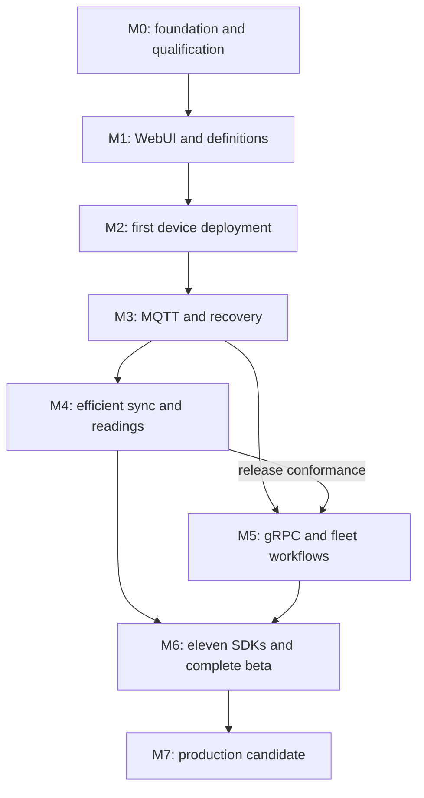

# Tyndar — Implementation Roadmap

**Version:** 0.3  
**Date:** 20 October 2026  
**Design baseline:** [Software design v0.3](iot-platform-software-design.md)  
**Product name:** Tyndar; adopted naming decision is in design section 18.  
**Scope:** a new Rust platform, secured by AXIAM, with an admin WebUI, capacity-aware configuration, efficient synchronization, readings, synchronous/asynchronous commands and WebRTC signaling, an essential common header, MQTTS/HTTPS/gRPC, and eleven SDK languages.

**Naming update:** This repository edition adopts Tyndar while retaining the v0.3 technical baseline and milestone scope.

Version 0.3 incorporates the coordinated scout/design review. There are **62 work items**: the 60 from v0.2 plus explicit M0 durability/recovery contracts and M2 minimal readings. Existing tasks now cover command-event ACKs, stale-effect fencing, compact bootstrap, runtime schema limits and safe restore. The detailed design owns behavioral semantics; this roadmap owns delivery order and evidence.

## 1. Delivery approach

Build vertical slices of this platform. The first useful release lets an operator sign in to the WebUI, define a device/table, obtain an actionable fit report, deploy to a real constrained device, and see the reported result/readings. Existing IoT platforms remain references; no fork/extension milestone is required.

That preview also executes a quick synchronous command and an asynchronous operation with a later result. Compact v1 uses one mandatory header octet plus conditional bounded routing/correlation integers; its exact encoding and safe session binding are specified before other transports/SDKs proliferate.

The WebUI starts in M0/M1. Do not defer operator workflows until the backend is feature-complete. Similarly, establish protocol fixtures before language SDKs multiply, and measure full-snapshot costs before claiming delta savings.

Each milestone ends with reviewable artifacts, a working demonstration, and failure-path evidence. Passing a milestone authorizes progress within the implementation plan; it does not publish software or certify production readiness automatically.

### Dependency and release map

M4 and M5 implementation can progress concurrently after M3 and shared contracts stabilize, but M5 release/conformance (M5-02) requires M4 behavior; the two release gates are not independent. Security, tests, documentation, and the WebUI are continuous workstreams. Single-maintainer execution can serialize these tasks without changing their dependencies.

| Milestone | Release outcome | Required predecessor |
| --- | --- | --- |
| M0 | Repository/contracts, compact-header/command semantics, and integration evidence | None |
| M1 | Internal operator preview including typed command definitions | M0 |
| M2 | HTTPS developer preview with real device and sync/async commands | M1 |
| M3 | Resilient MQTT developer preview | M2 |
| M4 | Efficiency alpha including exact header/total-wire budgets | M3 |
| M5 | Full transport/fleet alpha and WebRTC signaling reference | M3 to start; M4 to pass final three-transport conformance |
| M6 | Feature-complete beta | M4 + M5 |
| M7 | Production candidate; proposed 1.0 after gates pass | M6 |

## 2. M0 — Foundation and integration qualification

**Goal:** remove architectural uncertainty before expanding the implementation.

| Work item | Deliverable | Done when |
| --- | --- | --- |
| M0-01 | New Cargo workspace, Rust/WASM WebUI workspace, CI, contribution/license/security files | Server and bundled WebUI build reproducibly; smoke checks run in CI |
| M0-02 | ADRs and initial domain/public-contract vocabulary | Tenant/type/schema/revision/generation identities and error model are documented consistently |
| M0-03 | Pinned AXIAM release integration spike | Real browser/device/service-account flows, audiences, check-as/self distinction, denied decisions, and certificate binding are exercised |
| M0-04 | RMQTT qualification report and adapter contract | Verified identity reaches auth hooks; own-device ACLs, wildcard refusal, session persistence, and revocation disconnect can be tested |
| M0-05 | One real device profile and storage/recovery contract | Row, wire, RAM, staging/journal, crypto, and power-loss behavior are measured/established |
| M0-06 | Leptos UI spike | Authenticated routing, SSE, keyboard flow, and a large editable/paginated table work under bounded memory |
| M0-07 | Contract skeleton and naming checklist | OpenAPI/proto organization and golden-vector format exist; namespace selection is tracked before publication |
| M0-08 | Sync/async command lifecycle and complete Compact v1 specification | Per-kind direction/flag matrix, bootstrap/BIND/body protos, event ACKs, 1/2/3/11-byte vectors, clock/expiry rules, bounded context/epoch lifecycle, errors and fixtures reviewed |
| M0-09 | Durability/recovery and resource contracts | State ACK failure domains/RPO, restored-command quarantine, actuator fencing, ledger retention and device result capacity; define benchmark workloads, memory/byte limits and AXIAM renewal budget |

**Exit demonstration:** AXIAM-authenticated operator opens the new UI, accesses a tenant-scoped endpoint, and is refused outside their tenant. A real device identity can be resolved through the intended certificate path. The capacity/recovery profile is concrete enough to implement against.

**Failure response:** change the failing component/profile through an ADR. If AXIAM lacks a necessary mapping or PKI algorithm, resolve that integration explicitly; do not replace it with mock authorization. If a broker hook is inadequate, evaluate another implementation behind the adapter contract. The independent-platform direction stays intact.

## 3. M1 — Registry, schemas, configuration, and usable WebUI

**Goal:** operators can express device models and configuration safely.

| Work item | Deliverable | Dependency / completion condition |
| --- | --- | --- |
| M1-01 | PostgreSQL migrations and tenant-scoped repositories | M0-02; cross-tenant relationship tests and app-role isolation pass |
| M1-02 | Families, immutable type versions, devices, identity/resource provisioning saga | M1-01 + M0-03; provisioning/retry/orphan reconciliation works |
| M1-03 | Semantic schema v1 and family/type bindings | M1-02; configuration/reading bindings, pinned family lineage/type evolution, firmware compatibility and nullable/presence semantics work; collisions fail |
| M1-04 | Configuration drafts, immutable revisions, precedence and tombstones | M1-03; stable keyed rows and exact override semantics have fixtures |
| M1-05 | Generated Protobuf/descriptors, JSON Schema, basic exports | M1-03; typed round-trip and compatibility/presence cases pass; runtime descriptors and development-time static code generation have distinct contracts |
| M1-06 | BFF session and operator UI | M0-03/06; sign-in/out, tenant selection, definitions, schema bindings, draft editing, validation, and read-only access work |
| M1-07 | Durable administrative audit/outbox and API preconditions | Mutations survive restart; `If-Match`, idempotency conflicts, and safe errors are tested |
| M1-08 | Typed command definitions and WebUI command forms | Family/type binding, request/result/progress schema, permission, completion/effect/expiry policy, and approved device capability are enforced |

**Exit demonstration:** through the WebUI, create the irrigation-controller family, small/large types, schedule/reading schemas, devices, and a scoped table draft. Publish a revision, export typed data, and show a concurrent-edit conflict without losing draft input. Unauthorized operations fail on the server even when called directly.

**Release:** internal operator preview. Configuration delivery is not yet claimed.

## 4. M2 — Capacity planner and first real deployment over HTTPS

**Goal:** prove the central device-budget and activation workflow end to end.

| Work item | Deliverable | Dependency / completion condition |
| --- | --- | --- |
| M2-01 | Pure compiler with provenance and mandatory dependency closure | M1-03/04; deterministic fixtures and conflict/dependency errors pass |
| M2-02 | Versioned layout/capacity models | M0-05 + M2-01; all profile budgets checked and independently validated on device |
| M2-03 | Immutable pages/manifests and signed per-device grants | M1-05; exact byte digests, signer policy, enrollment/generation binding work |
| M2-04 | Plans, frozen targets/digest, approval/start, per-device generations | M2-01/02/03; stale plan and changed capability inputs block dispatch |
| M2-05 | HTTPS Sync v1 full snapshot and durable progress/results | M2-03/04 + M0-08; compact bootstrap, exact manifest bytes, duplicate/reordered requests and lost ACKs are safe |
| M2-06 | Rust reference device client, bounded C reference profile, simulator | M2-05; real profile and simulator share the same contract fixtures |
| M2-07 | WebUI fit report, plan review, deployment/device detail | M2-04/05; operator can act on refusal reasons and distinguish delivery from application |
| M2-08 | HTTPS invoke-and-wait/start/get/watch and device handlers | M0-08 + M1-08; durable IDs/outbox/ledger, same-effect retries, bounded sync wait, delayed async result, and unknown-outcome behavior work |
| M2-09 | Minimal durable readings and latest-state WebUI | M1-03/05 + M0-09; one bounded HTTPS stream uses inbox/dedup, application ACK, boot/sequence ownership and freshness; actual readings appear beside deployment/command results |

**Exit demonstration:** a schedule requiring 150 rows is rejected for a 128-row device before transfer. A valid revision is delivered; transfer is interrupted and resumed. Cut device power during staging/activation, recover according to its declared contract, and show the authenticated reported active generation in the UI. A lost success result is retried without rewriting/reapplying incorrectly.

Also switch a test light on/off and change a target-temperature setpoint with synchronous handler confirmation. Start a delayed async job, close/reopen the caller, and retrieve its durable result. Expire a waiter after possible execution and show pending/unknown with the same command ID rather than false failure or a second actuation.

M2-08 also proves device-result durable ACK/replay, direct terminal results, canonical request digest, actuator group sequence checks, and capacity refusal before accepting an effectful command. M2-09 provides basic current readings; optimized batches/history remain M4.

**Release:** first external developer preview, explicitly limited to HTTPS and Rust/C reference profiles. Admin WebUI and real capacity checking are included.

## 5. M3 — MQTTS, identity lifecycle, and durable recovery

**Goal:** reliable device connectivity with the same behavior as HTTPS.

| Work item | Deliverable | Dependency / completion condition |
| --- | --- | --- |
| M3-01 | Qualified broker and Rust MQTT adapter | M0-04 + M2-05; namespace/ACLs/envelopes route to existing application services |
| M3-02 | Device mTLS and credential rotation over supported paths | M0-03/05; rotation preserves device identity and generation high-water mark |
| M3-03 | Session authorization leases and invalidation | Online revocation target tested with event loss and AXIAM outage; no indefinite lease extension |
| M3-04 | Persistent transfer resume, bounded receiver credits, staging GC | M2-05; broker/server/device restart recovers acknowledged state |
| M3-05 | Inbox/outbox workers, fencing, and deployment reconciliation | Crash between commit/publish or commit/ACK is idempotent; stale workers cannot mutate state |
| M3-06 | Transport conformance and failure visibility in WebUI | MQTT/HTTPS run identical fixtures; PUBACK is never presented as applied |
| M3-07 | MQTT command parity, bounded offline queues, and epoch recovery | M2-08 + M0-08/09; durable event ACK/replay, expiry/cancel races, bootstrap nonce/epoch rejection, stale-setter fencing, group blocking and restored-command quarantine match HTTPS |

**Exit demonstration:** revoke an online device while a transfer/subscription is active; verify bounded refusal/disconnect. Restart the broker/server during deployment, resume, and show stable reported state. Attempt cross-device wildcard access and stale-worker updates; both fail.

**Release:** resilient MQTT developer preview. One-device correctness precedes broad fleet orchestration.

## 6. M4 — Efficient synchronization, readings, and consumption accounting

**Goal:** demonstrate measured efficiency while preserving explicit data semantics.

| Work item | Deliverable | Dependency / completion condition |
| --- | --- | --- |
| M4-01 | Hash-first no-change and stable page deltas | M3; sparse/dense changes, exact full target manifests, missing bases, page splits, and full fallback have fixtures |
| M4-02 | Adaptive mode selection, bounded compression, credit/window tuning | Compare total bytes/round trips/device work; enforce every device budget first |
| M4-03 | Extend M2-09 ingestion to batches, history and retained replay windows | Durable ACK/checkpoint, persistent high-water/gap handling, dedup-cache expiry, old-boot/late-data behavior and history isolation pass |
| M4-04 | Lossless batching, optional explicit suppression/aggregation, bounded spool | Quality/timing preserved; critical/lossless overflow never disappears silently |
| M4-05 | Usage counters, quotas, priorities, export/retention controls | Both directions/categories visible; optional work can defer without breaking mandatory streams |
| M4-06 | WebUI live state/history/usage and efficiency benchmark harness | No fleet-wide stream fan-out; compare JSON, full Protobuf, and deltas on equal terms |
| M4-07 | Minimal common-header/codec qualification | M0-08 + M3-07; golden bytes/event ACKs, multi-byte handles, no repeated metadata, tiny command bodies, parser allocation/CPU, bootstrap/epoch rotation, authorization-renewal load and carrier overhead measured |

**Exit demonstration:** no-op sync transfers no configuration body; sparse edits transfer only required pages; lost staging progress resumes safely; dense edits can choose snapshot. Run 50/200/1,000-ms RTT and loss scenarios plus a real modem. Publish bytes/activation, bytes/accepted sample, idle bytes/day, CPU/RAM, and freshness; explain all exclusions and trade-offs.

Report common-header (1–11 bytes), actual body, and MQTT/HTTP/gRPC/TLS/network overhead separately. Reject stale session mappings and malformed/noncanonical headers. A smaller common header cannot be claimed as the complete packet size, and redundant metadata moved into the body still counts.

**Release:** efficiency alpha. Do not claim a universal percentage saving from the scout's illustrative arithmetic.

## 7. M5 — Native gRPC, fleet rollouts, and complete operator workflows

**Goal:** finish server transport coverage and fleet administration.

| Work item | Deliverable | Dependency / completion condition |
| --- | --- | --- |
| M5-01 | Tonic device/management/observation services | M3 contract; TLS/mTLS, deadlines, bounded streaming, and lease renewal work |
| M5-02 | Three-transport conformance | M5-01 + M4 updates; domain errors/idempotency/state transitions agree |
| M5-03 | Frozen cohorts, deterministic waves, thresholds, pause/cancel/retry | No one giant fleet transaction; offline/pending/failure distinctions are tested |
| M5-04 | New-generation rollback and permission-separated approvals | Old receipts cannot advance current state; two-person policy checks distinct actors when enabled |
| M5-05 | Complete admin workflows, audit filtering, and asynchronous export jobs | Plan invalidation, authorized bulk operations, usage/history, and safe export access pass UI/API tests |
| M5-06 | Prototype multi-replica/fenced worker execution | Current state remains correct under ownership transfer; production qualification continues in M7 |
| M5-07 | Native gRPC command lifecycle and WebRTC signaling integration | M2-08/M3-07; invoke/start/status/watch/cancel parity plus real browser and WebRTC-capable peer offer/answer, trickled ICE, expiry, glare/renegotiation, and state reporting |

**Exit demonstration:** run a mixed HTTPS/MQTT/gRPC fleet with one offline target and one rejected target. Inspect waves and receipts, pause/cancel safely, and publish a rollback as a newer generation. UI and direct API access enforce the same permissions.

Negotiate an authorized WebRTC session while the synchronous command wait remains bounded, exchange signaling over the platform, and distinguish negotiated/connected/data-channel-open states. Deliver a late result after the wait expires without restarting negotiation automatically. Media uses the peer/TURN path, not the bulk IoT message channel; no custom media stack is required.

**Release:** full-transport/fleet alpha. SDK language coverage can still be incomplete.

## 8. M6 — Eleven SDKs and feature-complete beta

**Goal:** reach the requested AXIAM language range without divergent protocol behavior.

| Work item | Deliverable | Dependency / completion condition |
| --- | --- | --- |
| M6-01 | Normative SDK contract, generator pipeline, runtime/transport matrix | M4/M5 interfaces stable enough to version; generated types are reproducible |
| M6-02 | Rust/C production-shaped clients, Java and TypeScript facades | Keep reference behavior; test bounded C, browser/Node distinction, Java deadlines/stream lifecycle |
| M6-03 | Python, Go, C#, and Kotlin clients | Shared fixture suite plus idiomatic cancellation/concurrency/authentication |
| M6-04 | Swift, C++, and PHP clients | Document hosted/mobile/native-extension limitations and supported transports |
| M6-05 | Cross-language compatibility and examples | Presence/zero, 64-bit values, Unicode, bytes, schema mismatch, duplicates, timeout, cert rotation, and reconnect cases |
| M6-06 | User documentation and complete beta acceptance run | An operator can install, enroll, model, plan, deploy, inspect, and export using documented workflows |
| M6-07 | Command/signaling behavior across all SDK profiles | Invoke-and-wait/start/get/watch/cancel, late result and timeout identity recovery, typed schemas and compact context fixtures pass; media runtime not required in every SDK |

Use language waves to spread maintenance/testing load; do not equate generated files with a supported SDK. Every SDK has explicit management/device profiles, versioned packaging, CI, examples, and a named support matrix. Browser/MCU constraints remain as designed; native gRPC on every runtime is not required.

**Exit demonstration:** all eleven languages pass applicable shared conformance tests against the same server release. At least one example per language uses AXIAM-secured real APIs rather than mocked responses. All R01–R17 requirements are implemented at beta scope, including commands and minimal common headers.

**Release:** feature-complete beta. This is the first release claiming the full requested language and server-protocol range.

## 9. M7 — Production candidate and stable release gates

**Goal:** qualify recoverability, isolation, security, and operational limits.

| Work item | Deliverable | Dependency / completion condition |
| --- | --- | --- |
| M7-01 | Independent security review and remediation | Identity/check-as integration, broker ACLs, WebUI/BFF, exports, parsers, signing, and tenant boundaries reviewed |
| M7-02 | Multi-replica/load/fairness/reconnect qualification | Documented limits; stale fences, overload, slow consumers, and noisy tenants tested |
| M7-03 | Backup/restore and migration drills | Recovery quarantine precedes all workers; generation/group counters and command ledgers reconcile; no restored effectful replay; quantify unrecoverable ACKed-data gaps; expire RTC sessions; offline devices remain blocked |
| M7-04 | Hardware reliability/rotation regression suite | Power-cut matrix and storage exhaustion reproduced on supported device profile |
| M7-05 | Published reproducible benchmarks and sizing | Reference hardware/durability/TLS/policy settings, retention and projection lag stated |
| M7-06 | Release integrity and operations package | Pinned dependencies/toolchains, SBOM/license inventory, release artifacts, upgrade/runbooks, vulnerability response |
| M7-07 | Stable contract and support policy | Protocol/API/schema/SDK compatibility, tested platform matrix, known limits, and deprecation policy published |
| M7-08 | Command, signaling, and compact-protocol failure/security qualification | Uncertain physical effects, reply-loss/cancel/reboot races, strict expiry enforcement, session alias replay, bounded parsing, RTC participant isolation and sensitive-data retention reviewed |

**Exit demonstration:** restore a failed deployment environment from backup, reconcile device generations, recover pending work, and verify tenant/authorization boundaries under load. Publish residual risks and unresolved defects. Do not label release 1.0 until blocking security, correctness, and recovery findings are addressed.

**Release:** production candidate, followed by a proposed 1.0 after review gates pass. “Production candidate” is evidence about tested deployment profiles, not a claim of certification or universal scale.

## 10. First implementation iteration

Start with this narrow sequence; defer broad scaffolding that cannot yet be exercised:

1. Create repository/workspaces and ADR records; establish Rust service and bundled WebUI build in CI.
2. Pin AXIAM and prove browser/session + device principal/authorization mapping using real endpoints.
3. Create tenant/device/type/schema identifier types, error contract, and first tenant-scoped migrations.
4. Implement a WebUI family/type + schema + draft-table workflow using real management APIs.
5. Add one compiler fixture: 128-row limit, mandatory rows, exact encoding, and explainable refusal.
6. Implement immutable plan/content/grant and a single HTTPS device transfer with durable result.
7. Connect the real firmware profile, interrupt/power-cycle it, and surface actual reported state in the UI.
8. Add one absolute-setting command and one delayed async command using the shared minimal header; prove that a waiter timeout does not cause a duplicate physical action.

This iteration spans the earliest vertical slice of M0–M2; it is not a calendar commitment. Broad SDK generation, fleet rules, and analytics come after the core contracts are demonstrably correct.

## 11. Planning effort and capacity

Calendar dates depend on available engineering time, firmware access, SDK ownership, and external security-review availability. Use milestone gates as the commitment now and calibrate estimates after M0/M2.

An initial **rough order of magnitude**, not a delivery promise, is:

| Milestone | Focused engineer-weeks |
| --- | --- |
| M0 | 2–5 |
| M1 | 4–7 |
| M2 | 6–10 |
| M3 | 5–8 |
| M4 | 6–9 |
| M5 | 6–10 |
| M6 | 9–16 |
| M7 | 7–12 |
| **Total** | **45–77** |

The estimates are retained as provisional scope bands after review; the new work packages expose correctness work previously implicit rather than establishing measured extra capacity. M0 must re-estimate M2/M3/M7 against the chosen device and durability profile. Full support for eleven SDK languages may dominate maintenance effort.

These bands are judgment estimates for the complete scope, including UI, reference-device integration, testing, eleven SDKs, explicit command lifecycle, minimal-header qualification and a WebRTC signaling reference. They exclude building a media stack/relay service, external review procurement/waiting time, major changes to AXIAM or hardware, and post-1.0 features. They are not derived from a measured team velocity; AI assistance does not remove the qualification/review work.

One engineer-week means 40 focused hours. For a single maintainer, `calendar weeks ≈ engineer-weeks × 40 / focused hours per week`, before interruptions and external dependencies. At 10 focused hours/week, the total translates to roughly 180–308 weeks; this is a workload illustration, not a forecast. Re-estimate after the first working vertical slice and split previews so useful software arrives well before complete SDK parity.

For multiple contributors, separate backend/identity, firmware/protocol, WebUI, SDK, and operations responsibilities, but keep one owner of the shared semantic contract. Parallelism reduces elapsed time only where dependencies permit it.

## 12. Cross-cutting definition of done

- Behavior is documented in the public/domain contract, with fixtures for failure paths that matter.
- Tenant, actor, authorization, generation, and idempotency context are checked consistently.
- All new work queues/parsers/buffers have limits, metrics, and an overload response.
- Schema/API/protocol changes include compatibility assessment and applicable generated artifacts.
- Accepted durable work survives the stated crash/failover domain; backup/disaster RPO is separately documented and tested. Restore cannot blindly replay effectful outbox work.
- The operator can inspect relevant state and failures through the WebUI; direct API access enforces the same policy.
- Tests are meaningful: invariants, concurrency, recovery, protocol conformance, and real hardware behavior where required.
- Migrations, release notes, examples, and operational changes are included before marking the work item complete.
- No named SDK, transport, security feature, or supported device profile is claimed from a stub or happy-path-only example.
- Command acceptance/delivery/wait expiry and actual effect are distinct; retries preserve durable identity and uncertain effects remain visible.
- The same essential header is used for commands/configuration/readings, with exact byte vectors, safe context binding, and honest total-wire accounting.

## 13. Explicitly deferred work

After 1.0 demand and benchmarks: ClickHouse history sink; CBOR; analytical Parquet/Arrow export; disconnected edge relay; additional firmware layouts; Merkle synchronization for large divergent replicas; manifest-byte and row/binary patch algorithms; Sparkplug/WoT/NGSI-LD adapters; AWS/Azure/Ditto compiler targets; richer asset graphs.

Separate product decisions: firmware OTA, general rules engines, arbitrary dashboards, multi-region active/active writers, simulation, and 3D twins. Deferring these does not defer the required operational WebUI or basic readings/history.

Sync/async commands, command results, minimal common headers, and WebRTC signaling/orchestration are **not deferred features**. A general media server, custom WebRTC implementation, and media relay hosting remain outside this roadmap's scope.

## 14. Project name and publication namespaces

**Tyndar** is the chosen project name. Use **Tyndar** in documentation and branding and `tyndar` for the repository identifier. Design section 18 records the decision and preserves the superseded naming research.

Before publishing packages or registering domains, verify the exact relevant Tyndar namespaces and resolve any naming/confusion concerns. The project-name decision is complete; package/domain availability and any necessary name clearance are not established. Internal crate/proto identifiers remain an implementation decision for M0; the illustrative `platform-*` names elsewhere in the design are not published packages.

## 15. Requirement-to-release traceability

| Requirement | First evidence | Completion gate |
| --- | --- | --- |
| R01 Rust independent implementation | M0-01, M1 | M6-06, M7-06 |
| R02 AXIAM/tenant isolation | M0-03, M1-01/06 | M3-03, M7-01/02 |
| R03 Families/type versions | M1-02/03 | M6-06 |
| R04 Configuration/readings | M1-03/04, M2-09 | M4-03/04, M6-06 |
| R05 Capacity | M0-05, M2-01/02 | M7-04 |
| R06 Desired/projected/reported | M2-04/05/07 | M3-06, M5-04 |
| R07 Three transports | M2-05, M3-01 | M5-01/02 |
| R08 mTLS/lifecycle/revocation | M0-03/05, M3-02/03 | M7-01/04 |
| R09 Efficient synchronization | M2 snapshot baseline | M4-01/02/05/06/07, M7-05 |
| R10 Typed exports | M1-05 | M5-05, M6-05 |
| R11 Eleven SDKs | M2-06 | M6-01 through M6-07 |
| R12 Admin WebUI | M0-06, M1-06 | M5-05, M6-06 |
| R13 Recovery/concurrency | M0-09, M2-05/08/09 | M3-05/07, M7-03/04/08 |
| R14 Operations/observability | M1-07, M3/M4 metrics | M7-02/03/05/06 |
| R15 Open-source deliverable | M0-01/07, license inventory | M7-06/07 |
| R16 Commands/WebRTC | M0-08, M1-08, M2-08 | M3-07, M5-07, M6-07, M7-08 |
| R17 Essential common header | M0-08, M2-05/08/09 | M4-07, M5-02, M6-05/07 |

## 16. Review and planning risks

The central risk is not Rust throughput; it is completing firmware-backed recovery, protocol conformance and eleven maintained SDKs with consistent semantics. Assign an owner role and supported runtime matrix per workstream before promising dates. A first pilot can ship M2/M3 with narrower declared support while retaining the full beta requirements.

Do not defer foundational fencing, bounded decoding, real AXIAM checks, or command identity until the final security milestone. M7 qualifies and reviews mechanisms already present in earlier slices. Keep benchmark targets separate from acceptance invariants; a missed throughput objective leads to sizing or optimization, while a repeated unsafe effect or cross-tenant access blocks release.

The coordinated v0.3 review changed documentation and checked internal consistency. It did not execute the implementation/hardware/network tests listed as future milestone gates. This repository edition adopts the Tyndar name and imports the planning documents; it does not complete an implementation milestone or publish a software release. Package/domain availability remains unverified.
