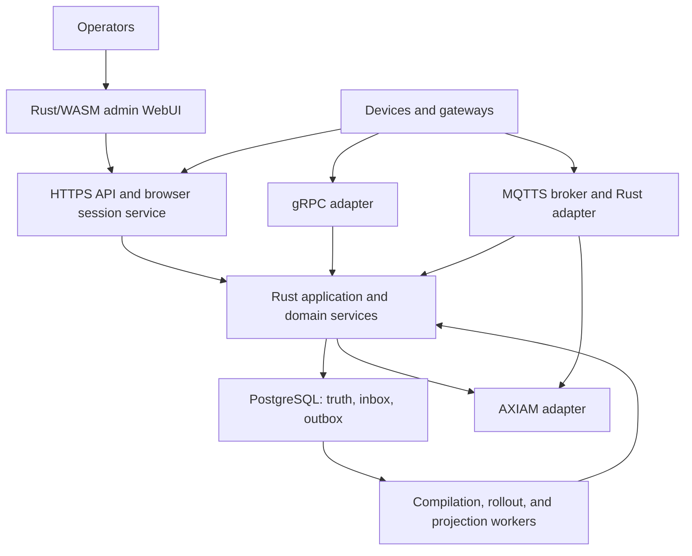
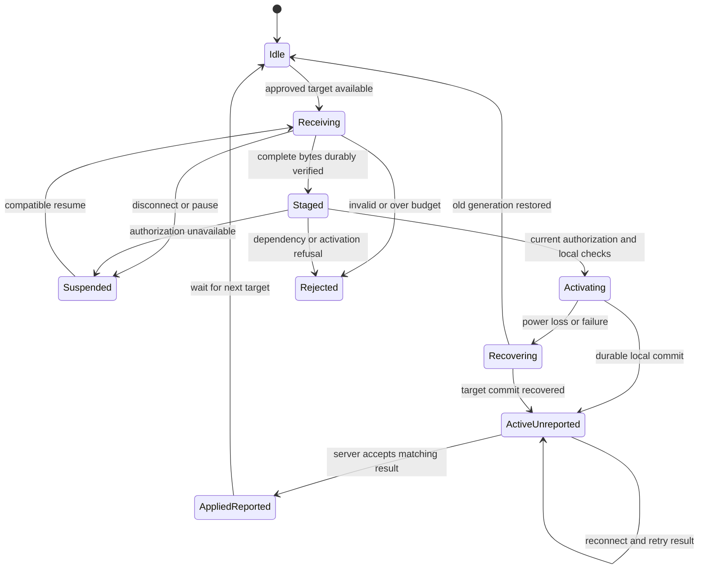
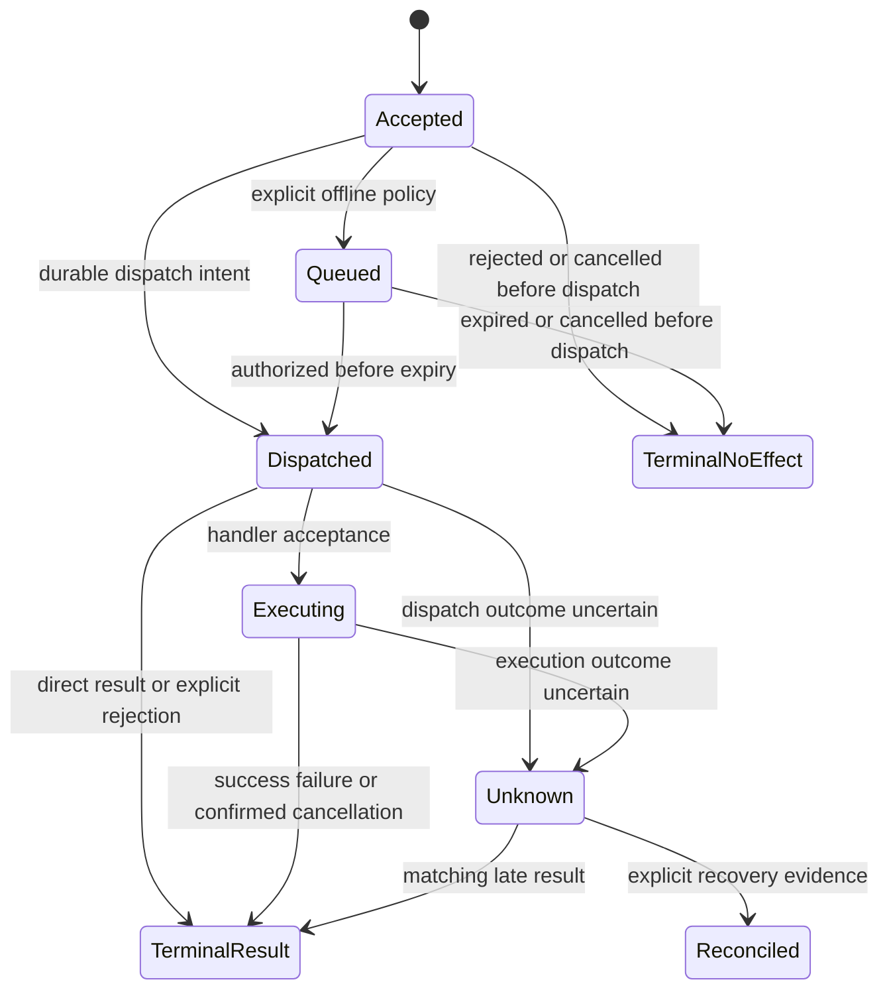

# Tyndar — Software Design

**Version:** 0.3 — implementation baseline proposed for review  
**Date:** 20 October 2026  
**Prepared for:** Emanuele Panigati  
**Project name:** Tyndar  
**Companions:** [Scout v0.3](iot-digital-twin-scout.md) · [Implementation roadmap v0.3](iot-platform-roadmap.md)

## 1. Baseline and design status

This design defines proposed software behavior alongside the coordinated [scout v0.3](iot-digital-twin-scout.md) and roadmap v0.3. The scout supplies market evidence; this document owns architecture/protocol semantics; the roadmap owns delivery gates. Companion scout SHA-256: `e41d5fe842a65f5ac022f090250a128ae77ba0994f6ce8e71d7b9fd027cf5fb2`. Document revision numbers are distinct from saved-file version history. This repository edition adopts Tyndar as the project name while retaining the v0.3 technical baseline and historical naming research.

Preserved decisions: build a new independent platform from scratch; use Rust and AXIAM; define device families/types, configuration tables, and reading schemas; support MQTTS, HTTPS, and gRPC with mTLS where applicable; provide typed Protobuf exports and the eleven SDK languages documented by AXIAM; make configuration capacity and bandwidth efficiency central; include the admin WebUI from the first usable release. PostgreSQL is the operational database; ClickHouse and an edge relay are later options.

Version 0.3 retains the explicit sync/async command and minimal-header requirements added in v0.2. It corrects command-result acknowledgment, stale-command ordering, restore behavior, schema/runtime binding, manifest transfer, and durability boundaries; aligns the scout and roadmap; and identifies the protocol contracts that M0 must finish before implementation. Section 20 records the review.

Existing IoT products are references and future integration targets. They are not implementation prerequisites. Reuse databases, protocol implementations, cryptographic libraries, and AXIAM rather than reproducing them.

“MUST” describes a required invariant or release behavior. “Default” describes a configurable starting policy. Numerical limits and performance objectives are provisional until tested. No code, benchmarks, or security certification are delivered by this document.

New choices resolving the scout's open implementation questions are listed in section 3. Deployment-specific details still requiring evidence are tracked in section 16; they do not reopen the decision to build this platform.

## 2. Requirements and boundaries

| ID | Requirement | Acceptance evidence |
| --- | --- | --- |
| R01 | Independent platform with a Rust implementation | First-party domain, compiler, synchronization, APIs, CLI, and WebUI source |
| R02 | AXIAM authentication/authorization and tenant isolation | Real integration tests for users, devices, delegated checks, and isolation |
| R03 | Families, concrete type versions, and devices | Published type version pins definitions; device has exactly one type version |
| R04 | Typed configuration tables and near-real-time readings | Both schema kinds bind at family and type level; values belong to instances/scopes |
| R05 | Device-specific capacity enforcement | Required data exceeding any supported budget blocks deployment |
| R06 | Desired/projected/reported state separation | Delivery acknowledgment cannot mark activation successful |
| R07 | MQTTS, HTTPS, and gRPC | Shared semantic conformance suite across all three adapters |
| R08 | Device mTLS, credential lifecycle, and bounded revocation | Certificate binding, rotation, rejection, and active-session revalidation |
| R09 | Efficient sync and metered-link visibility | Hash-first no-op, adaptive deltas, resume, bounded windows, and byte accounting |
| R10 | Protobuf and useful exports | Binary data plus descriptors, message names, schema versions, and metadata |
| R11 | Eleven SDK languages | Rust, TypeScript, Python, Java, Kotlin, C#, PHP, Go, Swift, C, C++ conformance |
| R12 | Admin WebUI | Normal workflow works without manually calling administrative APIs |
| R13 | Recoverable concurrency and durable acceptance | Crash/restart, duplicate, stale-worker, and power-loss scenarios |
| R14 | Observable and operable deployment | Metrics, audit, migrations, backup/restore, and bounded queues |
| R15 | Open-source deliverable | Proposed Apache-2.0 platform/WebUI/SDKs; documented third-party license inventory |
| R16 | Synchronous and asynchronous commands, including WebRTC session negotiation | Bounded waits, durable later results, expiry/cancellation/unknown outcomes, typed signaling, and all-transport/SDK tests |
| R17 | Essential, low-footprint common header | One-octet base; routing/correlation only when needed; exact golden byte counts and total carrier overhead measured separately |

Initial non-goals: simulation/physics, 3D rendering, arbitrary dashboard authoring, a general rules engine, firmware OTA, arbitrary code execution in schemas, multi-region active/active configuration writes, and offline configuration authoring. Operational fleet summaries and basic reading history are included. Hard real-time control and safety interlocks remain in firmware.

## 3. Architecture decisions

| ADR | Decision | Reason / consequence |
| --- | --- | --- |
| A01 | Modular monolith plus external MQTT broker and AXIAM | Keep one domain implementation and simple initial operations; separate processes only when measured |
| A02 | Rust async services, Actix-Web HTTPS, Tonic/Prost gRPC, Rustls, SQLx/PostgreSQL | Align HTTP/gRPC choices with AXIAM and use typed, explicit async boundaries; pin compatible versions in M0 |
| A03 | Rust/WASM admin WebUI using Leptos client-side rendering | Preserve the Rust implementation preference for the browser application too; serve static build assets from the Rust server |
| A04 | Restricted semantic schema model generates validators and wire definitions | Avoid arbitrary schemas/code on ingress; make field bounds and table semantics explicit |
| A05 | Immutable revisions, artifact pages, and deployment plans | Approval and device receipts refer to exact content |
| A06 | PostgreSQL transactions plus durable outbox and ingress inbox | Operational truth has a transaction boundary; downstream delivery/projection can be retried |
| A07 | Hash-first sync, immutable page deltas, full-snapshot fallback | Avoid full shadow replication and constrain device memory/recovery costs |
| A08 | Single configuration authority per device with monotonic generations | Prevent conflicting activation and stale worker/receipt effects |
| A09 | Backend-for-frontend browser sessions | Keep AXIAM tokens out of browser storage; centralize tenant/session enforcement |
| A10 | One protocol/SDK behavioral contract with language-specific facades | Code generation alone does not implement retries, lifecycle, or synchronization semantics |
| A11 | RMQTT is the first broker integration candidate | Reuse a Rust MQTT implementation; qualify identity hooks, durability, ACLs, and revocation before declaring support |
| A12 | Operational PostgreSQL, optional separate analytical history later | Do not use analytical deduplication as deployment consistency |
| A13 | One durable command model with synchronous-wait and asynchronous-return invocation styles | Caller waiting time does not determine device execution outcome; no blocking worker thread per command |
| A14 | Compact v1 binary envelope: one octet plus conditional bounded numeric fields | Negotiate identity/schema/codec context once; do not repeat JSON header keys, UUIDs, tokens, or version metadata per frame |

Leptos documents client-rendered builds as deployable static assets. This supports bundled deployment; it does not establish the suitability of a specific grid or chart component. The first UI spike must exercise a large editable table, accessibility, routing, and authenticated SSE. [T01] Actix server execution and SQLx's async database interfaces are implementation references, not performance guarantees. [T02, T03]

Use a pinned stable Rust toolchain where the chosen framework versions support it; record any exceptional toolchain requirement. The browser build may contain generated JavaScript/WASM bindings, but application logic remains Rust. Generated TypeScript SDKs remain required for external consumers.

## 4. Runtime and code boundaries



Initial server binary hosts HTTPS/BFF, gRPC, and workers with independently bounded task pools. MQTT broker is a separate process; its adapter authenticates/authorizes and forwards accepted messages through the same application interface. The broker cannot mutate database state directly. Worker-only deployment is a later runtime profile using the same code, not a new domain implementation.

| Workspace area | Responsibility | Must not depend on |
| --- | --- | --- |
| `crates/domain` | IDs, invariants, state transitions, errors | HTTP, MQTT, AXIAM SDK, database driver |
| `crates/schema` | Semantic schemas, binding resolution, compatibility, validators | Transport listeners |
| `crates/compiler` | Precedence, row selection, budgets, page/manifest generation | Running AXIAM or PostgreSQL; receives immutable inputs |
| `crates/application` | Authorized use cases, repository/clock/signer ports, transaction coordination | Concrete transport types |
| `crates/sync-core` | Bounded protocol state machine and resume rules | Database driver or a specific TLS stack |
| `crates/commands` | Definition validation, invocation lifecycle, durable correlation, scheduling, result reconciliation, signaling-session policy | Concrete HTTP/MQTT/gRPC types or a bundled media runtime |
| `crates/identity-axiam` | Principal validation, policy checks, identity/resource mappings | UI presentation |
| `crates/storage-postgres` | SQL repositories, inbox/outbox, migrations | Browser/firmware SDKs |
| `crates/api-http`, `api-grpc`, `mqtt-adapter` | Decode, authenticate, admission limits, map errors | Independent business-rule implementations |
| `crates/server`, `cli`, `simulator` | Composition, administration, device simulation | Unnecessary cross-layer access |
| `webui` | Rust/WASM UI, API DTOs/client, bounded view state | Server-only credentials and repository code |
| `proto`, `openapi`, `contracts`, `sdks` | Public definitions, golden fixtures, SDK contract | Unversioned generated behavior |

Keep public DTOs separate from domain entities and persistence rows. Use newtypes for tenant/device/schema/revision identifiers and a verified `PrincipalContext`; do not pass unverified payload tenant IDs through service methods.

## 5. Domain and ownership model

### 5.1 Registry

- `Tenant` maps to an AXIAM organization/tenant and trusted issuer configuration.
- `Family` has at most one parent. Hierarchy updates reject cycles and produce a new configuration/binding revision.
- `DeviceTypeVersion` is published immutably and references a family lineage and binding snapshot. Only nonsemantic labels/descriptions may be corrected separately; firmware constraints, bindings, parent lineage, and layout are immutable versioned semantics.
- `Device` references exactly one published type version and one approved capability profile. It has a separate lifecycle: `provisioning`, `active`, `suspended`, `retired`.
- `IdentityBinding` maps enrolled credentials/service accounts to a device within one tenant and enrollment epoch. A replacement credential can overlap during controlled rotation; it does not create a second logical device.
- Operational cohorts/sites are targeting/access structures, separate from family/type inheritance.

A published type pins the family lineage and schema/command bindings. Reparenting a family or changing its bindings does not silently modify existing published types: publish a new type version and explicitly migrate devices. Configuration default values may have newer revisions within the pinned lineage; a new plan freezes the exact selected default revisions. Validate defaults against the pinned schema version; no implicit reinterpretation of old devices. This separates definition evolution from ordinary configuration rollouts.

Change a device's type/profile through a validated operation. It MUST recheck compatibility, invalidate unapproved plans relying on old inputs, and block incompatible queued deliveries. Historical readings retain their original schema identity.

### 5.2 Six distinct state surfaces

| Surface | Writer | Meaning |
| --- | --- | --- |
| Configuration draft/revision | Authorized operator/service | Input tables and scoped overrides |
| Desired deployment reference | Authorized rollout service | The approved target for that device |
| Projected artifact | Compiler | Resolved, eligible, capacity-checked bytes |
| Reported configuration | Device | Last authenticated claim of active generation/content |
| Latest readings/history | Device/delegated gateway | Accepted observations with quality and freshness |
| Command invocation/events/result | Authorized caller, scheduler, and responding device | One-time operation, progress, terminal result, or explicit uncertainty; separate from desired configuration |

A server never writes a successful device report on behalf of its own delivery action. Commands are first-class one-time operations with IDs/expiry and the lifecycle in section 10. A persistent desired property is not a command queue. A command may update operational state, but cannot silently edit a published configuration revision.

### 5.3 Invariants

| ID | Invariant |
| --- | --- |
| I01 | Every persisted resource relationship is tenant-scoped; no cross-tenant foreign key |
| I02 | Published schemas/revisions/artifacts/plans are immutable |
| I03 | Every artifact has complete input provenance and a versioned compiler/layout |
| I04 | Required rows and dependencies are never silently omitted |
| I05 | An over-budget or incompatible target is not dispatched |
| I06 | Desired, staged, applied, verified-by-report, and physical behavior are different facts |
| I07 | One device generation identifies exactly one target/authorization grant |
| I08 | A stale receipt or worker cannot advance current deployment state |
| I09 | Durable application ACKs correspond to durable server/device state |
| I10 | Retries with the same operation ID and content are idempotent; changed content conflicts |
| I11 | All buffers, replay windows, queues, and parsing expansions have explicit limits |
| I12 | Authentication, tenant membership, operation authorization, and resource ownership all pass before access |
| I13 | Command acceptance/delivery is not execution success; caller wait timeout/cancellation does not prove the device did not act |
| I14 | A durable command ID cannot be reused with different content; retries do not automatically repeat uncertain non-idempotent effects |
| I15 | Compact context handles cannot outlive/rebind across an unchecked session epoch; late queued frames cannot acquire a new meaning |
| I16 | A stale command cannot overwrite a newer operation in the same actuator conflict group, even if it is an absolute setter |
| I17 | Disaster restore cannot automatically replay potentially executed commands or claim to recover acknowledged data lost beyond the selected replication/backup guarantee |

## 6. Schema and configuration compiler

### 6.1 Semantic schema v1

Configuration tables define a stable table ID, schema version, bounded key, column IDs/names/types, nullability, constraints, merge mode, and dependencies. Reading schemas define field IDs/types, units/scale, quality, sequence/timing rules, loss policy, and retention class.

Command definitions are also versioned and bind at family/type level. They specify a stable numeric operation selector, request/result/progress schemas, completion meaning, supported invocation modes, permission/action, idempotency/effect class, expiry/offline policy, concurrency group, and device resource limits. They select registered firmware handlers; the platform does not accept arbitrary shell/code execution as a command definition.

Supported v1 scalar types: boolean, bounded signed/unsigned integer, finite floating point, scaled integer, bounded UTF-8 string, bounded bytes, enum, and timestamp. Bounded repeated values are supported where the profile permits them. No recursive user types or unbounded collections. Use stable numeric column/field IDs independent of display names. The generator defines exact integer widths, timestamp epoch/unit and overflow rules; UTF-8 bounds are byte bounds. Nullable fields use a generated explicit null/value union, with presence representing omission. A nullable row update, deleting a row, and removing an override are different validated operations; proto3 optional scalar presence alone cannot encode all four states.

Keys are bounded strings or unsigned integers; one declared key per table in v1. Composite keys can be encoded as a typed bounded key later, not by ambiguous string concatenation. JSON-facing 64-bit integers and server revision/generation values use decimal strings; bytes use base64. Reject NaN/infinity. Units and scaling are explicit and never inferred from a label.

The schema registry generates `.proto`, descriptors, JSON Schema, validators, and SDK types. Protobuf does not enforce application row counts, ranges, or allocation bounds by itself. Field removal reserves names/numbers; breaking semantic changes require a new major version and migration/compatibility assessment. Unknown configuration fields cannot silently change device behavior. [T04]

Bindings attach **both configuration and reading schemas** to families and types. Binding sets are revisioned; a plan records concrete versions after composition and rejects collisions. Multiple-parent schema inheritance is not supported initially.

The same versioned binding mechanism exposes command capabilities for a family/type. A device's approved profile can restrict supported commands, maximum queued/in-flight work, request/result sizes, and handler/firmware compatibility.

The registry supports runtime-defined schemas, but compiled firmware does not acquire new handlers or static language types from a schema publication. Hosted tooling may use a bounded descriptor/value API. Typed SDK/model packages are generated explicitly for development and release; device bindings require a known schema/layout and registered handler supported by the approved firmware profile. Adding an unknown layout/command requires compatible firmware supplied outside this platform's v1 OTA scope. Reserve removed command selector IDs within their namespace, just as field numbers are reserved.

### 6.2 Resolution

Precedence remains:

`tenant defaults → family ancestors → family → type → deployment policy → device override`

Resolve from an immutable input snapshot. Schema rules define whole-table replacement, keyed-row replacement, or allowed column merging. Distinguish row deletion, nullable value, and removing an override to resume inheritance. Equal-priority conflicting policies fail; arrival/database order never resolves conflicts.

Editing/publishing a default revision does not retroactively mutate an approved artifact or immediately push new device intent. A new rollout is the v1 mechanism for applying those changes. Automatic policy-driven rollouts can be introduced later with the same plan/approval contract.

### 6.3 Compiler contract

Inputs: schema/binding versions, all scoped revisions, target type, approved capability profile, applicable lower runtime limits, firmware version, selection policy, codec/layout/compiler versions, and current active-image information needed for staging analysis.

Outputs:

1. Resolved logical tables and field/row provenance.
2. Required/optional dependency closure and selection report.
3. Exact published pages and content manifest.
4. Per-table/global resource analysis, eligibility, and refusal codes.
5. Complete input digest for cache/reproducibility and plan invalidation.

The compiler is a pure calculation over these inputs, except separately injected encoding/layout implementations. It performs no network calls, permission decisions, or database queries. Use a bounded blocking pool for CPU-heavy work; cancellation stops unneeded jobs without removing immutable referenced outputs.

The planner first includes mandatory dependency closure, checks budgets, then considers explicitly optional dependency groups by priority and stable key order. The algorithm is deterministic greedy selection, not an optimal solver. Detect dependency cycles or reject unsupported cyclic groups. Selection never silently reduces a safety/access/calibration table.

### 6.4 Capacity contract

Check row count; bounded fields; exact encoded bytes; decoded storage/index/alignment; peak decode/patch/decompression RAM; active/staging/journal/reserve storage; packet/framing limits; and optional flash-wear/update-rate rules.

For shared-partition staging:

`active_bytes + materialized_staging_bytes + journal_bytes + reserve_bytes <= partition_bytes`

For A/B storage, each image fits its slot and the journal is separately accounted for. Page sharing saves space only with an implemented reference-counted or equivalent recoverable layout. A 3-KiB wire delta may still require a 32-KiB staged image.

A published profile is approved for a hardware/firmware/layout combination. Runtime claims can lower usable limits; they do not authorize the device to raise approved limits. Profile changes invalidate plans. The device independently validates current capacity immediately before staging and activation; the server estimate is conditional on its declared firmware layout model.

Failures are structured, for example `ROWS_EXCEEDED`, `ENCODED_BYTES_EXCEEDED`, `STAGING_SPACE_UNAVAILABLE`, `WORKING_RAM_EXCEEDED`, `DEPENDENCY_UNSATISFIED`, and `UNSUPPORTED_LAYOUT`. Include limit/required/available values without leaking other tenants' data.

## 7. Artifacts and efficient synchronization

### 7.1 Artifact structure

Separate reusable **content** from per-device **deployment authorization**:

| Object | Contents | Digest/signature rule |
| --- | --- | --- |
| Table page | Server-encoded typed rows under a versioned layout | SHA-256 of exact page bytes |
| Content manifest | Schema/layout/compiler versions, ordered page references, lengths, dependencies, logical revision references | SHA-256 of exact manifest bytes; no wall-clock build time in reproducible content |
| Device deployment grant | Tenant/device/enrollment, generation, manifest hash, capability-profile hash, allowed activation behavior, signer/algorithm, applicable expiry/session conditions | Signed exact grant bytes with a versioned domain separator |
| Target manifest transfer | Exact complete target-manifest bytes, chunked when required | Verify published bytes directly; cached exact manifest can be reused |

A v1 page delta still transfers the full exact target manifest unless already cached. Do not reconstruct it from logical Protobuf edits and assume identical bytes. Byte-level manifest patches are deferred until their bounded format and measured benefit are established. Manifest/page-list size, indexes, verification buffers, and grant verification are included in device RAM/storage budgets.

Store author timestamps/audit information outside deterministic content where possible. Protobuf deterministic serialization is not a cross-language canonical encoding. Devices verify server-published bytes, not decode/re-encode equivalence. [T05]

Use enrolled signing keys and an allow-listed algorithm/key policy. Signature verification binds the key identifier and algorithm in the signed grant; reject mismatched outer metadata. This is application artifact signing, distinct from transport mTLS. Key rotation and device trust updates are provisioned explicitly. Device-private configuration is separately encrypted or referenced, not placed in a shared plaintext cache.

The v1 activation profile requires a live authenticated authorized session. Offline staging is allowed, but offline activation leases require a later explicit clock/anti-replay design. Do not assume every device has a trustworthy wall clock.

### 7.2 Protocol negotiation and framing

The device-plane application protocol carries commands, configuration, readings, and signaling over MQTT, HTTPS, or gRPC. `Compact v1` defines its shared header; `Sync v1` defines the configuration reconciliation behavior. Protocol version, codec, identity, and binding context are negotiated once, rather than serialized in every header. A message carries only its kind, any necessary routing/correlation handle, and bounded typed body. Compact handles are not credentials.

MQTT carries one compact frame per publication. HTTPS carries one frame per entity or explicitly length-delimited batches. Standard gRPC uses a minimal `DeviceFrame { bytes frame = 1; }` Protobuf carrier for generated SDK interoperability; account for that wrapper and mandatory gRPC framing separately. Export files use length-delimited records plus an export manifest. Reject unsupported negotiation, malformed headers, and over-limit frames before large allocations. Management REST headers remain standard HTTP; the low-footprint binary profile concerns the shared device-plane application envelope.

| Message | Required state / effect |
| --- | --- |
| `HELLO` | Features/profile reference, active generation/content hash, boot ID, persisted transfer/reading cursors |
| `WELCOME` | Authenticated session handle, fencing token, negotiated limits, authorization lease, server decisions |
| `SYNC_PLAN` | `UNCHANGED`, `DELTA`, `SNAPSHOT`, or `BLOCKED`; target/base hashes, required bytes, receiver budget |
| `PAGE_DATA` | Transfer handle, page/chunk offset/number, payload; bounded by negotiated packet/RAM limits |
| `PROGRESS` | Highest durably staged contiguous position plus bounded missing ranges and credit |
| `STAGED` | Complete target verified, capacity/dependencies checked locally |
| `ACTIVATE` | Current generation, target grant/hash, required preconditions |
| `RESULT` | Applied/rejected/recovered result, active content/generation, boot ID, structured error |
| `READING_BATCH` | Schema/stream reference, boot/sequence identity, shared timing/quality metadata, bounded samples |
| `ACCEPTED` | Durable batch acceptance cursor/results; not necessarily materialized latest-state visibility |
| `BIND` / `BIND_RESULT` | Bind a short route to an authorized device/stream/table/command-set/session context; establish the exact schema/codec once |
| `COMMAND_REQUEST` | Stable command identity and typed request, policy, and expiry conditions; synchronous/asynchronous caller behavior is defined in section 10 |
| `COMMAND_ACCEPTED` / `COMMAND_PROGRESS` / `COMMAND_RESULT` | Separate delivery/handler acceptance, bounded progress, and terminal typed outcome |
| `COMMAND_CANCEL` / `COMMAND_STATUS` | Best-effort cancellation and durable result/status reconciliation |
| `COMMAND_EVENT_ACK` | Highest contiguous command event sequence durably accepted by the server, with bounded selective accepted ranges if needed; never execution permission |
| `RTC_SIGNAL` / `RTC_EVENT` | Bounded offer/answer, ICE, negotiation and session-state messages under an authorized RTC-session binding |

Authentication/reauthorization occurs at session establishment and lease boundaries, not by attaching a JWT to every data chunk. Persistent transfer IDs survive reconnect; connection-local aliases do not.

### 7.2.1 Essential common header

The proposed v1 header is binary and contains **one mandatory octet** followed by at most two optional unsigned LEB128 integers, in fixed order:

| Field | Encoding / size | Presence and meaning |
| --- | --- | --- |
| Kind and presence bits | 1 octet | Bits 0–4: message kind; bit 5: route present; bit 6: correlation present; bit 7: reserved and MUST be zero |
| Route handle | Canonical uint32 unsigned LEB128, 1–5 octets | Only when bit 5 is set and no unambiguous implicit binding exists; identifies an already authorized route/context |
| Correlation handle | Canonical uint32 unsigned LEB128, 1–5 octets | Only when bit 6 is set and asynchronous/multiplexed request-result matching requires it |

Route and correlation zero are invalid when present; omit an unnecessary field instead of encoding zero. Reject overlong/non-minimal varints, values beyond uint32, truncation, unknown route/response correlation, and the reserved bit. Validate allowed flag combinations for each kind. Do not allocate a new binding merely because a peer supplies an integer.

Thus the **common application header is 1–11 bytes**: 1 byte without optional fields; 2 bytes for a one-byte correlation; 3 bytes for one-byte route plus correlation. Handle values above 127 need more bytes; a 3-byte header is an example, not a permanent size guarantee. Route/correlation omission is permitted only when the adapter supplies an equally unambiguous checked context. In particular, multiplexed command requests/results use correlation; a dedicated RPC context can make an additional correlation integer redundant.

Proposed message-kind allocation:

| Codes | Kinds |
| --- | --- |
| 0, 1 | `HELLO`, `WELCOME` |
| 2, 3 | `BIND`, `BIND_RESULT` |
| 4–9 | `SYNC_PLAN`, `PAGE_DATA`, `PROGRESS`, `STAGED`, `ACTIVATE`, configuration `RESULT` |
| 10–12 | `READING_BATCH`, reading `ACCEPTED`, `DESIRED` notification |
| 13–18 | `COMMAND_REQUEST`, `COMMAND_ACCEPTED`, `COMMAND_PROGRESS`, `COMMAND_RESULT`, `COMMAND_CANCEL`, `COMMAND_STATUS` |
| 19, 20, 21, 22, 23 | `RTC_SIGNAL`, `ERROR`, optional `HEARTBEAT`, `CLOSE`, `RTC_EVENT` |
| 24 | `COMMAND_EVENT_ACK`: server-durable acknowledgment of device command events/results |
| 25–31 | Reserved; not interpreted as a known v1 command |

The bounded bootstrap `HELLO` framing is fixed; its body negotiates the wire major version, features, and codecs. Unsupported versions fail before ordinary frames. Schema/codec changes require a new binding; message arrival cannot silently change decoding. Do not add optional extension bags to every v1 header; extend through explicit negotiation/new protocol versions when justified.

Bind compression/encoding before sending the affected page/batch stream. Adaptive transfer may select a new binding/transfer descriptor when the mode changes; include that setup cost in the decision. Compact v1 does not add a repeated content-type/compression field by default, and the carrier's own compression flag is not duplicated.

The header MUST NOT routinely include tenant/device UUIDs, JWT/certificates, timestamp, schema URL/version, content type string, tracing UUID, full command name, deployment ID, payload length, checksum, or a JSON key/value wrapper. Identity comes from authenticated context; the message boundary comes from the carrier; schemas come from bindings. Operation-specific information that is genuinely required—command deadline/identity on initial dispatch, reading sequence, chunk offset, or target generation—belongs to the relevant typed body/context. **Do not merely relocate redundant metadata into the body to claim a smaller header.**

Optional trace sampling is recorded/correlated server-side or bound once, not mandatory repeated device metadata. A heartbeat is sent only when the liveness contract needs it; a tiny header does not justify needless traffic.

Golden header vectors (hex; bodies omitted):

| Case | Exact header | Bytes |
| --- | --- | --- |
| Reading batch, implicit route/context | `0A` | 1 |
| Command request, implicit route, correlation 42 | `4D 2A` | 2 |
| Command request, route 7, correlation 42 | `6D 07 2A` | 3 |
| Command result, implicit route, correlation 42 | `50 2A` | 2 |
| Server command-event ACK, implicit route, correlation 42 | `58 2A` | 2 |
| Command request, both handles uint32 maximum | `6D FF FF FF FF 0F FF FF FF FF 0F` | 11 |

The header is deliberately smaller than a self-describing generic JSON envelope. The typed body can remain Protobuf; field tags/lengths and embedded messages still have costs that must be measured. [T17]

### 7.2.2 Session safety and real transport overhead

A binding maps an authorized session/route to its device or delegated child, operation/stream/table/session, schema, codec, and limits. Cap binding and in-flight correlation tables using the approved device profile. Key correlations by session epoch and initiator/direction, so simultaneous peer requests do not collide. Route and correlation values are not reused for different meanings within an application session epoch; exhaustion requires a new epoch. Allocators use monotonic counters per declared direction/namespace and never wrap. Closed mappings release bounded live state; a bounded completion cache can answer duplicates, and evicted old handles receive a rate-limited stale-context response, never automatic re-execution. Durable operation identity survives reconnect, whereas compact handles are rebound.

**Do not omit freshness context without replacing it elsewhere.** An old queued MQTT frame containing route 7 must never be interpreted under a new session's route 7. For the compact MQTT profile, use session-epoch-scoped topics negotiated by `HELLO/WELCOME`, no retained command/data frames, and an ACL that binds them to the authenticated device. Old-epoch traffic is rejected. Persistent MQTT-session resume can retain compact bindings only when both sides safely retain and reauthorize that application epoch; otherwise establish a new epoch and discard old-topic traffic. MQTT 5 Topic Alias amortizes the scoped topic after negotiation; aliases themselves reset on reconnection. MQTT 3.1.1 needs its actual topic bytes counted. [T06]

For gRPC, bind context to the negotiated stream. For HTTPS exchanges, use an authenticated checked session route/token when context spans requests; independent requests cannot assume an earlier TCP connection's bindings. Count any URI/header/session-token bytes required by this adapter. None of these transport-local handles grants authorization by itself.

The 1–11-byte number is **only the common header**, not a complete packet or guaranteed billed traffic. Separately account for MQTT topic/properties/QoS exchanges, HTTP request/response headers, TLS/TCP/IP, and reconnects. On the wire, the selected standard gRPC carrier has a mandatory 5-byte gRPC message prefix, then the Protobuf `DeviceFrame` tag (1 byte), its length (1–3 bytes for a frame up to 64 KiB), and the frame itself; HTTP/2/TLS adds further overhead. Do not hide those bytes in payload statistics or claim the total gRPC header is one byte. [T18]

Conformance and performance tests MUST report common-header bytes, carrier/wrapper bytes, body bytes, total network bytes, and CPU/allocation cost independently for commands/configuration/readings. The normal compact profile must not emit the same identity or schema context twice.

### 7.2.3 Bootstrap, acknowledgments, and bounded session lifecycle

Bootstrap version 1 uses header `00`/`01` for `HELLO`/`WELCOME` without route/correlation fields and a fixed bounded Protobuf bootstrap schema. It advertises supported Compact majors/features and limits; select an allowed mutually supported major, otherwise fail. Authentication happens before accepting binding or device data. Configure a minimum accepted version to prevent compatibility fallback bypassing required security behavior. Carrier protocol/endpoint and the fixed bootstrap schema identify this negotiation before normal body decoding.

An implicit route is established explicitly for the dedicated exchange. A multiplexed `BIND` uses a fresh request correlation, sends the proposed immutable context, and activates the assigned route only after a successful correlated `BIND_RESULT`. A command result retains its invocation correlation; its event sequence belongs in the typed body. A known completed correlation may replay a cached response within limits. Unknown/stale correlations cannot mutate state; do not send error responses to error responses. Route ownership and allowed message direction are checked independently of possession of a number.

Initial server guardrails, lowered by approved device limits: at most 64 live route bindings and 32 in-flight commands per device session; per-tenant admission and memory quotas also apply. A reference MCU profile may allow 8 bindings and one command. Negotiation cannot raise approved limits. Count maps, in-flight bodies, caches, TLS buffers and SDK runtime in footprint tests. Default session-epoch lifetime is 24 hours, with earlier restart on reboot/state loss or exhaustion. Drain/rebind durable operations at rotation; this is separate from frequent server-side authorization renewal.

MQTT bootstrap uses own-device `.../bootstrap/up` and `.../bootstrap/down` topics; only HELLO/WELCOME and bounded negotiation errors are accepted there. A fresh client nonce is echoed by WELCOME so stale queued bootstrap replies cannot reset context. The server supplies an unpredictable epoch, authorizes the exact session topics, and the device establishes its downlink subscription before requesting work. No retained bootstrap or session frames. Duplicate valid HELLO is idempotent within its short negotiation window; it must not allocate unbounded sessions. New epochs fence old ones; broker ACL expiry and application epoch checks both apply.

Each MQTT publication/gRPC `DeviceFrame` contains one Compact frame. The initial HTTPS binary profile uses one frame per request/response body; multiple outstanding HTTPS requests remain independently bounded. Length-delimited HTTP batching is deferred until an exact batch contract is published. Compression is disabled for bootstrap and is separately negotiated for supported data bindings; enforce compressed and decoded byte limits before allocation. The reference codec is Protobuf with schema-generated bounds and no descriptor fetching on the device hot path.

`COMMAND_EVENT_ACK` identifies the existing command correlation and a contiguous durable event checkpoint plus bounded selective accepted ranges when events arrive out of order. An explicitly ACKed terminal sequence can release its result payload without asserting that missing progress was received. A device retains its terminal result until this ACK or an authenticated status query confirms durable acceptance, subject to the declared bounded retention/failure contract. Broker PUBACK and HTTP delivery alone do not authorize result deletion. ACK loss causes same-event replay; the server persists/deduplicates first and ACKs again. ACKs themselves are not acknowledged. Keep a separate device replay-protection ledger after result deletion until validity/replay expiry; deleting a result cannot re-enable an old effect.

The one-octet minimum is a selected design constraint, not a proof of global optimality: a dedicated transport endpoint can imply a kind and use no generic header at all. The shared frame buys uniform dispatch and conformance. Measure that trade-off, including setup/epoch rotation and all essential body fields. Routine control commands can have a tiny body but still need stable identity, validity and ordering on first dispatch.

M0 must publish the complete per-kind direction/flag matrix, bootstrap/bind/body `.proto` definitions, error codes, byte and clock limits, and timeout/duplicate fixtures. The tables here are an implementation design, not a complete interoperable wire specification. No independent SDK should infer missing rules from these examples.

### 7.3 Adaptive transfer

First compare active/target hashes. Equal content means no configuration body; record alignment with the desired generation only through an authorized report/grant transition, not by fabricating a receipt.

Use stable key-range pages for sparse edits. Transfer only missing changed pages plus the exact target manifest when the exact base is available; cache-hit manifest reuse requires matching bytes/hash. A short revision journal is preferred to exchanging all page hashes for small configurations. Page splits can amplify changes and must be benchmarked. Merkle trees and generic binary/row patches are later features.

Select no-op, page delta, compressed delta, snapshot, or compressed snapshot after enforcing all device budgets. Estimate bidirectional bytes, round trips, CPU, energy, and retry risk; weights are deployment policy. Precompute/cache candidate encodings where useful. Compress independently resumable pages/batches only when beneficial, bound expansion/window memory, and avoid double compression.

Use receiver credits and a bounded sliding window. Start with a one-chunk profile for small devices; larger windows are negotiated. Tune against RAM and bandwidth-delay product. Cumulative application progress means durable staging, not merely received RAM. TCP handles ordinary packet retransmission; application retries query/resume progress after connection loss or confirmed missing state.

Prioritize control/critical readings over bulk transfer. Coalesce superseded desired intent before dispatch; already activated or in-flight actions follow explicit cancellation rules. Never resend all configuration on each telemetry report or heartbeat.

### 7.4 Initial configurable limits

These are defaults for a reference implementation, not claims about hardware capacity:

| Setting | Initial policy |
| --- | --- |
| Management page size | 100; maximum 1,000 |
| Reading batch | Maximum 256 samples and 64 KiB decoded, further reduced by device/transport profile |
| Normal reading flush deadline | 1 second default; configurable per stream; critical events bypass batching |
| Constrained profile chunk | Up to 4 KiB payload, inside a negotiated total packet limit |
| In-flight chunks | Negotiated from 1 upward with an explicit byte budget |
| Readings deduplication window | 7 days initial target; replay beyond it is rejected or explicitly imported as historical data |
| Idle device sync | Push notification when connected; scheduled wake/check for sleeping devices |
| Authorization lease | At most 30 seconds initially; never extended solely because AXIAM is unavailable |

Limits must agree across schema, SDK, broker, HTTPS/gRPC, database admission, and firmware; the effective limit is the minimum. Device capabilities can be lower. Expose negotiated limits so a generated SDK never assumes the server maximum is locally safe.

### 7.5 Metered-link policy

Track payload, application metadata, protocol/security overhead where measurable, ACK/keepalive, retransmission, and connection setup in both directions. Separate application byte counters from packet/modem counters; only the latter can validate actual link/billing estimates. Carrier billing rules remain deployment inputs.

Batching and packed encodings can be lossless. Deadband, suppression, quantization, and aggregation require explicit stream policy and metadata; alarms/lossless streams cannot be silently discarded. Bounded spools have an explicit overflow contract: throttle/reject or report a data-loss incident.

Prefer reused MQTT/gRPC connections for frequent traffic and bounded wake-period exchanges for sleeping sensors. Use conditional HTTPS fetches where appropriate; `304` still costs headers/connection overhead. MQTT aliases, expiry, and inflight limits follow negotiated MQTT semantics; application cumulative ACKs do not replace broker ACKs. Reuse gRPC channels and configure flow control/keepalive deliberately. State-changing configuration, activation, command invocation/cancellation, and signaling mutation do not use replayable TLS 0-RTT. [T06–T09]

## 8. Deployment planning, concurrency, and persistence

### 8.1 Plans and approval

`CreatePlan` freezes target device IDs, input revisions, capability fingerprints, compiler/layout versions, selection/rollout policy, per-target artifact hashes, eligibility, and estimated cost. A plan digest summarizes these inputs. UI approval refers to this exact digest and policy revision.

Default: any ineligible target blocks approval of the whole selected cohort. An explicitly authorized partial-cohort policy may approve the enumerated eligible subset with excluded targets visible. Editing content, target set, policy, or relevant type/capability inputs produces a new plan; it never changes an approved plan silently.

Before dispatch, recheck device lifecycle, identity, type/capability compatibility, current staging state, and required permission/lease. If they changed, block that target and require replanning where needed. Approval is not a perpetual authority to send to a later unrelated owner/device.

### 8.2 Transaction boundaries

| Operation | Atomic PostgreSQL transaction |
| --- | --- |
| Publish schema/config revision | Immutable revision, reference validation, administrative audit, outbox event |
| Approve/start deployment | Plan/digest preconditions, approval records, durable rollout intent, audit/outbox |
| Schedule one target | Lock device control row; allocate generation; bind target artifact/grant; queue outbox |
| Accept activation result | Deduplicate operation; verify identity/generation/hash; append result; conditionally update current state; audit/outbox |
| Accept reading batch | Deduplication record, durable raw inbox payload, acceptance checkpoint |
| Project reading batch | Idempotent history write when enabled, conditional latest-state updates, mark inbox projected |
| Accept command invocation | Validate definition/target/idempotency digest; persist invocation, bounded dispatch intent, audit/outbox |
| Accept command event/result | Verify enrolled device/durable command identity and immutable request; deduplicate event; append result and conditionally advance lifecycle/outbox |
| Create/advance RTC session | Persist authorized participants, negotiation generation, bounded signaling state/references, expiry, and audit metadata without exposing credentials |

Do not hold SQL locks while calling AXIAM, signing, compiling, or publishing to a broker. Obtain authorization before the short transaction and check a bounded policy context/lease; critical transitions can demand a fresh decision. Outbox consumers deliver at least once and use idempotency/fencing. No distributed exactly-once claim is made.

For large cohorts, the deployment is a durable scheduling job, not one giant transaction containing every target. Initialize all target records/eligibility before starting waves. Each target transition is atomic; aggregate progress is derived. Rollout waves are deterministic target lists, with pause thresholds based on explicit failures/timeouts and separate offline/pending counts.

### 8.3 Suggested physical tables

All operational primary/foreign keys include `tenant_id` where applicable. The following is a migration blueprint, not executable DDL:

| Table | Key / important fields |
| --- | --- |
| `tenants` | Platform ID; issuer/org/AXIAM tenant mapping; status |
| `families`, `family_revisions` | Tenant/family/revision; parent lineage; binding/default references |
| `type_versions`, `devices` | Tenant/type/version; tenant/device; type/profile references; lifecycle/enrollment |
| `identity_bindings`, `resource_bindings` | Credential/principal and AXIAM resource mappings; provisioning state |
| `schema_versions`, `binding_sets` | Schema kind/version/descriptor/semantic metadata; immutable bindings |
| `configuration_revisions`, `configuration_rows` | Tenant/table/revision/key; validated typed row representation and override operation |
| `artifacts`, `artifact_pages` | Tenant/content hash; immutable bytes/lengths; compiler/layout/input digest |
| `plans`, `plan_targets`, `approvals` | Frozen input/target snapshot, digest, eligibility, author/approver |
| `deployments`, `deployment_targets` | Rollout state; per-device generation/hash and delivery phase |
| `device_control`, `transfer_sessions`, `device_results` | Generation high-water mark, fenced owner, persisted progress, append-only receipts |
| `reading_inbox`, `reading_dedup`, `reading_events`, `latest_readings` | Batch identity/payload/status; replay keys; partitioned history; per-stream latest values |
| `command_definitions`, `command_invocations`, `command_events`, `command_dispatch` | Versioned typed operations; tenant/device/enrollment/durable ID, request digest, deadlines/policy, state/result, deduplication, queue lease |
| `rtc_sessions`, `rtc_signaling_events` | Authorized participants, short route binding, negotiation/ICE generation, expiry; bounded sensitive signaling data retention |
| `outbox`, `control_events`, `audit_events` | Durable work, bounded resumable UI events, administrative trail |
| `web_sessions`, `usage_counters`, `export_jobs` | BFF session/token custody; byte categories; export lifecycle/authorization |

Use normalized rows for relationships and revisions; validated JSONB can hold flexible semantic content. Do not create a SQL table for each user table. Store large immutable bytes in PostgreSQL initially, with an abstraction for later object storage. Tenant-scoped content lookup prevents an unauthenticated hash from becoming a read capability.

Generation/revision counters use positive signed 63-bit values on the server and decimal-string JSON representation; check overflow and never wrap. Device sequence numbers requiring the full unsigned 64-bit range use an appropriate exact SQL representation such as `numeric(20,0)`, not a lossy float.

History is time-partitioned; global deduplication belongs in its own bounded ledger, not an assumed unique constraint across arbitrary partitions. Index current inventory by tenant/status/type and latest readings by tenant/device/stream/field. Add indexes from observed queries and watch WAL/vacuum pressure. PostgreSQL partitioning and RLS constraints are relevant implementation references. [T10, T11]

Use a non-owner, non-superuser application database role with no RLS bypass. Enable/force RLS as appropriate and set verified tenant context transaction-locally on every pooled connection path; missing context fails closed. Maintenance/migration roles are separate and audited. Tenant-scoped foreign keys and application ownership checks remain mandatory; RLS is defense in depth, not a substitute for AXIAM decisions.

### 8.4 Ownership and recovery

Serialize device control through short row locks/compare-and-swap. A worker lease carries a monotonically increasing fencing token in every state-changing write. A stale worker cannot overwrite its successor even if its local timer is wrong. Periodic reconciliation repairs missed notifications by comparing durable target/device state.

A point-in-time database restore can restore old generation counters. Before resuming dispatch, reconcile each device's authenticated persisted high-water mark and active content with recovered server state; allocate only a newer generation. Offline/unreconciled devices remain blocked. A documented re-enrollment/recovery ceremony handles erased device state; do not reset counters and replay old signed grants automatically.

Garbage collection retains pages/manifests while referenced by active devices, approved/retained plans, transfers, or rollback policy. Use a grace period and a reference check in the deletion transaction. Expired orphan staging data is recoverable garbage, not a reason to delete the last active configuration.

### 8.5 Restore and acknowledgment guarantees

“Durably accepted” means committed under the documented PostgreSQL durability/replication policy. Local WAL flush protects the tested process/OS crash case; surviving primary-storage loss without losing acknowledged work requires a qualified synchronous replica/storage design. Backup RPO is a separate disaster-recovery promise. The reference deployment must publish both, including commit and failover settings. Never combine a 15-minute backup RPO with an implicit zero-loss disaster guarantee.

Enter recovery quarantine before starting restored outbox/dispatch workers. Establish a new recovery/session epoch; fence old adapter/broker sessions and reconcile enrolled devices before releasing work. Recovery applies to commands as well as configuration generations. An old backup can say “queued” for a command executed after that backup; replaying it can repeat an effect or overwrite newer intent.

Treat all restored nonterminal effectful invocations as potentially dispatched until evidence resolves them. Query/rebind durable command IDs and actuator high-water marks. Reconcile matching device ledger results; retain unresolved invocations as `Unknown` and block automatic redispatch. A lost device ledger or erased enrollment requires explicit recovery, not a fresh command ID for old work. Previously unknown post-backup results may be retained in an authorized recovery record with request digest; do not attach them to an unrelated invocation. Restored RTC sessions are closed/expired and require a fresh authorized negotiation.

Acknowledged readings/results may have been discarded by a device before disaster. If the selected deployment loses those commits, disclose the loss interval and gaps; replay is possible only if a retained replica or device copy exists. Do not claim generation reconciliation recovers telemetry. Durable acceptance, replay ledger retention, result retention, disaster RPO and firmware power-loss guarantees must all be visible in the support profile.

## 9. Device activation state machine



Device persistence MUST identify the active generation/content, highest accepted grant generation, staging target and durable progress, and recovery/journal state. The firmware defines its storage atomicity guarantees and validates them with power-cut tests.

For an atomic bundle: verify all staged tables, cross-table references, layout/capacity, target identity/generation, and current activation authorization; commit a recoverable active pointer; persist the result; then send `RESULT`. Replayed activation of the same already-active target is idempotent. The same generation with different content is refused. An older generation is refused. Devices lacking atomic activation cannot receive a plan that requires it.

Pause prevents new dispatch/activation requests under platform control. Cancellation cannot reliably undo a device-local commit already underway; mark such a target pending reconciliation. Timeout means unknown/pending or failed by policy, never proof that the old configuration remains active. Rollback is a new generation referencing an approved older content manifest.

If two configurations contain identical content, a grant may advance the desired generation without rewriting pages, but the device must durably accept that grant and report its generation/hash. The server cannot substitute content equality for the device's receipt.

## 10. Commands, reading ingestion, and observation

### 10.1 Acceptance pipeline

1. Verify principal, tenant/device ownership or gateway delegation, current session fence, and stream permission.
2. Enforce packet/batch/schema/resource limits and validate the entire batch. Initial behavior is atomic batch rejection for invalid content, with bounded field diagnostics.
3. Compute a batch identity from tenant, device, enrollment, stream, source boot ID, and sequence. Store its payload digest.
4. In one transaction, insert the deduplication record and durable inbox payload. Same ID/digest returns the previous acceptance; same ID/different digest conflicts.
5. Return application `ACCEPTED` after commit. This means persisted for processing, not necessarily visible in latest-state/history queries yet.
6. Projection workers idempotently write configured history and update latest values conditionally, then mark the inbox item projected. Do not expire an accepted unprojected lossless batch as an ordinary cache entry.

Maximum inbox bytes/age and tenant/device quotas drive backpressure before acceptance. A broker PUBACK is not an application ACK. Invalid or over-quota data receives an explicit application result so the device can distinguish retryable overload from permanent rejection.

A cumulative acceptance cursor advances only over contiguous durably accepted batch sequences. Represent holes with bounded ranges or individual results; a later accepted batch must not falsely acknowledge an earlier missing batch. SDK spool deletion follows that acceptance contract.

### 10.2 Ordering and reboot behavior

Keep source observation time and server ingestion time. Observation timestamps are not a trusted global sequence. `HELLO` establishes the current transport/stream ownership epoch; old connection fences cannot update current state. Keep source boot identity on buffered data and never promote an older boot because a delayed batch arrives last.

Within a registered stream/boot, sequence orders updates and deduplicates replays. The latest-state condition compares the accepted active stream epoch and sequence. Older valid batches can enter history under retention policy without overwriting current values. An unknown boot/session requires registration/reconciliation; UUID lexical order is not time order. A reconnect of the same physical boot changes transport fencing but does not create a newer observation boot. Register historical buffered boots explicitly as history-only; only the current authenticated boot registration advances current-stream ownership. Maintain a persistent accepted-sequence high-water mark and bounded gap tracking after digest-cache expiry; an old replay cannot become a new batch just because a dedup row was garbage-collected. Beyond the advertised window, reject ambiguous replay or import through a separate authorized historical path that cannot change latest state.

The device is authoritative for its own sensor observations within these checks. A valid device credential does not prove a physical measurement is true; hardware attestation is not included in v1.

### 10.3 Watch semantics

- Latest-state watches are bounded/coalesced and may skip intermediate updates; they always expose quality, observation time, freshness, and the coalescing contract.
- Historical/lossless event consumers use a separately documented cursor/export path, not a latest-state SSE feed.
- Administrative SSE uses a tenant-scoped ordered control-event cursor. Allocate its sequence under a short tenant control-counter lock in the mutation transaction to avoid treating preallocated but uncommitted IDs as commit order. Do not put every sensor sample through that counter.
- When a cursor falls outside retained control events, return `CURSOR_EXPIRED` and fetch a fresh snapshot. Snapshot/subscription setup uses a defined watermark or replay overlap so reconnect does not silently miss relevant state.
- Permissions are checked on subscription and lease renewal; switching tenant clears caches/subscriptions.

### 10.4 First-class command definitions and invocation modes

A twin exposes commands separately from configuration and readings. Each published command definition supplies typed request/result/progress schemas, family/type bindings, registered handler/capability, permission, resource limits, concurrency/ordering group, replay policy, offline behavior, deadlines, and a precise completion condition. Do not infer synchronous/asynchronous behavior solely from a command name or transport.

| Invocation style | Caller contract | Default delivery policy |
| --- | --- | --- |
| **Synchronous (`InvokeAndWait`)** | Asynchronously await a terminal typed result within a bounded caller wait; return it when available | Require a currently reachable command-capable device and timely dispatch; no silent offline queue |
| **Asynchronous (`StartCommand`)** | Persist acceptance and immediately return a durable command ID; completion/progress can arrive later through query/watch | Queue only when the definition/policy allows it, under explicit expiry and bounded capacity |

Both styles use the same durable invocation/event model, compact command messages, and validation. “Synchronous” describes the API's request/result semantics; it does not mean blocking a Rust thread, executing inside an HTTP handler, or requiring a synchronous physical network. MQTT and streaming gRPC can both provide correlated request/result behavior. [T21]

Defaults: caller wait 5 seconds, capped at 30 seconds; per-definition execution/dispatch deadlines can be different and explicitly returned. Long-running jobs use async by default. If an accepted operation is still pending when the caller wait expires, return its durable ID and `WAIT_EXPIRED`/pending or unknown information, never a false execution failure. A strict sync client can raise a `CommandWaitExpired` error carrying that same ID. Reject an unreachable sync target before dispatch where known. A reachable HTTPS device needs an active command long-poll/exchange or a suitably bounded polling contract; receiving telemetry alone does not prove commands can reach it promptly.

Examples:

- `SetLight { on: true/false }`: synchronous device-handler result such as output state committed/read back, as defined by firmware. Prefer absolute set over a non-idempotent toggle for safe retries.
- `SetTargetTemperature { value, unit }`: synchronous confirmation that the target setpoint was accepted/applied. It does **not** mean room temperature has reached the target. A separate `ReachTemperature`/calibration task can complete asynchronously.
- `NegotiateWebRtc`: can wait synchronously for the defined offer/answer negotiation result while signaling messages flow concurrently; it may also be started asynchronously. Do not confuse signaling completed with ICE connected, data channel open, or useful media flowing.
- Diagnostic/calibration/export jobs: async acceptance followed by bounded progress and a later terminal result.

Interactive operational state must have an explicit authority rule. A command cannot silently mutate a published configuration table, and a configuration reconciler cannot unknowingly fight a manual setpoint. Define whether a command affects a separate operational field, creates a timed manual override, or requires a new durable configuration revision. Report overrides, their expiry, and actual state clearly.

### 10.5 Command lifecycle, late replies, and uncertain effects



`TerminalNoEffect` groups `Rejected`, `Expired`, and `Cancelled` only when no dispatch/effect is established; `TerminalResult` groups `Succeeded`, `Failed`, `Rejected`, or confirmed `Cancelled` with explicit effect metadata. These are diagram groups, not ambiguous wire enum values. Failure/cancellation can follow partial effects, so every terminal result carries `effect = none | applied | partial | unknown` and a reason. `Reconciled` records evidence/current state without fabricating a missing successful execution receipt. A device may return a final result directly without a progress/acceptance message.

Caller wait expiration and cancel requests are orthogonal events, not proof of device lifecycle transitions. Persist `cancel_requested` separately. A queued operation can be cancelled definitively before dispatch. An executing operation becomes `Cancelled` only when the handler confirms a defined safe cancellation; a transport deadline cannot prove the effect stopped. If expiry occurs after possible dispatch/execution, preserve uncertainty rather than marking “expired without execution.”

Use separate fields for `caller_wait_deadline`, `dispatch_not_after`, `execution_deadline`, and result-retention/replay policy. The server checks dispatch time and authorization. A strict “do not execute after” condition also needs enforceable device clock/session-time bounds; if the firmware cannot establish them, reject that strict profile or expose a weaker dispatch-deadline contract. Restarting a relative TTL on each retry is forbidden. Expiry never implies rollback of an already performed physical action.

Recheck authorization immediately before dispatch, on long sessions, and for later result access. Bind the invocation to the intended device enrollment/ownership and command definition version. Queue limits, per-device/tenant fairness, and command priority are explicit. Serialize conflicting actuator commands by a declared concurrency group; allow parallel independent groups only within approved device capacity. The first profile defaults to one effectful operation per group. An uncertain operation holds that group until reconciliation or an explicit authorized recovery decision; a lease expiring in the scheduler is not proof the actuator stopped. Support optional expected-state/version preconditions. Superseding a queued setpoint is an explicit policy; never drop or reorder arbitrary effectful commands silently. `Reconciled` can record observed current state without proving which operation caused it; matching a later sensor value alone must not fabricate an earlier command success.

Before network publication, persist `Dispatched`/dispatch intent atomically with the outbox record and group ownership; after that point assume possible delivery even if the publish call fails. Recheck lifecycle, authorization, expiry and group fencing when consuming the outbox, not only when creating it. A broker's queued packet cannot be withdrawn reliably; device-side validity and ordering checks remain necessary.

Allocate a monotonic operation sequence per device enrollment/conflict group. Persist the device's accepted high-water mark and its associated command ID/digest before acting; accept exact retries only under the matching ledger/effect policy. Reject a lower sequence or a reused sequence with changed identity/content. Group sequences use positive signed 63-bit values, never wrap, and are distinct from uint32 session handles. A higher sequence cannot preempt an unresolved effect unless the handler defines safe supersession/cancellation. A terminal failure/cancellation with `effect = unknown` still holds the conflict group until the same recovery policy resolves it. Configuration activation touching the same actuator must enter the same device-local exclusion/override rules. This prevents an old `SetLight(true)` retry from undoing a newer `SetLight(false)`; idempotent arguments alone do not make late retries safe.

### 10.6 Durable correlation, retries, and persistence

The public invocation has a non-reused durable command ID and immutable request digest, persisted before dispatch with an outbox intent. Initial device dispatch establishes that identity and the definition/arguments/expiry context. A short session correlation handle maps to it for progress/results, so subsequent messages need not repeat a UUID. On reconnect, bind/reconcile the durable ID once under the new session; never treat a new short handle as a new physical operation.

The idempotency namespace is shared between invoke-and-wait and start: changing caller wait style must not create a second effect. The effect digest covers target/enrollment, definition version, arguments, preconditions, and execution/expiry policy; caller wait duration/response-delivery preference is separate. Define one versioned canonical **logical request** encoding for the digest (types, presence/null, numeric representation, ordering, UTF-8 bytes, and prohibited unknown fields), with cross-language fixtures. Do not hash arbitrary JSON text or assume general Protobuf serialization is canonical. Store the originally accepted bytes as evidence; the server assigns the immutable command digest and returns it for device ledger checks. A repeated client key returns the original resolved invocation rather than re-resolving a now-newer default command version. Changing the effect requires a new explicitly identified invocation. Cancelling a waiter is not automatically a `cancel_command` request.

The device command ledger/storage callback persists received identities, execution state, and cached terminal results as required by the effect profile. A duplicate same-ID/same-digest returns cached state/result; changed content conflicts. Ledger retention must cover command validity/retry/expiry and recovery policy. Reject stale/expired invocations after ledger eviction; a device lacking durable deduplication/validity enforcement must advertise a weaker profile and cannot claim restart-safe effectful replay.

Idempotent absolute setters may be retried with the **same** identity under policy. Non-idempotent actions are not automatically re-executed after an uncertain outcome. If power fails after an external effect but before its durable result is recorded, report `Unknown` and reconcile through device-specific readback/operation support. A database/device ledger does not create exactly-once physical actuation by itself.

The platform stores progress/terminal events durably before acknowledging them to the device or forwarding terminal success. Event IDs/sequences and immutable digests make duplicate/late results idempotent. Conflicting terminal results are recorded as a protocol fault and never overwrite the accepted terminal outcome silently. Late progress cannot regress a terminal state. Terminal results are self-contained; missing optional progress does not prevent their acceptance, while ACK checkpoints must not acknowledge unseen events. A result for a different target, enrollment, or command is rejected; a valid late result is retained even if the initiating HTTP/gRPC call ended. Query/watch permissions remain tenant/resource scoped. A browser closing a tab must not delete the job or lose its eventual result.

Proposed Rust-facing semantics: `invoke_and_wait(request, wait)` returns either a terminal `CommandOutcome` or a pending/unknown reference with durable ID; `start_command(request)` returns `CommandRef`; `get_command`, `watch_command`, and best-effort `cancel_command` operate on that reference. SDKs distinguish dispatch acceptance, progress, terminal success/failure, wait expiry, and unknown effect. Result/progress retention and queue capacity are bounded and operator-visible.

Resource exhaustion cannot silently evict active effectful operations. Before acceptance, reserve bounded ledger/result storage or reject with a retryable capacity error. Large results use an authorized result-object/export reference with explicit size/retention; the compact response does not embed an unbounded blob. Lossy progress is permitted only when the definition explicitly allows coalescing and distinguishes it from terminal-result durability.

### 10.7 WebRTC session negotiation and signaling

WebRTC negotiation is part of command/signaling support, not an opaque “send one SDP and assume connected” operation. Model an authorized RTC session with initiator/device participants, lifecycle/expiry, negotiation generation, ICE-generation association, and bounded signaling buffers. The application supplies signaling; WebRTC/JSEP governs the peer connection/session-description behavior. Use current RFC 9429, which supersedes RFC 8829. [T19, T20]

`NegotiateWebRtc` creates/joins that context and invokes the device handler. Offline negotiation queues are disabled by default. Route offer/answer and trickled ICE candidates through `RTC_SIGNAL`, and publish `RTC_EVENT` states/errors. Use compact session routing handles once participants are bound. Preserve required SDP/ICE semantics; do not invent lossy compression or remove fields merely to shrink signaling. Bound message size, candidate counts, expiry, and rate; associate messages with the right negotiation/ICE generation and handle duplicate, stale, out-of-order, renegotiation, and simultaneous-offer/glare cases through an explicit endpoint strategy.

Return exactly the completion promised by the definition: for example `NEGOTIATED`, then separately `CONNECTED`/`DATA_CHANNEL_OPEN` if observed. If the bounded sync wait expires, the same authorized session/command can remain inspectable until its execution/session expiry; starting a second negotiation automatically is not safe retry behavior. Cancellation/teardown is explicit.

Browser-facing transport can be authenticated BFF HTTPS requests plus SSE events; native/device peers can use MQTT or gRPC. Command and session permissions control participation and signaling. TURN credentials, SDP, and ICE addresses are sensitive: restrict access, lifetime, retention, and logging. Media/data flows directly between WebRTC peers or through explicitly configured TURN/relay services; do not route bulk media through the generic IoT command channel. Track signaling and any relay consumption separately. The platform provides signaling/orchestration and a reference integration, not a new media stack or a requirement to bundle one in all SDKs. [T19, T20]

### 10.8 Command and header qualification

Test quick on/off and setpoint commands; a delayed async result after caller disconnect; offline queue refusal/expiry; wait timeout after possible execution; conflicting actuator commands; cancellation racing completion; duplicate command/result; server/device reboot; stale session correlation; and uncertain non-idempotent effects. Include a WebRTC-capable reference peer/gateway plus browser—an MCU without WebRTC need not gain a media stack.

Header golden vectors apply unchanged to command, configuration, readings, and signaling. Test absent versus required fields, one-/multi-byte handles, uint32 boundaries, reserved flags/kinds, malformed/noncanonical varints, unknown bindings, allocation bounds, session reset, and queued old-epoch traffic. Publish common-header and **total** wire costs for tiny command bodies as well as large transfers, including handshake/binding amortization. No benchmark may disguise repeated protocol metadata as application body bytes.

## 11. AXIAM security integration

### 11.1 Identity and policy enforcement

Use the scout's inspected AXIAM snapshot as the initial integration baseline: `6b15aa36a42def144e3acb888ffc429c0c986b34`. Pin an actual deployable release in M0 and test its token, certificate, resource, and policy contracts. Do not share AXIAM's SurrealDB records with the platform. [T12–T15]

The adapter maps `(issuer, organization, tenant, principal/service account, enrollment)` to a platform actor/device. Verify token signature or supported introspection, expected issuer/audience, expiration, principal kind, tenant context, enrolled status, and resource scope. Payload IDs, MQTT client IDs, and certificate CN alone are not identity authority.

AXIAM's inspected gRPC `CheckAccess` is caller-scoped. REST authorization checks permit privileged `authz:check_as`; the result body’s `allowed` field controls the decision. Therefore:

- Use supported caller-scoped checks only with a credential accepted by that endpoint and representing the real caller.
- For broker/certificate-only flows, default to a least-privileged tenant-scoped adapter credential calling REST check-as for an already verified actor; do not use a service credential in caller-scoped gRPC and mistake its permissions for the device's.
- If the pinned release cannot support a required principal/audience mapping, resolve it in M0 through a documented AXIAM integration change. Do not silently bypass AXIAM or infer authorization from roles embedded in unverified data. [T12, T13]

Resource provisioning is an idempotent saga: create platform resource in `provisioning`, create/register its AXIAM resource and permissions, persist mapping, then activate. Failed or orphaned steps are reconciled. Resource classification by family/type does not automatically inherit operational access grants.

Permissions separately cover definition/configuration edit, publish, approve, deployment control, device enrollment/revocation, readings/state report/read, and exports. The backend enforces each operation. An optional two-person approval policy checks different actor IDs; separation of permissions alone is not a two-person guarantee.

Commands add definition-scoped `command:invoke`, `command:read-result`, `command:cancel`, `command:report` and `rtc:negotiate`/`rtc:signal`/`rtc:close` actions on the intended device/session. Register these as platform permissions in AXIAM; they are not assumed built-ins. A generic right to read a twin or edit configuration does not grant actuation or access to another participant's signaling/results. Persist the initiating actor and explicit delegated service authority. Dispatch checks that authority plus target permission; an outbox worker's broad service permission cannot turn a revoked human request into an authorized action. A scheduled autonomous service command must name its own authority explicitly.

### 11.2 mTLS and revocation

Each listener/broker verifies certificate possession/chain/use/validity and resolves enrolled identity. AXIAM's native certificate handling does not secure a newly added listener automatically. Its guide distinguishes application revocation checks from handshake/bound-token behavior; treat revocation as an explicit platform integration responsibility. [T14, T15]

Default online authorization leases are at most 30 seconds. Stop processing or close a session whose lease cannot be renewed. Use authenticated AXIAM events for prompt invalidation where supported, with expiry as the fallback. Proposed qualification target: revoke online access within 60 seconds, tested with event loss and AXIAM outage. This is not a guarantee of immediate reversal of physical actions or offline-device erasure. These are server/broker authorization-cache leases, not a requirement for devices to resend JWTs, HELLO, or capabilities every 30 seconds. Renew/check internally and disconnect or refuse access on expiry; device-visible activation/command authorization and long-job policies are separate. Benchmark AXIAM call/cache load at the expected connection/action count, coalesce bounded concurrent checks, and jitter renewals without extending the maximum. A long async job may finish locally after access is revoked; loss of reporting access does not imply it was cancelled.

Prefer device-generated keys and CSR enrollment. Qualify real TLS/secure-element support: the inspected AXIAM PKI guide documents Ed25519/RSA profiles, not a blanket P-256 hardware guarantee. Certificate rotation overlaps only approved identities, and must not reset deployment anti-replay state.

### 11.3 Browser sessions and secrets

Use AXIAM Authorization Code with PKCE through the Rust BFF. Validate state, issuer, nonce where required, redirect URI, and token audience. Store OAuth credentials server-side, encrypted under an operational secret, with expiry/rotation; the browser receives only a Secure, HttpOnly session cookie. Use appropriate SameSite policy, CSRF tokens and origin checks on mutations, and a restrictive content policy. No tokens in local storage, URLs, or logs.

Sessions carry verified tenant selection; the server rechecks membership/access. Logout invalidates the local session and uses supported AXIAM logout/session events as integrated. Export links/jobs are scoped and reauthorized; artifact hashes are not public download tokens.

## 12. Public APIs and compatibility

### 12.1 Management HTTPS surface

The following names are the proposed v1 resource model. Root: `/api/v1/tenants/{tenant_id}`; the path tenant is checked against authenticated authorization context.

| Resource / operation | Behavior |
| --- | --- |
| `/families`, `/types/{id}/versions`, `/devices` | Registry CRUD/version publication; retirement instead of deleting referenced published definitions |
| `/schemas/{id}/versions`, `/bindings` | Typed schema publication and immutable binding sets |
| `/configuration-drafts`, `/configuration-revisions` | Mutable drafts with revision preconditions; immutable committed revisions |
| `/command-definitions`, `/devices/{id}/commands/{definition}:invoke`, `.../{definition}:start` | Versioned typed capabilities; bounded synchronous wait or immediate durable async acceptance |
| `/commands/{id}`, `/commands/{id}/events`, `/commands/{id}/cancel`, `/commands:resolve` | Durable status/result, bounded resumable progress/result watch, and best-effort cancellation |
| `/devices/{id}/rtc-sessions`, `/rtc-sessions/{id}/signals`, `/rtc-sessions/{id}/events` | Session creation starts/links the defined negotiation command; authorized signaling, lifecycle and teardown |
| `POST /plans` | Asynchronous capacity planning; returns job/plan ID |
| `GET /plans/{id}`, `/plans/{id}/targets` | Digest, provenance, eligibility, resource/cost report |
| `POST /plans/{id}/approvals` | Approve an exact digest under policy |
| `POST /deployments` | Start approved plan under an idempotency key |
| `/deployments/{id}/pause`, `/cancel`, `/rollback` | Explicit lifecycle operations; rollback creates a new target generation |
| `/devices/{id}/shadow`, `/readings/latest`, `/readings/history` | Separated state, freshness, and paginated bounded history |
| `/exports`, `/audit`, `/usage`, `/events` | Authorized jobs, audit filtering, byte accounting, bounded SSE |

All list APIs have capped cursor pagination and allow-listed filters/sorts. IDs are opaque. Draft updates require `If-Match`; stale updates return 412. Unsupported schema/activation constraints return structured domain errors. GET/conditional-response behavior follows HTTP semantics. [T08]

Mutations use a tenant/principal/operation-scoped idempotency key and request digest with a documented retention window. `202 Accepted` means a durable job/intent, not completion. Use 401 unauthenticated, 403 authorized-context refusal, 404 for absent/inaccessible resources according to the information-hiding policy, 409 domain/idempotency conflicts, 412 stale preconditions, 422 semantic validation, 429 quotas, and 503 temporary dependency failure. Errors include stable code, safe detail, retryability, and correlation ID.

`POST /commands:resolve` accepts the original caller idempotency key in the authenticated body and returns the caller-scoped durable invocation, or an explicit not-found/expired-reference result. Invoke and start use the same command-operation namespace; keys are not exposed in public URL/query logs. Retention expiry never promises safe re-execution: expose the lookup/replay window, and require a new deliberate operation after unresolved expiry.

For commands, `200` carries a terminal typed result (whose outcome may be device failure); `202` carries the durable accepted/pending/unknown reference. Sync wait expiry can return that `202` reference with `WAIT_EXPIRED`; it is not a claim of successful actuation. If a network/gRPC deadline hides even the initial response, resolve/retry using the same caller idempotency key through an authorized command lookup, not a new command identity. SDKs persist that key before dispatch and can recover the durable reference. A gRPC deadline may end the RPC independently of the device operation. [T21]

### 12.2 Device transports

HTTPS device root: `/device/v1/hello`, `/sync/plan`, `/sync/pages`, `/sync/progress`, `/sync/result`, `/readings`, `/commands/next`, `/commands/events`, and `/rtc/signals`. `/commands/next` supports bounded long-poll/exchange for downlink work; command-result uploads remain separately acknowledged. Device identity derives from authenticated context; delegated gateways supply checked child-device references.

The default compact MQTT profile uses session-scoped upstream/downstream frame topics negotiated at bootstrap, for example `v1/t/{tenant}/d/{device}/s/{session_epoch}/up` and `.../down`. Their topic context and optional MQTT 5 aliases avoid duplicating full identity/schema/session metadata in the common header; actual topic/setup costs remain in accounting. The previously proposed semantic topic namespace can remain an optional compatibility/debug profile, extended with command/RTC topics; it must not dual-publish the same data by default:

```text
v1/t/{tenant}/d/{device}/up/readings
v1/t/{tenant}/d/{device}/up/reported
v1/t/{tenant}/d/{device}/up/config/request
v1/t/{tenant}/d/{device}/up/config/ack
v1/t/{tenant}/d/{device}/down/desired
v1/t/{tenant}/d/{device}/down/config/chunk
v1/t/{tenant}/d/{device}/up/commands/events
v1/t/{tenant}/d/{device}/down/commands/request
v1/t/{tenant}/d/{device}/down/commands/cancel
v1/t/{tenant}/d/{device}/up/rtc/signals
v1/t/{tenant}/d/{device}/down/rtc/signals
```

Device ACLs allow only their own upstream publish/downstream subscribe operations; the platform owns downlink publication. Validate wildcard subscription intersections. The compact profile retains no frames. Only the optional compatibility profile may retain bounded desired pointers, never bulk chunks or replayable commands. MQTT 3.1.1 uses application envelopes when MQTT 5 metadata is unavailable.

Proposed gRPC services: `RegistryService`, `SchemaService`, `ConfigurationService`, `DeploymentService`, `ObservationService`, `CommandService`, `SignalingService`, and `DeviceSyncService`. Device exchange/signaling and observation can stream; management calls are mostly unary. `CommandService` exposes invoke-and-wait, start, get/watch, and cancel with the same durable operation semantics as HTTPS/MQTT. Use deadlines, bounded message sizes, cancellation, authentication metadata, and reauthorization for long streams. Tonic supports client-CA TLS configuration; full identity policy is still platform work. [T16]

Transport adapters map the same domain error codes and protocol states. Publish OpenAPI, `.proto`, and a versioned semantic contract. Breaking API/protocol changes require major versions; optional fields/features require explicit compatibility handling. Internal Rust structs are not the public wire contract.

### 12.3 Exports and SDKs

Initial exports: typed Protobuf binary plus `FileDescriptorSet`, full message name, schema/layout/version metadata, framing, and content hashes; JSON plus JSON Schema. Schemas themselves and configuration/reading data are exportable. A JSON string inside Protobuf does not satisfy typed export. CSV, CBOR, and analytical Parquet/Arrow are follow-up adapters with defined semantic mappings.

SDKs expose `PlatformClient` and `DeviceClient` where appropriate. All eleven languages are required before the feature-complete release. Generate models/routine endpoints; implement idiomatic auth, deadlines, cancellation, retries, watch/resume, and safe error handling using one behavioral contract.

Every applicable hosted SDK exposes typed synchronous-wait and asynchronous command invocation, durable status/result/progress, best-effort cancellation, and WebRTC signaling/session primitives. Device SDKs expose handler registration, persistent deduplication/result callbacks, and bounded concurrency. Signaling support does not require embedding a media implementation in PHP, C MCUs, or every other runtime; a reference WebRTC-capable peer/gateway and browser validate negotiation end to end.

Browser TypeScript uses HTTPS/SSE. Hosted Rust/JVM/.NET/Go/etc. can use native gRPC and MQTT where supported. C has a hosted client and a bounded embedded profile with storage/TLS callbacks; it is not required to carry a full gRPC runtime on an MCU. C++ and Swift distinguish hosted/mobile constraints. PHP native gRPC integration is optional. Publish a tested transport/runtime matrix, not a blanket claim of identical runtime capabilities.

## 13. Admin WebUI

### 13.1 Operator experience

The Rust/WASM frontend is bundled and served under `/admin`; API/device routes and API errors must never fall through to the SPA HTML fallback. Fingerprinted assets can be cached immutably; the entry document must select the current release safely. API and UI compatibility are tested together. Browser routes are presentation, not authorization boundaries.

| View | Main actions | Important state |
| --- | --- | --- |
| Overview | Inspect fleet health and pending work | Drift, freshness, blocked targets, failures, queue/usage pressure |
| Families/types | Create/publish definitions and bindings | Hierarchy, concrete versions, impact/conflicts |
| Devices | Register/enroll/filter and inspect lifecycle | Identity, type/profile/firmware, current generation |
| Schemas | Edit/publish typed definitions and obtain exports | Bounds, stable field IDs, compatibility |
| Commands | Invoke permitted typed operations; choose wait/async mode; inspect/cancel where supported | Acceptance versus execution, deadline/expiry, progress, late replies, unknown effects, and current operational state |
| RTC sessions | Initiate/inspect authorized negotiation and teardown | Participants, negotiation generation, negotiated/connected/data-channel states, bounded signaling diagnostics |
| Configuration tables | Edit drafts, keyed rows, overrides; compare revisions | Validation, provenance, deletion/unset distinction |
| Plans | Freeze targets and preview capacity/transfer cost | Eligibility, exclusions, memory/storage and byte estimates |
| Deployments | Approve/start/pause/cancel/retry/new rollback | Delivery, staging, reported application, unknown/offline states |
| Device detail | Compare desired/projected/reported; inspect readings | Hash/generation, stale/quality flags, transfer progress |
| Usage/history/audit | Inspect/export authorized data | Retention, byte categories, actors/results |

Configuration workflow: AXIAM sign-in → tenant selection → type/schema/table draft → resolved diff/provenance → target selection → capacity plan → digest review/approval → deployment → reported result/readings. Any relevant plan-input change requires a new plan. Two-person approval appears only when tenant policy requires it.

Command workflow: choose an authorized device/typed command → validate arguments and completion semantics → invoke-and-wait or start asynchronously → display real device outcome/progress, a durable pending reference, or explicit uncertainty → reconcile/cancel when appropriate. WebRTC sessions show negotiation separately from connectivity. Do not optimistically show a light as on merely because dispatch succeeded; mark a requested/pending state until the defined result/readback arrives.

Show readable explanations such as “requires 150 rows; device allows 128” and “staged, awaiting device activation.” A successful request/broker ACK is never shown as “applied.” IAM identities/grants remain in AXIAM; the UI provisions/inspects platform resources and links to AXIAM for IAM administration.

### 13.2 Frontend implementation rules

Use server-side cursor pagination/filtering and bounded/virtualized grids. Never load an entire large fleet/table history into WASM memory or open a stream for every row. Subscribe to the active view and coalesce summaries. Compile/export jobs run asynchronously with progress and cancellation where safe.

Maintain draft revision/dirty state, recover input on validation errors, and show concurrent-edit conflicts. Tenant switches clear caches and subscriptions. UI error state includes a correlation ID and safe retry action. Keyboard navigation, labels, focus/error management, text alongside status colors, and accessible tables are release criteria. Validate large-grid feasibility in M0 rather than assuming a component works.

The initial UI is operational, not a generic analytics builder. A WebUI bundle's size is measured separately from device-link traffic; downloading admin assets does not belong on a constrained device's metered connection.

## 14. Operations, resource isolation, and performance

Deploy a Rust server with bundled WebUI, RMQTT candidate broker, PostgreSQL, and independently operated AXIAM. HTTPS, device-mTLS HTTPS, and gRPC listeners can be separate ports/profiles; do not force browser clients to present a device certificate. Broker/API listener exposure, trust anchors, and administrative access are explicit configuration.

Use separate bounded database pools/worker budgets for management, ingestion, compilation/export, and background work. Persistent queues impose admission limits; an in-memory unbounded channel is not a queueing strategy. Graceful shutdown stops admission, commits accepted work/checkpoints, and leaves retryable durable tasks.

Migrations use expand/contract where required, with explicit minimum compatible server/UI/schema versions. Backups cover database, secret/key custody configuration, trust material, and any later object storage. Restore drills include generation/actuator reconciliation, command quarantine, acknowledged-data loss accounting, and artifact availability (section 8.5). Proposed operational objectives after qualification: RPO at most 15 minutes and RTO at most four hours for the documented reference deployment; these depend on backup infrastructure and are not code-only guarantees.

Metrics: queue bytes/age, ingestion acceptance and projection lag, latest-state freshness, compiler duration/cache hit, over-budget reasons, transfer modes/retries, bytes per activation/sample/idle day, AXIAM latency/cache/lease failures, revocation delay, database/WAL/storage, and tenant throttling. Do not use unbounded device IDs as metric labels; device-level detail belongs in bounded queryable records/logs. Administrative audit is distinct from every reading sample.

Also measure command wait/queue/execution latency, late and unknown outcomes, retries/dedup hits, command priority starvation, RTC negotiation/connection failure, common-header bytes, binding/setup bytes, and full packet consumption. Bound interactive command concurrency and isolate command/signaling work from bulk configuration/history export. Do not log request bodies, SDP, ICE addresses, or TURN credentials indiscriminately. External uninstrumented media traffic is unmeasured, not zero.

Benchmark starter fleet (1,000 devices, 500 samples/s) and growth fleet (10,000 devices, 10,000 samples/s). A million samples/s is separate scaling research. Tentative same-region growth objective: p99 durable acceptance below 100 ms; report projection lag separately. Document hardware, retention, payloads, TLS, policy checks, codecs, software commits, and equal durability when comparing modes.

At 10,000 samples/s, 100 persisted bytes/sample implies 86.4 GB/day before overhead. Benchmark actual batches/rows; do not promise this as a storage estimate. History retention must be configured explicitly. ClickHouse is optional when measured history pressure justifies a second store; it never becomes authoritative for active deployment transactions.

## 15. Verification and release criteria

| Suite | Required scenarios |
| --- | --- |
| Domain/property tests | Immutable publication, precedence/tombstones, tenant keys, mandatory dependency preservation, generation monotonicity |
| Compiler golden fixtures | Same input/version gives identical content bytes; exact lengths/budgets; UTF-8/integers/presence; incompatible profiles |
| Sync state/model tests | Duplicates, reorder, missing ACK, reconnect, base mismatch, dense/sparse edits, supersession, stale fences |
| Device hardware tests | Power cut at every commit/staging boundary; full storage; corrupted/truncated page; lost result after successful activation |
| AXIAM/security integration | Real token audiences/principal types, check-as/self distinction, certificate binding/rotation/revocation, denied exports/ACL wildcards |
| Database/crash tests | Outbox/inbox replay, partial cohort scheduling, concurrent approvals/edits, worker failover, PITR generation recovery |
| Transport/SDK conformance | Same semantic fixtures over MQTTS/HTTPS/gRPC and all eleven languages; runtime limitations documented |
| WebUI E2E/accessibility | Read-only/tenant isolation, session expiry, editing conflicts, blocked plan, stale plan, reported-vs-delivered, keyboard flow |
| Efficiency/load tests | No-op idle, sparse/dense change, 50/200/1,000-ms RTT, loss, reconnect storm, overloaded tenant, real modem byte counters |
| Command/RTC tests | Sync on/off/setpoint, async late results, timeout/cancel races, queue expiry, dedup/reboot, uncertain effects, offer/answer and ICE/renegotiation failures |
| Header tests | Exact 1/2/3/11-byte vectors, varint/flag/binding rejection, carrier overhead, no duplicate metadata, old-epoch queued frames and bounded parser cost |

Fuzz envelope, Protobuf/schema ingestion, bounded decoder, exact-manifest parsing, and page-delta application. Authenticate before expensive work where possible while enforcing pre-auth packet/concurrency limits. Dependency/license inventory and independent security review are required for production candidacy; test success is not certification.

Correctness/recovery gates block release even if throughput goals pass. Efficiency baselines include idle healthy sessions, cold bootstrap, epoch rotation, tiny sync commands, late async results, sparse/dense/no-op sync, and schema evolution. Measure cancellation/overload without changing durability or freshness to make one mode look faster.

No user-visible savings percentage is promised before controlled measurements. Reports separate payload savings, total network savings, device CPU/energy/RAM, and additional freshness latency.

## 16. Remaining implementation gates

| Gate | Evidence needed | Owner role / milestone |
| --- | --- | --- |
| Exact AXIAM release compatibility | Device/service-account authorization and accepted audience/subject contracts | Identity/backend, M0 |
| PKI/secure-element algorithms | Actual hardware TLS/key/CSR compatibility | Firmware/security, M0 |
| RMQTT qualification | Verified identity hook, ACL, durable sessions, restart and disconnect behavior | Transport/backend, M0–M3 |
| Firmware capacity/recovery layout | Measured limits and power-loss-safe activation for at least one real device | Firmware, M0–M2 |
| Rust/WASM editing UI | Usable large-grid, keyboard/accessibility, authenticated watch, production build | Frontend, M0–M1 |
| Retention and reference infrastructure | Real pilot traffic, disk/network constraints, backup/restore | Operations, M4–M7 |
| License inventory | Exact selected versions, including AXIAM's source-available SurrealDB dependency boundary | Maintainer, M0 and release gates |
| Tyndar publication namespaces | Project name selected; verify exact package namespaces/domains and formal clearance as appropriate | Maintainer, before public package publication |
| Command effect/expiry contract | Handler completion meaning, durable replay support, clock/session deadline enforcement, and actuator ordering | Firmware/backend, M0–M3 |
| Minimal header and RTC interoperability | Golden byte vectors, safe transport/session mapping, tiny-body total-wire benchmarks, and a real WebRTC peer/browser reference | Protocol/SDK, M0–M5 |

If a gate fails, record an ADR changing the relevant implementation component while preserving the agreed independent-platform scope. Do not substitute mock identity or fake device activation to declare the gate complete.

## 17. Roadmap summary

The companion roadmap contains work packages, dependencies, deliverables, and exit criteria. Recommended release sequence:

| Milestone | Result |
| --- | --- |
| M0 | Contracts including compact header/commands, integration/hardware/UI qualification, repository foundation |
| M1 | Authenticated WebUI, registry, schemas/command definitions, immutable configuration drafts/revisions |
| M2 | Capacity planner, real HTTPS deployment, sync/async commands, minimal readings/latest-state UI, Rust/C references |
| M3 | MQTTS parity for commands/sync, durable resume, receipt/revocation/recovery behavior |
| M4 | Adaptive page deltas, efficient readings/minimal-header benchmarks, usage accounting |
| M5 | Native gRPC, fleet rollouts, WebRTC reference and complete operator workflows; final conformance depends on M4 |
| M6 | All eleven SDK languages including commands/signaling and feature-complete beta |
| M7 | Production-candidate hardening, command/RTC/recovery review, stable contracts |

M0/M1 work begins with the WebUI and Rust backend together. No milestone requires extending another IoT platform. Full SDK parity and all three transports are release requirements, not day-one requirements.

## 18. Project name: Tyndar

**Tyndar** is the adopted project name. Use **Tyndar** in documentation and public-facing branding, and `tyndar` as the repository identifier. Exact package, crate, protocol, and domain namespaces still need verification before publication. No availability or trademark clearance is implied by this decision.

Positioning: **“Tyndar — capacity-aware IoT configuration and device shadows.”** AXIAM remains the identity layer; Tyndar is a separately versioned product.

### Historical naming research — superseded by Tyndar

The expansions below preserve the original research and are not current recommendations. They describe synchronization/management; “adaptive” means capacity/transfer-policy adaptation, not an AI requirement.

| Candidate | Proposed acronym | Fit and preliminary assessment |
| --- | --- | --- |
| **ANIMIR** | **A**daptive **N**etworked **I**oT **M**irroring, **I**ntegration and **R**econciliation | **Former preferred candidate.** Close to ANIMA, with mirroring/reconciliation explicit. Exact-name searches did not establish a clear direct platform collision; availability is unverified |
| **ANIMA** | **A**daptive **N**etworked **I**oT **M**irroring **A**rchitecture | Strongest match to the soul/twin metaphor and AXIAM pairing, but already an IETF networking acronym and software product name. [N01, N02] |
| **SPIRIT** | **S**ecure **P**latform for **I**oT **R**eplication, **I**ntegration and **T**elemetry | Clear, memorable, and technically descriptive; an existing Rust project uses Spirit, making bare-name discovery harder. [N03] |
| **ANIMAR** | **A**daptive **N**etworked **I**oT **M**irroring, **A**dministration and **R**econciliation | Good emphasis on WebUI plus sync; the ANIMAR name already appears in a public software/research project. [N04] |
| **NUMEN** | **N**etworked **U**nified **M**irroring for **E**dge **N**odes | Evocative short alternative; existing public software uses the name. [N05] |
| **SPIRA** | **S**tate **P**rojection for **I**oT **R**econciliation and **A**dministration | Compact and close to spirit; Inflectra already uses Spira for its software family. [N06] |
| **ANIMO** | **A**daptive **N**etworked **I**oT **M**irroring and **O**rchestration | Pleasant ANIMA variant, but Animo already markets an IoT fleet platform, so it is a poor first choice for differentiation. [N07] |

The earlier shortlist was **ANIMIR**, **ANIMA**, and **SPIRIT**, in that order. **ANIMA Twin** was also considered as a descriptive variant. These options and the earlier recommendation to keep identifiers neutral are superseded by the Tyndar naming decision; the historical research is retained for provenance.

The former candidate positioning was **“ANIMIR — the synchronized state of your devices.”** It is retained only as historical context; the current name and positioning are Tyndar as stated above.

Checks on 19 October 2026 covered targeted public web/GitHub discovery for the historical candidates, not Tyndar. They are neither exhaustive package/domain checks nor trademark clearance. Search failure cannot prove a name is unused. That research did not register repositories, domains, or package names.

## 19. References

The scout contains the full market/source register. The references here support implementation boundaries and the naming observations; proposed contracts/limits/ADRs are design decisions.

- **[T01]** [Leptos: deploying client-rendered applications](https://book.leptos.dev/deployment/csr.html).
- **[T02]** [Actix-Web server execution](https://actix.rs/docs/server/).
- **[T03]** [SQLx documentation](https://docs.rs/sqlx/latest/sqlx/).
- **[T04]** [Protobuf evolution](https://protobuf.dev/programming-guides/proto3/) and [field presence](https://protobuf.dev/programming-guides/field_presence/).
- **[T05]** [Protobuf serialization is not canonical](https://protobuf.dev/programming-guides/serialization-not-canonical/).
- **[T06]** [OASIS MQTT 5.0](https://docs.oasis-open.org/mqtt/mqtt/v5.0/mqtt-v5.0.html).
- **[T07]** [gRPC performance](https://grpc.io/docs/guides/performance/), [flow control](https://grpc.io/docs/guides/flow-control/), and [keepalive](https://grpc.io/docs/guides/keepalive/).
- **[T08]** [RFC 9110 HTTP semantics](https://www.rfc-editor.org/rfc/rfc9110.html).
- **[T09]** [RFC 8446 TLS early-data replay considerations](https://www.rfc-editor.org/rfc/rfc8446.html).
- **[T10]** [PostgreSQL partitioning](https://www.postgresql.org/docs/current/ddl-partitioning.html).
- **[T11]** [PostgreSQL row-level security](https://www.postgresql.org/docs/current/ddl-rowsecurity.html).
- **[T12]** [Inspected AXIAM gRPC authorization contract](https://github.com/ilpanich/axiam/blob/6b15aa36a42def144e3acb888ffc429c0c986b34/proto/axiam/v1/authorization.proto).
- **[T13]** [Inspected AXIAM REST authorization checks](https://github.com/ilpanich/axiam/blob/6b15aa36a42def144e3acb888ffc429c0c986b34/crates/axiam-api-rest/src/handlers/authz_check.rs).
- **[T14]** [Inspected AXIAM PKI guide](https://github.com/ilpanich/axiam/blob/6b15aa36a42def144e3acb888ffc429c0c986b34/docs/pki/README.md).
- **[T15]** [Inspected AXIAM certificate identity extraction](https://github.com/ilpanich/axiam/blob/6b15aa36a42def144e3acb888ffc429c0c986b34/crates/axiam-api-rest/src/extractors/cert_auth.rs).
- **[T16]** [Tonic server TLS configuration](https://docs.rs/tonic/latest/tonic/transport/server/struct.ServerTlsConfig.html).
- **[T17]** [Protobuf wire encoding and field/length overhead](https://protobuf.dev/programming-guides/encoding/).
- **[T18]** [gRPC HTTP/2 protocol and length-prefixed message framing](https://github.com/grpc/grpc/blob/master/doc/PROTOCOL-HTTP2.md).
- **[T19]** [W3C WebRTC: peer connection and application signaling](https://www.w3.org/TR/webrtc/).
- **[T20]** [RFC 9429: JavaScript Session Establishment Protocol](https://www.rfc-editor.org/rfc/rfc9429.html).
- **[T21]** [gRPC call lifecycle and deadlines](https://grpc.io/docs/what-is-grpc/core-concepts/).
- **[N01]** [IETF ANIMA working group](https://datatracker.ietf.org/wg/anima/about/).
- **[N02]** [Anima software](https://www.animaapp.com/).
- **[N03]** [Spirit Rust project](https://github.com/vorner/spirit).
- **[N04]** [SHREC23 ANIMAR baseline project](https://github.com/nhtlongcs/SHREC23-ANIMAR-BASELINE).
- **[N05]** [Numen software project](https://github.com/theBstar/numen).
- **[N06]** [Inflectra Spira documentation](https://spiradoc.inflectra.com/).
- **[N07]** [Animo Engage IoT platform](https://animo.eu/en/coffee-machines/engage/).

## 20. Coordinated review record — v0.3

| Finding | Correction and validation gate |
| --- | --- |
| Scout omitted recent command/header scope and retained old roadmap/framework choices | Coordinated v0.3 scope and ownership across all three documents; command prior art added to scout |
| Result delivery lacked a named durable ACK | Kind 24 `COMMAND_EVENT_ACK`, event checkpoints, replay and ledger/result retention distinction; M0/M2/M3 |
| Compact header did not fully specify context setup/lifetime | Bootstrap/BIND rules, nonce/epoch checks, bounds, no-reuse policy and full protocol-spec gate; M0/M3/M4 |
| Protobuf manifest edits could conflict with exact-byte hashing | Transfer exact full target manifest with page deltas in v1; defer manifest patches; M2/M4 |
| Absolute setters were called retryable without sufficiently explicit ordering | Device-persisted conflict-group sequence/fencing and uncertain-group blocking; M2/M3 |
| Restore rules covered deployment generations but not repeated commands or lost ACKed data | Recovery quarantine, command ledger reconciliation, closed RTC sessions, explicit crash/disaster guarantees; M0/M3/M7 |
| Runtime schema publication implied automatic firmware capability | Separate dynamic tooling from static generated SDK/firmware support; explicit nullable/presence and type-lineage rules; M1/M6 |
| First preview showed readings that were implemented only in M4 | Add minimal durable ingestion/latest-state path in M2; optimize/history in M4 |
| Exact byte counts could imply complete/minimum packet costs | Correct gRPC framing order, retain 1–11-byte common header only, measure setup/body/carrier/total costs |

Review method: read all three documents, inspect cross-document requirements and failure paths, recheck command-related primary sources and selected protocol/license references, and validate Markdown/reference/task structure and byte-vector arithmetic. No platform implementation, network benchmark, hardware test, security audit, or name clearance was performed. AXIAM remains pinned to the earlier inspected snapshot; deployable-release behavior still requires M0 qualification.
